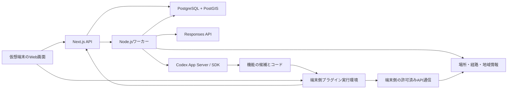

# 第1段階の読解用バンドル

原文の結合版です。ファイルごとの原文が正本です。相対リンクは元の各ファイルを基準とし、画像・モデルはZIP内の実ファイルを参照してください。研究/アーカイブ/素材/lockfileの全内容はZIPにあります。第2段階には別途STAGE1_HANDOFF.mdが必要です。


---

# SOURCE: 03_CONTEXT_AND_DECISIONS.md

# 文脈、決定、読む際の優先順位

## 目的と現状

「育てる地図」は、訪れた場所と歩いた道に、本人の過ごし方、選ぶ理由、記憶が重なる個人の地図です。記録から自分を知り、他者の視点で街を探索し、新しい体験を地図へ持ち帰ります。機能自体もプラグインで追加できる構想です。

今回の依頼は、この全体をGPT Proでレビュー・改善し、別チャットで技術スタックを含む仕様へ進めるための引継ぎ資料作成です。本パッケージ内の解説はそのための整理で、新たなユーザー決定ではありません。

現在の製品体験の正本は2026-09-08更新の`project/docs/requirements/`です。動くコードは`project/prototypes/mapbox-character/`の地図表示試作で、本体の機能群は未実装です。

## 資料の優先順位

| 対象 | 正として読む資料 | 注意 |
|---|---|---|
| 最新の体験・配置・必須/望ましい機能 | docs/requirements/の各文書 | 4タブ要件を優先 |
| 用語 | CONTEXT.md | 用途と施設分類、理由と用途、仮説と本人説明を区別 |
| 基礎理念、既存の判定規則・API | docs/spec/ | 既存設計。最新追加分は次の設計で反映 |
| 現在動く技術と数値 | 試作src、index.html、package.json、bun.lock | READMEよりソース優先 |
| 視覚上の目標 | 最新要件の参考画像と説明 | アプリへそのまま流用する素材とは限らない |
| 過去の選択肢・背景 | research、archive、既存デモ | 廃止済み案や未更新の実演構成を含む |
| 大会情報 | competitionの2026-09-05確認メモ | 最新性・持込み許可の再確認が必要 |

以下のパスは特記しない限り`project/`内です。

## 維持する体験と具体例

- **4タブ**：地図を育てる → みんなで育てる → アプリを育てる → 自分を知る。ホームとAIは追加タブにしません。ホーム表示設定の初期値はオン、オフなら地図へ直行。地図の初期状態は自分レンズ・2Dです。
- **地図を育てる**：自分/他人レンズと2D/3Dを独立させる。実際の訪問と用途で建物が育ち、勉強なら本など用途を象徴する姿へ変わる。再訪で造形・装飾が育つが、回数を好きの強さと同一視しない。5段階画像は表現の参考。元の建物形状も確認できる。
- **探索・案内・記録**：友人が訪れた場所などからクエストを提案。目的地指定の経路/乗換案内をAI相談なしでも利用できる。定期券の区間を考慮した追加運賃や寄り道、現在地の記録、欠けた区間の簡単な補完、任意のAIの問いかけを含む。
- **みんなで育てる**：目的/場所の検索を主にし、人の指定は絞り込み。友人がいなくても公開体験を探せる。ラーメンのニンニクや注文のコツ、服・インフルエンサーのルートなど、具体的な過ごし方を共有する。同じ場所の異なる意味、異なる場所の同じ役割、同じ駅周辺の違う昼食先を比較し、共同コースや別の街への体験の移し替えへつなぐ。
- **アプリを育てる**：アプリ内ストアで検索→権限確認→導入→利用まで完結。防災、バイク、聖地の3プラグインをデモする。開発者にはGitHubの設計・手順・検証ノウハウを渡し、Codexへ依頼して作れるようにする。アプリ内の作成/カスタマイズUIは今後検討。
- **自分を知る**：今日の移動と訪問から振り返り、AIと用途や場所を選ぶ根本の理由を話し、解釈を訂正する。週/月/年の傾向と変化、診断、地図への還元を含む。日記形式は望ましい機能。診断方式は未決で、固定的人物像を断定しない。
- **共通**：画面をまたぐ選択・編集中の内容・記録状態を保持。実測、本人の説明、他者の共有、AIの推定を区別。共有許可・取消と訂正を後続の比較や提案へ反映する。

詳細・例外・受入条件は各タブの原文にあります。この一覧だけを仕様化して原文を省略しないでください。

## 技術側の既存方針と未実装の境界

既存実装仕様は、Macのシミュレーター/エミュレーター上で接続した通しデモを完成地点とします。実機の背景位置記録、一般公開、外部アプリストア配布は追加段階。記録には再生入力を使えますが、保存・比較・提案・生成コードの検証と有効化は実際に動かす方針です。Next.jsのWebをiOS SimulatorのSafariで使う構成は既定案です。現在確認できるものはViteのWeb試作で、Next.js本体や仮想端末の完成を示しません。

Node.jsを実行環境、Bunをパッケージ管理に使う方針です。PostgreSQL+PostGISはMacへ直接導入、画像/生成物はローカル保存、Supabaseを使わず、Dockerを必須にしないと既存仕様に記載されています。プラグインは端末側で実行し、運営秘密キーが必要な処理はNode.js APIで仲介する設計です。これらは仕様上の選択で、パッケージにDBやAPIの実装はありません。

地図試作はMapbox GL JS+Mapbox Standard+Three.jsです。最新要件ではPLATEAUは見た目と負荷の試作比較から採用しない方針。不足するランドマークを限定して補完し、アプリ固有の成長状態を標準地図と分離します。過去のMapLibre、deck.gl、PLATEAU、Supabaseの調査を現在の採用と解釈しないでください。変更を提案することは可能ですが、理由と移行影響を示します。

## 矛盾・更新待ちとして扱う箇所

| 論点 | 最新要件/現在の事実 | 旧資料や試作との差 |
|---|---|---|
| 起動とナビ | 4タブ、自分レンズの2D、ホーム表示設定 | 試作は名古屋3Dから開始し、旧い静的ナビを表示 |
| 成長 | 訪問・用途・再訪から独自に建物表現を育てる | 試作は標準3D建物、固定の線と3点。成長ロジックはない |
| 2D/3D | レンズから独立した明示切替 | 試作はズームでpitch/表示を変更。独立した切替は未実装 |
| LOD | ソースの境界は17.0/15.2、minZoom14.5 | 試作READMEに17.3/16.4、min16.1が残る |
| 人物描画 | 独立Three.js canvasをDOM Markerへ載せる | THIRD_PARTY_NOTICESのcustom layer説明は古い |
| 出典表示 | CSSでMapboxの左右下部controlを非表示 | 試作READMEの出典表示説明と矛盾。仕様化/公開時の修正・利用条件確認対象 |
| 建物上アイコン | 現在は高度付きDOM/CSS Marker、bbox中心 | 要件の軽量3Dアイコンや形状中心との対応を詳細設計で決める |
| プラグイン実演 | 最新は防災/バイク/聖地の3例 | 既存仕様の最初の休憩場所機能などは更新待ち |
| 地域評価 | 過去の初期カメラ目視記録 | 当時はファサード/樹木あり。現在の軽量設定では両方オフ |

原文は忠実な資料として保全し、今回の梱包では元の仕様や試作を修正していません。

## 次のレビュー・設計で決めること

対象利用者と日常継続の理由、デモの主役と対象地域、全機能の実装順、成長の段階/閾値/複数用途、建物と場所の対応、ホーム復帰、AIの文脈と診断方式、定期券/乗換/運賃APIの成立性、共有単位と取消、プラグインの実行/配信/互換性、3プラグインの地域データと更新、標準3Dと独自造形の共存、対象端末での描画品質を具体化する必要があります。

これは論点の索引です。各要件文書の「未決事項」と、既存仕様の未確定事項を併せて読み、回答済みの判断を再び未決へ戻さないでください。


---

# SOURCE: project/CONTEXT.md

# 育てる地図

訪れた場所や歩いた道に、本人の過ごし方、選ぶ理由、記憶が重なる個人の地図。
要件定義v4と仕様のすり合わせで使う用語を整理する。

## Language

**位置記録**:
ある時刻に端末が観測した位置。観測の精度を伴い、その場所への訪問を示す根拠の一つになる。
_Avoid_: 訪問（位置記録の同義語として）

**訪問候補**:
位置や前後の行動などから、本人がその場所を訪れた可能性がある段階。実際にそこで過ごしたかは、まだ確定していない。
_Avoid_: 訪問済み、訪問履歴（訪問候補の同義語として）

**体験**:
本人が場所や経路で過ごしたひとまとまりの出来事。過ごし方、記憶、そのときの状況を含み、正確な位置記録がなくても本人の説明から残せる。
_Avoid_: 位置記録、推薦された経路（体験の同義語として）

**場所との関係**:
誰が、その場所や経路を、どのような状況で、何のために使い、なぜ選ぶかという関わり。一つの場所に複数の関係があり、同じ用途が複数の場所に現れる。
_Avoid_: 場所の評価点（場所との関係の同義語として）

**用途**:
本人がその場所を何をするために使うか。「一人で気持ちを切り替える」など、一つの用途が異なる場所に対応する場合がある。
_Avoid_: 施設の種類（用途の同義語として）

**理由**:
本人がその用途のために、その場所を選ぶわけ。同じ用途でも「視界が開ける」「本に囲まれる」など、理由が異なる場合がある。
_Avoid_: 用途（理由の同義語として）

**仮説**:
観測や会話を手掛かりにGPTが考えた、本人との確認が済んでいない解釈。
_Avoid_: 本人の説明、確定した好み（仮説の同義語として）

**行動傾向**:
複数の体験に共通する、場所や過ごし方の選び方。時間帯や状況など、現れる条件と根拠を伴う。
_Avoid_: 固定された人物タイプ（行動傾向の同義語として）

**視点**:
場所を選ぶときや街を歩くときに、その人が注目し、重視するもの。
_Avoid_: 人物タイプ（視点の同義語として）

**体験の移し替え**:
元の体験にある目的、場所の役割、環境、順序、外せない条件を読み取り、別の街で対応する体験を探すこと。
_Avoid_: 経路の複製（体験の移し替えの同義語として）

**忠実さ**:
移し替え先の体験が、元の持ち主の目的、場所の役割、順序、選ぶ理由をどれだけ保っているか。
_Avoid_: 自分への適合（忠実さの同義語として）

**自分への適合**:
候補となる体験が、今の本人の目的、気分、好み、移動条件にどれだけ合っているか。
_Avoid_: 忠実さ（自分への適合の同義語として）


---

# SOURCE: project/docs/requirements/README.md

# 要件定義

更新日：2026年9月8日

「育てる地図」は次の4タブで構成する。本フォルダを利用体験の正本とし、各タブの詳細を別文書で管理する。

| 順序 | タブ | 中心となる体験 |
|---:|---|---|
| 1 | [地図を育てる](grow-map.md) | 探索・案内・記録を行い、訪問と用途で建物が育つ |
| 2 | [みんなで育てる](grow-together.md) | 目的や場所から他者の体験を探し、意味の比較や共同コースへ進む |
| 3 | [アプリを育てる](grow-app.md) | アプリ内ストアで導入し、GitHubのノウハウで開発に参加する |
| 4 | [自分を知る](know-yourself.md) | 記録と対話から、場所を選ぶ理由・傾向・変化を知る |

起動・タブ間の引継ぎ・AIの共通導線は[画面構成と起動](navigation.md)にまとめる。各文書では、操作、保存、失敗時の状態、受入条件、未決事項を定義する。「望ましい機能」は必須要件と分けて扱う。

## 既存仕様との関係

従来の5ページを4タブへ変更した。「地域を育てる」の場所情報・意見は地図の建物詳細へ、「人とつながる」の共有・比較・共同コースは「みんなで育てる」へ整理している。

[基礎要件](../spec/requirements.md)は製品の目的と共通原則、[実装仕様書](../spec/implementation.md)・[データとAPI](../spec/data-and-api.md)・[受入条件](../spec/acceptance-criteria.md)は詳細設計の参照先とする。追加・変更した体験のAPIや実装順序は次の詳細設計で反映する。機能の配置や体験が異なる場合は本フォルダを優先する。


---

# SOURCE: project/docs/requirements/navigation.md

# 画面構成と起動

更新日：2026年9月8日  
4タブの順序、起動、共通導線を定義する。各機能の詳細と未決事項はタブ別文書を参照する。

## 4タブ構成

下部ナビゲーションには、左から次の順序で4項目を常設する。

| 順序 | タブ | 主な体験 |
|---:|---|---|
| 1 | [地図を育てる](grow-map.md) | 探索・案内・記録と補完、訪問と用途による建物の成長 |
| 2 | [みんなで育てる](grow-together.md) | 目的・場所から体験を探し、意味の比較や共同コースへ進む |
| 3 | [アプリを育てる](grow-app.md) | アプリ内ストアでの導入、GitHubのノウハウによる開発参加 |
| 4 | [自分を知る](know-yourself.md) | 記録と対話による振り返り、統計・傾向・診断 |

選択中のタブは色に加えて文字や背景などでも識別できるようにする。タブ名は意味を損なわず端末幅に収める。

## 機能の配置と引継ぎ

探索・移動中の案内・その場の記録は「地図を育てる」で行う。レンズは視点、2D・3Dは表示の切替として独立させる。3Dの建物は用途を象徴する姿と元の形状を確認できる。

建物を選んで場所の意味や他の人の意見を読む機能は、両レンズに共通する望ましい機能とする。友人の共有情報の一覧や比較は「みんなで育てる」に置き、街をその視点で探索するときは「地図を育てる」の他人レンズへつなぐ。

| 移動元 → 移動先 | 引き継ぐ内容 |
|---|---|
| みんなで育てる → 地図を育てる | 選択した友人の共有視点、場所、または共同コースと同行者条件 |
| 地図を育てる → 自分を知る | 振り返る日付、訪問・移動記録、選択した場所 |
| 自分を知る → 地図を育てる | 振り返りで選んだ場所や、本人が確認した希望・傾向 |
| アプリを育てる → 対象タブ | 導入したプラグインの入口と表示設定 |

タブ切替後も地図範囲・レンズ・場所・対象日・比較相手・編集中の投稿を保持する。移動記録は画面と独立して管理し、明示した停止操作で終了する。

## 起動とホーム画面

アプリ本体の利用開始地点は「地図を育てる」の自分レンズとする。ホーム画面はタブに含めず、既存の起動設定を維持する。

- 「起動時にホーム画面を表示する」の初期値はオンとする。
- オンの場合はホーム画面から「地図を育てる」へ進む。オフの場合は直接開く。
- 設定は「自分を知る」の補助的な設定入口から変更し、次回の通常起動に適用する。
- ホーム画面をオフにしても、同じ設定入口から内容を確認できるようにする。

通知、共有リンク、記録中・案内中の復帰については、対象画面を優先する条件を詳細設計で決める。

## AIとの相談

AIは独立したタブにせず、各タブの目的に沿って利用する。会話には選択中の場所、レンズ、友人、日付などを引き継ぎ、参照対象を確認・変更・解除できるようにする。

| タブ | AIの役割 |
|---|---|
| 地図を育てる | レンズと希望に応じた場所・経路の推薦と案内 |
| みんなで育てる | 共有情報に基づく比較と、一緒に楽しめるコースの提案 |
| アプリを育てる | Codexへの開発依頼を支援。GitHubのガイドを入口とする |
| 自分を知る | 記録を見ながらの振り返りと傾向の説明 |

目的地を指定する経路・乗換案内はAI相談なしで使える。「ここへ行く」とAIの提案は同じ案内機能へ接続する。

地図で行き先や経路を相談する入口は「AIと街を探す」にまとめ、気分・同行者・時間・距離は同じ相談内の条件とする。振り返りの入口は「この場所を振り返る」など目的を明示し、「自分を知る」の対象記録へつなぐ。

## 共通の受入条件

- 下部ナビゲーションが指定順の4タブで構成され、ホームやAIが追加タブになっていない。
- 友人の視点や共同コースを、条件を保って地図で開ける。
- タブ切替後も記録状態と編集中の内容を確認できる。
- 自分の記録、他者の共有情報、AIの推定を区別し、共有を許可された情報だけを表示・比較に使う。

## 未決事項

- 端末幅ごとのタブ表示、AI相談ボタンの位置
- 通知・共有リンク・進行中の案内からの復帰優先順位
- ホーム画面に表示する成長情報


---

# SOURCE: project/docs/requirements/grow-map.md

# 「地図を育てる」要件

更新日：2026年9月8日

自分や他人の視点で街を探索し、訪問と体験で地図を育てる。**訪れると建物が立ち上がり、用途によって姿が変わり、通うほど装飾が育つ。** 探索、経路案内、移動中の記録、写真投稿をこのタブで行う。

以下は決定済みの利用体験を定義する。建物詳細は「望ましい機能」、造形例や5段階の装飾は「参考案」とし、未決事項は末尾にまとめる。

## 1. レンズと表示

初期状態は「自分レンズ・2D地図」。履歴がなくても希望を入力して探索できる。

| レンズ | 体験 |
|---|---|
| 自分レンズ | 自分の希望・確認済みの好み・記録から場所やコースを探し、訪問した建物を育てる |
| 他人レンズ | ペルソナや友人の共有視点を選び、注目点・候補・経路・建物の姿を切り替える |

誰の視点か、推薦の理由は何かを確認でき、自分レンズへ戻れる。ペルソナの想定と実在する友人の共有情報を区別し、他人の用途・訪問・好みで自分の記録を上書きしない。

レンズと2D・3Dは独立して切り替える。移動記録と写真投稿はどちらの表示でも使える。

| 表示 | 内容と操作 |
|---|---|
| 2D「地図を見る」 | 地名・道路・施設・現在地・軌跡・保存場所・経路を俯瞰する。移動・拡大縮小・場所選択ができ、成長や用途は色・輪郭・アイコンで示す |
| 3D「地図の世界に入る」 | 現在地の人形を中心に、訪問による建物の立ち上がりと成長を見る。追従・回転・拡大縮小ができ、いつでも2Dへ戻れる |

3Dは専用の操作で開き、場所のタップでは自動で切り替えない。切替時は建物・人物・操作・追従方法を合わせて変え、現在地との関係を保つ。2Dへ戻ると元の表示範囲を復元する。動きを減らす端末設定では大きなカメラ移動や変身演出を省く。

### 今いる場所を記録し、不明な区間を補う

日常の記録は「地図を育てる」で行う。自分レンズに「今ここにいる」などの入口を置き、現在地や選んだ建物・施設と時刻を確認して、滞在・訪問を記録できるようにする。自動取得した訪問候補も、その場で確認・訂正できる。

地図と時系列に、欠損区間と、位置や訪問先が曖昧な区間を示す。タップして候補選択・場所検索・地図上の指定で補える。「この時間はこの店にいた」「この駅から電車で移動した」といった短い入力からも補完案を作れる。

場所・おおよその時間・移動手段を分かる範囲で入力する。正確な経路や時刻は必須にせず、不明・後回しも選べる。既存記録を下書きにして訂正できるようにする。

### 記録のついでにAIが話を聞く

記録や補完のついでに、AIが「ここでは何をしていた？」「どうだった？」と1問ずつ尋ねる。用途・理由・感想を整理し、本人が確認・訂正する。回答は任意で、会話なしでも場所を記録できる。

本人が伝えた内容とAIの補完案、測位による記録を区別する。AIが作った場所・時間・移動の補完案は、本人が確認してから記録に反映する。端点だけから正確な移動経路を作らず、概略の申告は概略のまま保持する。

記録・補完・訂正は同じ体験に結び付け、訪問を重複登録しない。確認された訪問は建物の成長へ、用途は外観へ反映し、「自分を知る」の振り返りにも引き継ぐ。保存失敗時は入力を保持して再試行できるようにする。

## 2. 訪問と用途で建物が育つ（必須）

### 訪問すると立ち上がる

訪問した建物が3Dで立ち上がり、その状態が蓄積される。2D中の訪問も保存し、3Dへ切り替えた際に反映する。

訪問済みと背景の未訪問建物を見分けられるようにする。通過は軌跡・解放範囲で表し、閲覧、経路検索、AIの推薦、他者の共有だけでは訪問済みにしない。

### 用途によって姿が変わる

自分レンズの3Dでは、本人が用途を登録・確認した建物を、その意味を象徴するランドマークへ置き換える。

| 用途 | 造形の参考案 |
|---|---|
| 勉強する場所 | 大きな本をかたどった建物 |
| 友人と話す場所 | 吹き出しが集まった建物 |
| 一人で休む場所 | 木陰や小さな庭 |

施設の業種ではなく、本人にとっての用途を反映する。複数用途を扱い、表示しきれない用途も確認できる。用途の追加・変更・削除は外観へ反映する。用途未登録なら通常の建物を表示し、訪問済みであれば立ち上がった状態を保つ。

レンズ表現を外すと、地図データに基づく元の建物形状を確認できる。置換後も位置・道路・施設名・案内に必要な入口との対応を保ち、現地の外観とは区別する。他人レンズでは、共有された用途に応じて同じ場所が別の姿になる。

### 通うほど造形・装飾が育つ

訪問を重ねると、用途のモチーフを保ちながら造形・色・縁取り・輝き・装飾が段階的に変わる。本が増える、庭が豊かになるなどの表現を検討する。2Dはマーカー、3Dはランドマークやアイコン・装飾で同じ成長段階を示す。


ユーザー提供画像の5段階を試作の参考とする。段階数・配色・名称・訪問回数は未確定。「お気に入り」「特別な場所」は訪問回数だけで決めず、本人の意味付けと区別する。画像のアプリ素材への採用は別途決める。

用途と成長段階は両方読み取れる表現にする。色だけに依存せず、用途名やアイコンでも意味を確認でき、選択中・AIのおすすめ・訪問済みの表示と混同しない。装飾が育っても道路や案内を隠さない。

### 成長の記録

訪問・用途・建物や施設・所有者・根拠を結び付け、成長段階を保存する。同一訪問の位置更新や再読込を重複加算しない。用途の変更や削除でも訪問の蓄積を保ち、再起動後に復元する。AIの推定用途は本人の確認済み用途と区別する。

## 3. 行き先の提案

### 自動クエスト

自分レンズでは、AIに質問しなくても「ここに行ってみない？」と提案する。現在地・表示地域・好み・訪問記録・定期区間・友人の共有情報を使う。友人や履歴がない場合も、利用可能な地域情報から提案する。

| きっかけ | 例 |
|---|---|
| 友人の訪問 | 「フレンドの○○さんも行っていたよ」 |
| 自分の好み | 「近くでもう一つ、一人で休める場所を探してみない？」 |
| 寄り道 | 「定期区間内で、帰りに30分寄ってみない？」 |
| 地図の成長 | 「まだ訪問記録のない建物を訪れてみない？」 |

アプリ内のカードなどに、行き先・理由・達成条件・所要時間・距離・分かる場合は追加運賃を表示する。「行ってみる」から詳細と案内へ進み、同じ提案についてAIへ相談できる。「あとで見る」「今回は見送る」と自動提案オフも用意し、案内を遮ったり見送り直後に再表示したりしない。

友人の訪問を理由にする場合は、閲覧可能な訪問記録や投稿を根拠として示す。場所の保存を訪問に、過去の訪問を現在地に読み替えない。共有取消後は提案と理由から対象情報を外す。

実際の訪問で達成し、建物の成長と写真・感想・用途の記録へつなぐ。提案の閲覧・受諾・経路検索だけでは達成にしない。提案先・理由・参照元・達成条件と、あとで見る／見送り／進行中／達成の状態を保存する。

### 定期区間内の寄り道（特色）

「帰りに30分」「追加運賃なし」などを指定し、定期区間の駅・停留所から寄れる、まだ訪問記録のない場所をAIが提案する。徒歩区間と最終目的地までを含むコース、追加時間・運賃・理由を示す。区間外を許容するときも費用を明示し、候補がなければ条件変更へ戻る。

AIのおすすめ、クエスト、寄り道、友人との共同コースは、次の案内機能へ接続する。

## 4. 経路案内・乗換案内（必須）

両レンズで利用でき、AIとの会話なしでも目的地を指定して使える。

| 機能 | 必要な操作・情報 |
|---|---|
| 目的地の指定 | 場所名・住所・駅名の検索、地図や建物の「ここへ行く」、保存場所から開く。出発地は現在地を初期値とし、手入力で変更できる |
| 徒歩案内 | 経路・距離・所要時間・目的地・主な曲がり角を表示。開始後は現在地・次の方向・残りの距離と時間を示す。終了と経路を外れた際の再検索ができる |
| 乗換案内 | 出発日時・到着希望日時を指定。鉄道・バスと徒歩を含む候補の出発／到着時刻・所要時間・乗換回数・運賃を比較する |
| 乗換の詳細 | 路線・行先・乗降駅や停留所・乗換順序・各区間の時刻を示す |

時刻・運賃・運行情報は交通データに基づき、取得できない項目は不明とする。AIで補完せず、時刻表の予定とリアルタイム情報を区別する。

### 定期券を考慮する（必須）

定期券の区間・交通事業者・経由路線・有効期間を登録・編集・削除できる。検索時に利用の有無を選び、指定日時に有効な定期券で追加運賃を計算する。

候補ごとに通常運賃・追加運賃・所要時間・乗換回数を示し、速さを優先する経路と追加運賃を抑える経路を比較する。適用区間と追加費用の発生区間を分け、期間外は適用しない理由を示す。適用可否や金額が不明な場合は、追加運賃なしと表示しない。

定期券は本人の移動条件として保存し、他人レンズでも本人のものを使う。

## 5. 写真と場所への意見

### 写真を撮って投稿する

写真を撮影し、投稿先の場所・本文・公開範囲を確認して投稿する。写真を場所と本人の体験に結び付け、地図から確認できるようにする。撮影場所を取得できなければ手動で選べる。撮影取消時は投稿しない。

### 建物詳細（望ましい機能）

両レンズで建物をタッチすると、他の人にとってどんな場所かを用途・体験・写真・意見から知り、自分の意見も投稿できる。

投稿者・時点・対象を示し、異なる意見を残す。AIの要約から元の投稿を確認でき、「みんな」は閲覧可能な投稿の範囲を指す。意見がなければ最初の投稿へ案内する。建物全体と個別施設を投稿先として選び分ける方法は検討する。

## 6. 保存・失敗時・タブ間の接続

移動・訪問・写真・場所との関連・公開範囲を保存する。タブ、レンズ、表示を切り替えても、選択中の場所・地図範囲・経路・案内状態・記録を保つ。レンズ変更だけで案内中の経路を置き換えない。

検索・推薦の処理中、候補なし、地域や交通手段の未対応、通信失敗を区別する。失敗時も地図と既存記録を表示し、条件や編集中の写真・本文を保って再試行できる。位置情報を失ったら更新停止を示し、手動で出発地や場所を選べるようにする。

「みんなで育てる」から友人の共有視点・共同コースを受け取り、「自分を知る」へ振り返る日付・場所・記録を渡す。

## 7. 受入条件

| 確認する体験 | 完了の判断 |
|---|---|
| レンズと表示 | 自分・他人・ペルソナを識別でき、2D・3Dと独立して切り替えられる |
| その場の記録と補完 | 地図から現在・直前の滞在を記録し、欠損・曖昧な区間を候補選択や短い入力で補える。不明を残せ、AIへの回答なしでも保存できる |
| 補完の根拠 | 測位・本人の申告・AIの案を区別し、確認後に重複なく反映する。概略の経路や時刻を実測として扱わない |
| 建物の成長 | 初訪問で立ち上がり、用途で姿が変わり、再訪で育つ。元の形状も確認でき、重複計上・用途変更・再起動で記録が崩れない |
| クエスト | 質問なしで提案され、理由と条件を確認し、案内・保留・見送り・オフを選べる。実訪問で達成し、共有取消を反映する |
| 経路と乗換 | AIを経由せず検索・比較・案内開始／終了ができ、時刻・運賃の不明と取得失敗を識別できる |
| 定期券と寄り道 | 定期券を管理し、期限と区間に応じた費用を比較できる。徒歩・最終目的地を含めて寄り道条件を評価する |
| 写真・意見 | 写真を場所・公開範囲付きで投稿し、失敗時に再試行できる。建物詳細を採用する場合は両レンズから意見を読み書きできる |
| 状態の保持 | タブ・レンズ切替後も案内と記録を保持し、他者の情報を本人の訪問として扱わない |

## 8. 未決事項

- 訪問判定、建物との対応が不確かな場合の確認、同日再訪の数え方、記録訂正・削除時の再計算、建物データがない場所の表現
- 成長段階・しきい値・名称・造形、複数用途／施設の代表表現と切替、2Dの成長表示
- クエストの表示時機・頻度・件数・達成判定。プッシュ通知と報酬の有無
- 交通データの提供元・対応地域／路線・更新頻度・運賃計算、リアルタイム情報の範囲、複数枚・連絡・エリア定期への対応
- 自動再検索、音声案内、自動車・自転車案内は追加検討
- 3Dへの切替と位置記録開始・継続の関係、3D案内の範囲、切替操作の名称・位置・アイコン、建物詳細の情報量、人物の実機での視認性

## 付録：地図・人物・建物の表現仕様

通常の地図と実在建物の補完に関する既存仕様。用途を象徴するランドマークへの置換とは目的を分けて扱う。

<details>
<summary>造形・地図基盤・試作時の確認結果を開く</summary>

## 現在地の表示

2Dと3Dでは、それぞれの表示目的に合う現在地表現を使用する。

| モード | 現在地の表現 |
|---|---|
| 地図を見る | 地図で一般的な現在地パック。位置、向き、測位精度を地図の読みやすさを損なわずに示す |
| 地図の世界に入る | 頭、胴体、手足が判別できる簡素な人形。現在地と進行方向を示し、街の表示を隠さない大きさにする |

3Dの人形は、次の条件を満たす。

- 特定の年齢、性別、人物像を強く想起させない中立的な外観とする。
- 初期版では着せ替え、容姿の編集、複数キャラクターの選択を設けない。
- 有効な方角を取得できる場合は、その方角へ向ける。
- 方角を取得できない場合は、直前の有効な移動方向を維持し、根拠のない向きへ回転させない。
- 有効な移動を検出した場合だけ歩行モーションを再生する。測位の揺れだけで歩行させない。
- 停止中、記録中、測位精度が低い状態を、人形または足元の表示で区別できるようにする。
- カメラを回転しても現在地と進行方向を読み取れるようにする。

人物の周囲から街が育つ表現を製品固有の体験とし、人形は簡素にする。造形は次の画像を基準とする。


大きな多面体の頭、細い胴体、関節の分かる簡略化された手足、まとまりのある手先と足先で構成する。顔、髪、服、指、肌の質感などは作らず、全身を一つの無地の素材で表示する。小さく表示しても人と進行方向が分かり、地図や建物より目立たない造形にする。特定作品の形状や意匠はそのまま複製しない。

人形には簡素な骨格を入れ、左右の足の接地、足上げ、大きめの腕振り、重心の上下動が一続きに見える短く軽快な歩行サイクルを持たせる。移動速度に合わせて再生速度を調整し、停止時は歩行途中で固めず自然な立ち姿へ戻す。造形は簡素にするが、滑って移動しているように見えない歩行品質は確保する。

初期試作では、George Blackwellの「Super Basic Human Model w/ Animations」を使用する。配布元は `https://georgeblackwell.itch.io/basic-human-mesh`、ライセンスはCC BY 4.0であり、作者名と配布元をアプリまたは同梱資料に表示する。これはMapbox上で大きさ、視認性、歩行品質を確認するための仮採用であり、最終版の造形確定とは区別する。

## モードの切替

- 2Dから3Dへの切替は、地図上の通常操作と区別できる明示的な操作にする。
- 切替時には、現在見ている場所または現在地との関係を失わないようにカメラを移動する。
- カメラ移動だけでなく、3D用の建物、人物、操作UI、追従方法を同時に切り替える。
- 3Dから2Dへ戻った場合は、3Dへ入る前に見ていた範囲へ戻ることを基本とする。
- 動きを減らす端末設定が有効な場合は、大きなカメラアニメーションを省略する。

切替操作の最終的な表示名は未決とする。「地図の世界に入る」「3Dで歩く」「街の成長を見る」を、記録開始との関係を決めた後に比較する。

## 地図の技術基盤

Mapboxを採用する場合は、Mapbox Standardを通常の地理情報の基盤とし、標準の3D建物をそのまま成長表現として使わない。

PLATEAUはLOD2の素の表示とアニメ調表示を試作比較した結果、求める見た目とのずれと読み込み負荷が大きいため採用しない。通常の地理情報はMapbox Standardを使い、不足するランドマークだけを根拠と利用条件を確認した外部モデルで補う。

- 2Dでは、地名、道路、施設を確認できる淡い背景地図を表示する。
- 3Dでは、独自に管理する探索状態と建物データを使って、育った範囲を表示する。
- 軌跡、解放範囲、場所、記憶、AI提案経路は独自レイヤーとして重ねる。
- 記憶、AI提案、気になる場所は、対象建物を選択したうえで、その建物の上に高度付きの軽量3Dアイコンとして表示できる。アイコンは少数の単純形状を再利用し、地図の建物形状や操作を隠さない大きさにする。
- Mapbox由来の地図と、利用者の記録や推定による表示を見分けられるようにする。

3Dアイコンの座標は対象建物の形状中心、高度はMapboxの建物属性にある`height`へ固定する。アイコンから屋根の固定点まで接続線と標的リングを表示し、建物自体も選択色で示す。高さの根拠がない場合は建物上に配置しない。種類、参照先、確認状態は表示データとして分離する。詳細3Dと近距離の広域3Dで表示し、俯瞰や密集時は非表示または集約する。

### 不足するランドマークの補完

Mapboxの標準3D表現に存在しない、または体験上必要な特徴が不足しているランドマークだけを、独自の3Dモデルで補完する。街全体を独自モデルで再制作せず、Mapboxの建物を基盤として利用する。

- 対象は、経路の目印、地域らしさ、場所の記憶、成長演出に必要な建物に限定する。
- Mapboxに十分な3Dランドマークがある場合は重複して制作しない。
- 制作前に、対象地点でのMapbox表示、建物形状、高さ、視認距離を確認する。
- 独自モデルはBlenderで制作し、編集可能な`.blend`とアプリで利用する軽量なglTFまたはGLBを残す。
- 制作にはAstraを利用し、形状、縮尺、原点、向き、材質、ポリゴン数を同じ基準で揃える。
- 地図上でその場所だと分かる実際の外形、屋根、塔、段差などの形状を優先する。
- 建物の材質は淡いアイボリーを基調とし、形状を読み取るための陰影を残す。全棟へ窓や外装格子を追加することは要件にしない。
- 公開モデル、図面、現地写真など根拠のある形状だけを使用し、資料にない窓、階数、外装線を推測で補わない。
- 外部から取得したモデルは実形状を保ったまま材質と軽さを周囲のMapbox建物に合わせる。実写真テクスチャは使用しない。
- 遠景でも識別でき、周辺の地図情報を隠さず、対象端末で操作を妨げない軽さにする。
- 出典、参照資料、制作日、利用条件をモデルごとに記録する。
- 権利上再現できない意匠がある場合は、場所の識別に必要な特徴だけを抽象化する。

対象地域をMapboxで確認して不足一覧を作り、優先度の高いランドマークから1件ずつ制作・表示確認する。

造形、配色、陰影は次の画面を基準とする。窓や外装の密度を全建物へ再現する基準にはせず、形状の参考として使う。この画像はそのままアプリ素材として使用するものではない。


### Mapbox Standardの初回目視確認（2026-09-08）

Mapbox Standardの`default`テーマで3D建物、ランドマーク、ファサード、樹木を有効にし、人物モデルを重ねて次の地点を確認した。これは各地点の初期カメラ範囲に対する目視評価であり、都市全体の網羅率やMapboxが公表する件数ではない。

| 地域 | 確認結果 | 初期判断 |
|---|---|---|
| 東京駅・丸の内 | 駅舎と周辺高層棟の形状・ファサードを確認 | 標準3Dを初期デモの基盤にできる |
| 東京・新宿 | 東京都庁舎、コクーンタワーなどの固有形状と簡略化されたファサードを確認 | 今回定めた質感の基準地点として使う |
| 横浜・山下公園 | マリンタワーと氷川丸を識別。周辺街区は汎用形状が中心 | 標準3Dを使い、不足する目印だけ補完する |
| 横浜・みなとみらい | ランドマークタワー、観覧車、周辺大型施設を識別 | 標準3Dを基盤にできる |
| 名古屋・栄 | 中部電力 MIRAI TOWERとオアシス21を識別 | 標準3Dを初期デモの基盤にできる |
| 箱根・芦ノ湖 | 湖岸と建物形状は見えるが、象徴的な3Dランドマークが不足 | 地域らしさに必要な目印を独自モデル候補にする |
| 大阪・道頓堀 | 街区形状は見えるが、初期カメラ範囲では道頓堀らしい象徴物が弱い | デモ地点を再検討するか象徴物を補完する |

初期デモ地域は、ランドマークの識別しやすさだけで選ぶなら東京駅・丸の内または名古屋・栄を優先する。コンセプトとの適合を含める場合は、横浜・山下公園を標準3Dと少数の独自ランドマークで構成する。


</details>


---

# SOURCE: project/docs/requirements/grow-together.md

# 「みんなで育てる」要件

更新日：2026年9月8日

**目的や場所から、友人や発信者の体験を見つけ、自分でも試す。** 共有と比較で互いの街の使い方を知り、一緒に出かけるきっかけを作る。

[基礎要件](../spec/requirements.md)の「地図の重ね合わせ」「視点と体験の移し替え」を引き継ぐ。比較と共有はこのタブ、街の探索・経路案内・訪問による成長は[地図を育てる](grow-map.md)で扱う。

## 1. 目的・場所から体験を探す

初期画面は目的・場所の検索を中心に、共有体験と友人一覧を開ける構成とする。人物の指定は不要で、友人がいなくても公開情報を探せる。

| 検索の入口 | 例 | 見つかる情報 |
|---|---|---|
| 目的から | ラーメンを食べたい、服を買いたい、一人で休みたい | 目的に合う場所、体験のコツ、おすすめルート |
| 場所から | 現在地周辺、駅・街の名前、特定の店、地図の表示範囲 | その場所に関する体験や、周辺を巡るルート |
| 目的と場所から | 渋谷で服を買いたい | 指定した地域で目的に合う場所・ルート |

目的・場所は片方だけでも検索でき、後から追加・変更・解除できる。検索対象の地域や現在地の範囲を示し、変更できるようにする。

結果には「何ができるか」「どこか」「誰の体験か」を示す。友人・公開情報・特定の発信者は絞り込みとして使い、結果からその人の共有情報やレンズへ進める。該当なしと取得失敗を区別し、条件を保って変更・再試行できるようにする。

### 友人との接続と共有

友人を探してつながり、関係を解除できる。友人がいない場合は接続の入口を、共有情報がない場合はその状態を示す。

共有情報では、誰が、どの場所で、何をして、なぜそこを選んだかを、写真・意見・体験から読めるようにする。場所の詳細、友人との比較、その人のレンズへの入口を設ける。友人に加え、地域住民などが閲覧を許可した地図も比較対象にできる。

自分の場所・経路・用途・理由・写真・説明・集約した活動範囲は、共有する項目と相手を選び、公開前に確認できる。後から変更・取消でき、友人関係だけで移動軌跡全体を共有しない。

### 地図上で体験を見つける

地図では、現在地・表示地域と目的に合う場所・ルートを、AIへ質問せずに見つけられる。目的は検索・選択で指定し、文脈から提案された場合も変更・解除できる。

| 場面 | 地図で見つかるもの | タップした後 |
|---|---|---|
| ラーメンを食べたい | 近くで友人が以前訪れたラーメン店 | 「にんにく多めが美味しい」など、友人が残した注文のコツや感想を読む |
| 服を買いたい | 友人が共有した買い物ルート | 店を回る順序、各店のおすすめ、所要時間を確認して案内を始める |
| この街を散歩したい | インフルエンサーが公開した街歩きルート | 誰のどんなテーマのルートか、立ち寄り先と説明を確認する |

場所名だけでなく、注文方法・買ったもの・過ごし方など、その人の具体的な体験を共有できるようにする。投稿者、訪問・投稿日、元の言葉を確認でき、個人の感想と店舗の現在の提供情報は区別する。「友人が訪れた」と「友人がおすすめした」も分け、訪問記録だけから好意的な感想を作らない。

### 友人・インフルエンサーのおすすめルート

友人やインフルエンサーが共有・公開したルートを、目的と地域から見つけられるようにする。ルートには作成者、テーマ、立ち寄り先と順序、各地点のおすすめ、所要時間、更新日を持たせる。自分でも場所と順序に説明を付けてルートを作り、共有範囲を選んで公開・更新・取消できる。

ルートは作成者を示し、特定の発信者でも絞り込める。公開ルートは友人関係がなくても閲覧できる。

気になるルートを保存し、「地図を育てる」で詳細と案内を開く。元のルートとAIの変更案、共有された所要時間と現在の検索結果を区別し、変更点を示す。

共有する人・体験・ルートはこのタブで管理する。候補は「地図を育てる」へ渡し、地図からも共有一覧や比較を経由せず直接見つけられる。

## 2. 互いにとっての場所の意味を知る

比較の中心は、**誰が、どんな場面で、その場所を何のために使い、なぜ選ぶか**という関係とする。地図の重ね合わせは、その共通点や違いを確かめる表示方法の一つとして使う。

| 比較すること | 発見の例 |
|---|---|
| 同じ場所の意味 | 「君には友人と話すカフェだけど、僕には一人で勉強する場所なんだね」 |
| 同じ場面での選び方 | 「この駅に来て昼ご飯を食べるとき、僕は定食屋、君はラーメン店に行くんだね」 |
| 別の場所に共通する役割 | 「僕にとっての気持ちを切り替える河川敷は、君でいうとこの本屋なんだね」 |
| 共通する場所と役割 | 「二人とも、この公園で一息ついていたんだね」 |
| 自分になかった使い方 | 「いつも通る建物に、君が休憩する場所があったんだね」 |

### 比較の入口

場所、場面、用途のいずれかから相手との関係を探せるようにする。

- **場所から**：このカフェは、それぞれにとってどんな場所か。
- **場面から**：この駅で昼ご飯を食べるとき、それぞれどこを選ぶか。
- **用途から**：自分が気持ちを切り替えるこの場所に対応する、相手の場所はどこか。

相手・期間・曜日区分・時間帯・同行者などで条件を絞る。同じ建物や施設分類に限らず、異なる場所・地域・業種の間でも、本人の用途と理由から対応を探す。昼食の店が違う場合も、速さ・量・落ち着きなど、なぜ選ぶかを根拠がある範囲で示す。

### 結果の見せ方

比較カードには、共通の場面・役割と、双方の場所・用途・理由・違いを並べる。「同じ駅で昼食」は共通の場面であり、同じ好みと決めつけない。「河川敷と本屋が対応する」場合も、場所全体が同じ意味ではなく、気持ちを切り替える役割で対応すると示す。

カードと地図の選択を連動させ、「自分だけ」「相手だけ」「重ね合わせ」で場所・経路・活動範囲を確認できる。持ち主を明示し、離れた場所や別都市は並列表示・移動で双方を見られるようにする。意味の対応と移動経路は異なる表現にし、名前の類似だけで場所を統合しない。

### 根拠を見て訂正する

AIの比較から、本人の言葉・体験・時間帯・同行者などの根拠を確認できる。AIの解釈と本人の説明を区別し、対応を「合う／違う」で訂正できる。否定した対応を同じ根拠だけで再生成せず、新しい回答があれば訂正を踏まえて見直す。

情報不足は「共通点がない」「相手しか知らない」と断定しない。比較は共有された記録の範囲で行う。

## 3. 友人のレンズと体験を試す

共有や比較から、気になる場所の記憶を読み、その人の視点で街を見る操作へ進める。

| 操作 | 次の体験 |
|---|---|
| この人のレンズで見る | 「地図を育てる」の他人レンズへ移り、共有された用途に応じて注目点や建物の姿が変わる |
| 自分も行ってみる | 対象の場所を目的地にして経路案内を開く |
| この体験を別の街で試す | 元の体験と移し替え先を選び、その役割や順序を保つコースの提案へ進む |

同じカフェが自分には本、友人には吹き出しの建物として見えるなど、用途の違いをレンズの表現にもつなげる。表示するのは共有された視点であり、自分の用途や成長状態を上書きしない。

### 別の街で体験を再現する

元の体験の目的・役割・順序・理由・必須条件を確認し、地域・出発地・時間・歩行距離・移動条件を指定する。「この人の目線で歩く」と「自分向けにアレンジする」を選べるようにする。

結果には、維持した特徴、変更点、再現できない要素、未確認の情報を示す。相手への忠実さと自分への適合を分け、思い出や人との関係をそのまま移せたと扱わない。候補がなければ不足条件を示し、本人が条件を調整する。具体的な候補確認と案内は「地図を育てる」へ引き継ぐ。

## 4. 一緒に出かけるコースを作る

同行する友人を選び、共有された好みと今回の希望からコースを提案する。

| 入力 | 提案で分かること |
|---|---|
| 同行者、それぞれの希望、出発地、使える時間、距離・移動条件 | 各人が楽しめる場所、訪問順序、所要時間、各人の希望を満たす点と調整した点 |

共通の好みだけでなく、違いもコースに活かす。例えば「本屋に寄った後、水辺で休む」など、双方の理由を取り入れる。これは組合せの例であり、実際の候補と移動時間は場所・経路の情報で確かめる。

候補を確認・変更し、選んだコースと同行者条件を「地図を育てる」へ渡す。条件を満たせない場合は不足を説明し、勝手に緩めない。コースの採用と友人への送信は別の操作にする。

## 5. 体験を持ち帰る

友人から教わった場所は、実際に自分が訪れた場所と区別して残す。訪問後は写真・感想・用途を記録し、自分の建物の成長へ反映する。同じ場所でも自分は別の理由で気に入った、という違いを次の比較や提案に使う。元の持ち主の説明は書き換えない。

友人の共有訪問は、「フレンドも行っていたよ」という自動クエストのきっかけにも使う。クエストの表示・受諾・達成は「地図を育てる」、振り返りは「自分を知る」で行う。自分の感想を友人へ返す場合も公開範囲を確認する。

## 6. 保存・共有取消・失敗時

友人関係、共有項目と公開範囲、場所ごとの具体的な体験メモ、作成・保存したおすすめルートと作成者・版、比較相手・条件・双方の根拠と版・訂正、採用した体験やコースを保存する。地図から戻ったときは、比較相手・条件・選択・表示位置を保持する。

共有取消後は、対象情報を共有画面・比較・検索・推薦・クエスト・AIの参照から外し、派生する説明を更新する。保存済み結果や会話を再表示する場合も現在の共有範囲を確認する。

データなしと取得失敗を区別し、失敗時は入力条件や同行者を保って再試行できるようにする。共有解除で比較対象がなくなった場合は、その状態を示して相手を選び直せるようにする。

## 7. 受入条件

| 確認する体験 | 完了の判断 |
|---|---|
| 接続と共有 | 友人関係を作成・解除し、項目と相手を選んで共有・変更・取消できる |
| 目的・場所からの発見 | 人物の指定なしに、目的だけ・場所だけ・両方で検索できる。対象地域を確認・変更し、場所の具体的なコツやルートを開ける |
| 人による絞り込み | 友人がいなくても公開情報を検索でき、結果を友人・公開情報・特定の発信者で絞り込める |
| おすすめルート | 友人・インフルエンサーのルートを作成者・テーマ付きで発見・保存し、案内へ進める。自分のルートも作成・共有・更新・取消できる |
| 意味と場面の比較 | 場所・場面・用途から比較でき、同じ場所の異なる意味、同じ駅での昼食の選び方、別の場所に共通する役割を理由付きで示す。共通の場面を同じ好みと決めつけない |
| 比較の表示 | 自分・相手・重ね合わせと比較カードが連動し、離れた場所でも役割の対応と移動経路を区別できる |
| 訂正 | 元の言葉を確認して対応を訂正でき、同じ根拠だけで却下した解釈が復活しない |
| 視点と移し替え | 友人のレンズや目的地を地図で開ける。別の街で試す際は維持・変更・未確認の要素を確認できる |
| 共同コース | 双方の希望と移動条件を反映し、候補の変更から地図での案内へ進める |
| 訪問後 | 教わった段階と実訪問を区別し、自分の感想が以後の比較・提案へ反映される |
| 共有取消と復帰 | 取消済み情報を保存結果やAIから再表示せず、失敗・タブ移動後も有効な選択と入力を保持する |

## 8. 未決事項

- 友人の検索・招待・承認方式、地域住民などの共有地図を見つける入口
- 目的の入力補助と文脈からの提案条件、候補の並び順、友人・公開情報の絞り込み
- インフルエンサーの検索・フォロー導線、公開ルートの登録方法、外部サービスからの取り込みの有無
- 通知・リアクション・コメントの範囲
- 場所・場面・用途の入力補助、比較カードと地図の配置、複数人を同時に比較する範囲
- 共同コースの送信方法、複数人での条件入力・合意・編集方法

## 元文書との対応

| 参照元 | 本書への反映 |
|---|---|
| [基礎要件](../spec/requirements.md)の2・3節 | 地図比較の4類型、元の言葉と訂正、視点と体験の移し替え、訪問後の感想 |
| [実装仕様書](../spec/implementation.md)の7・8節 | 比較条件、根拠と版、却下した対応の再生成防止、移し替えの条件と説明 |
| [受入条件](../spec/acceptance-criteria.md)の3節 | 別都市の比較、条件付きの違い、共有取消と保存済み結果への反映 |
| [デモシナリオ](../demo/scenario.md)の場面2・3 | 河川敷と本屋の比較、相手の体験を旅先で試す流れ |

元文書の計算方式や件数上限は詳細設計の参照事項とし、本書には利用者の操作と結果を記載する。


---

# SOURCE: project/docs/requirements/grow-app.md

# 「アプリを育てる」要件

更新日：2026年9月8日

必要なプラグインを追加して、地図でできることを増やす。**使う人はアプリ内ストアで検索・導入し、作る人はGitHubに蓄積したノウハウを使ってCodexへ依頼する。** デモでは3つのプラグインを用意する。アプリ内カスタマイズは今後検討する。

## 1. アプリ内ストアで探して導入する

初期画面はアプリ内ストア。名前や実現したいことから検索し、機能・提供者・対応環境と版・利用データと権限を確認して導入する。利用開始までアプリ内で完結させる。

導入の確認・進捗・結果はストア内に表示し、GitHub・手動ダウンロード・コマンド実行を利用者に求めない。導入済み一覧と、開発したい人向けのGitHubへの入口を設ける。

導入後は、どのタブで何が使えるようになったかを示し、その機能を開ける。導入済み一覧から無効化・削除できる。

## 2. デモ用プラグイン

以下の3つを、検索・導入から地図上での利用まで実演できる状態で用意する。名称は仮称とする。

| プラグイン | 地図に追加する機能 | デモで見せる体験 |
|---|---|---|
| 防災マップ | ハザードマップ、冠水状況、避難先と避難経路の案内 | 対象地域の災害リスクと冠水情報を確認し、避難先までの経路を表示する |
| バイクマップ | バイクで走れる場所・道路の表示 | 対象地域で走行できる場所と、確認できる通行条件を地図で探す |
| 聖地マップ | 作品などに関連する場所と説明の表示 | 作品・テーマを選び、関連地点を開いて由来や見どころを確認する |

### 表示する情報

- **防災**：ハザードマップの想定リスクと、時点のある冠水状況を区別する。情報源・対象時刻・更新状況を示し、取得できない地域を冠水なしと扱わない。避難経路は参照した冠水・通行情報と未確認部分を示し、安全が保証された経路として表示しない。
- **バイク**：走行可否の根拠と、分かる範囲の車種・時間帯などの制限を示す。未確認の道路を走行可能と断定しない。対象車種と道路の範囲は詳細設計で決める。
- **聖地**：作品・テーマ、関連地点、関係する説明と出典を示す。デモで扱う作品や地点、画像などの利用条件は素材選定時に確認する。

デモの再生・模擬データと実際に取得した情報は画面で区別する。各プラグインの情報源・対象地域・更新方法は実装前に確定する。

## 3. GitHubの開発ノウハウで、自分でも作る

GitHubに今回の開発手順・設計・検証方法を残す。「こういうプラグインを作りたい」とCodexに依頼し、作成・検証・導入へ進めるガイドとする。アプリから目的の分かるボタンで開けるようにする。

| 残すもの | Codexへの依頼で使う内容 |
|---|---|
| 開発の始め方 | 必要な環境、準備、起動、確認手順 |
| プラグインの作り方 | ひな型、アプリとの接続方法、データ・権限・表示の規約 |
| 依頼例 | 欲しい機能と条件を伝えるプロンプト例、作成から導入までの操作例 |
| デモ3種の実例 | 実装、設定、利用データ、動かし方、検証結果 |
| 開発で得た知見 | つまずきと解決方法、失敗例、確認項目、更新・修復・版管理の手順 |

別の利用者がガイドとCodexへの依頼だけで、ひな型から小さなプラグインを作成・検証・導入できるか確認する。必要なアカウント・権限・外部サービス設定はガイドに明記する。

既存の機能作成・試用・共有・版管理の方針を引き継ぐ。今回の開発導線はGitHubのガイドを入口とし、アプリ内での作成・カスタマイズのUIは今後検討する。

## 4. 保存と失敗時の状態

導入済みプラグイン、版、有効・無効、利用権限、個別設定を保存する。対象タブから戻った際も、検索条件と選択したプラグインを保持する。

検索結果なし、非対応、導入中、完了、失敗を区別する。非対応や失敗の理由を示し、導入失敗時は既存の設定を保って再試行できるようにする。

## 5. 受入条件

| 確認すること | 完了の判断 |
|---|---|
| 検索と導入 | 3つのデモ用プラグインをアプリ内ストアで検索し、詳細・権限確認から導入・利用開始まで完結できる。GitHubや手動のファイル操作を経由せず、地図上の機能を開ける |
| 防災 | 想定リスクと時点付きの冠水状況を区別し、根拠と未確認部分を伴う避難経路を確認できる |
| バイク | 走行できる場所と通行条件を確認し、根拠のない可否は未確認と表示する |
| 聖地 | 作品・テーマに関連する地点と説明・出典を確認できる |
| 管理と失敗 | 無効化・削除ができ、導入失敗時も既存設定を保って再試行できる |
| 開発への参加 | GitHubのガイドを開き、別の利用者がCodexへの依頼から小さなプラグインの作成・検証・導入まで再現できる |

## 6. 今後決めること

- 各プラグインの対象地域・データ提供元・更新頻度、デモで実データと模擬データを使う範囲
- 防災の対象災害と避難経路の計算条件、バイクの対象車種、聖地の作品・テーマ
- ストアへの登録・配信方法、互換性、更新方法、GitHubのリンク先と公開範囲
- アプリ内カスタマイズと機能作成UI。今回のデモの完成条件には含めない


---

# SOURCE: project/docs/requirements/know-yourself.md

# 「自分を知る」要件

更新日：2026年9月8日

移動と体験を振り返り、自分が場所をどう使い、なぜ選ぶのかを知る。**記録を見る → 理由を話す → 傾向や変化に気付く → 次の探索に活かす**流れを中心に置く。

[基礎要件](../spec/requirements.md)の対話・用途・理由・訂正の方針を引き継ぐ。初期画面は今日の振り返りとし、日付を選んで過去も見返せる。日記形式は望ましい機能として扱う。

## 1. 今日の移動と訪問を振り返る

日常の記録・欠損や曖昧な区間の補完は[地図を育てる](grow-map.md)で行う。このタブでは、その記録を地図と時系列で振り返る。時刻・滞在・写真・メモ・会話を、場所や経路に結び付けて表示する。

通過、訪問候補、確認済みの訪問を区別し、候補の確認・拒否・別の場所への訂正ができる。記録が欠けた区間を移動済みとして補わず、一部の記録を一日の全行程として見せない。

振り返り中も同じ記録・補完操作を開ける。記録がない日は、場所を選んで手入力や会話から始められる。記録のない訪問も本人の申告から追加でき、昔の記憶と現在の訪問は区別して残す。

## 2. AIと話して、場所の意味を見つける

日付・場所・経路・体験を選び、行動・感想・選んだ理由を話す。AIは記録時の会話も引き継ぎ、回答に応じて質問を変え、用途と理由を整理する。

| 振り返り | 残す内容・次の発見 |
|---|---|
| 「帰宅前に河川敷で一人になっていた」 | 気持ちを切り替える用途と、帰宅前という条件 |
| 「視界が開けるところが好き」 | その場所を選ぶ理由 |
| 「本屋でも気持ちを切り替えている」 | 異なる場所に共通する役割と、視界・本という理由の違い |
| 「おすすめの店はどうだった？」 | 期待に合った点・違った点と、次の提案への手掛かり |

時間帯・天候・同行者・気分などによる違いも扱う。例えば同じカフェでも、一人なら勉強、友人となら会話の場所になり得る。

質問は原則一度に1問とし、答える・後で答える・飛ばすを選べる。回答を誘導せず、既に話した理由を聞き直したり、新しい根拠なしに同じ質問を繰り返したりしない。

### 本人の説明とAIの解釈を分ける

観測された行動、本人の言葉、AIの仮説を区別し、解釈から元の記録や発言を確認できるようにする。毎日通る道でも、好みなのか、通学や時間の制約なのかを記録だけで決めない。本人が語っていない好みや未回答の内容は仮説として扱う。

本人は用途・理由・解釈を確認・訂正・保留できる。「この日は急いでいただけ」と訂正した場合は対象と条件を保存し、休日全般の好みへ広げない。同じ記録を再読込しても、訂正前の解釈へ戻さない。

## 3. 統計と傾向から、自分の変化を知る

週・月・年を切り替え、行動の集計と、場所をまたぐ選び方の傾向を見る。

| 見るもの | 表示例・候補 |
|---|---|
| 行動の統計 | 移動距離、訪問数、新しく訪れた場所、よく行く地域・時間帯 |
| 場所の使い方 | 勉強・交流・休息など、どんな目的で街を使っていたか |
| 選ぶ理由の傾向 | 複数の場所に共通する、落ち着く環境や寄り道の仕方 |
| 時間による変化 | 以前と最近で、行く場所・用途・理由がどう変わったか |

集計期間と記録の欠落を示し、数値とAIの解釈を分ける。傾向には根拠と成立する条件を添え、元の訪問・会話へ戻れるようにする。傾向の生成は、元の実装仕様の既定案では異なる2体験以上を条件とするが、件数だけで好みを確定しない。

好みが変わった場合は、過去の体験を当時の記憶として残し、現在の推薦に使う条件を更新する。統計指標と比較期間の詳細は未決とする。

## 4. パーソナリティ診断

記録や振り返りから、場所選びや過ごし方の特徴を診断する。対象期間と根拠の記録・回答を示し、本人の追加・訂正で見直せるようにする。

情報不足なら無理に分類しない。人物像を固定するラベルだけで地図や推薦を構成せず、実際の用途・理由・条件も使う。診断方式、質問票、分類名、更新時期は未決とする。

## 5. 日記として残す（望ましい機能）

軌跡・訪問・写真・感想・会話を一日の日記にまとめ、保存・追記・編集して読み返せるようにする。AIが文章を作る場合は本人が確認して保存する。

## 6. 発見を地図と次の体験へ返す

| 振り返りで分かったこと | 反映先 |
|---|---|
| 「このカフェは勉強する場所」 | 「地図を育てる」の用途に応じた建物の姿 |
| 好む環境、使える時間、訪問後の感想 | 行き先・経路・自動クエストの提案 |
| 別の場所に共通する用途や選ぶ理由 | 「みんなで育てる」の比較。共有が許可された範囲だけを使う |
| もう一度行きたい場所 | 「地図を育てる」の目的地と経路案内 |

「地図を育てる」から指定された日付・場所・記録で振り返りを開ける。用途の記録と訪問の確認は区別し、会話しただけで建物を訪問済みにしない。会話や日記は自動公開せず、共有する場合は対象と範囲を確認する。

## 7. 保存・失敗時・設定

元の記録と発言、用途・理由・条件、仮説・確認・訂正・保留、根拠、解釈の適用期間、診断結果を保存する。日記を採用する場合は対象日と記録を結び付ける。

AIや集計に失敗しても元の記録と入力を残し、再試行で発言や解釈を重複登録しない。生成途中の文章を確定した解釈として保存しない。

プロフィール、公開範囲、通知、位置情報、AI、データ管理、ホームの起動設定は補助的な設定入口にまとめる。

## 8. 受入条件

| 確認する体験 | 完了の判断 |
|---|---|
| 日別の振り返り | 今日・過去の軌跡と訪問・写真を確認し、通過・候補・欠落を識別して訪問を訂正できる |
| 記録のない振り返り | 場所を選んで話し、ログなしでも用途や記憶を残せる |
| 対話による発見 | 河川敷と本屋など異なる場所に共通する用途と、理由の違いを本人の言葉から整理できる |
| 質問と訂正 | 回答・後回し・スキップを保持し、「急いだだけ」という訂正が同じログで覆らない |
| 統計と変化 | 週・月・年の集計と傾向を根拠付きで確認し、好みを変えても過去の記憶が残る |
| 診断 | 根拠・情報不足を示し、本人の追加回答や訂正で見直せる |
| 次の体験への反映 | 確認・訂正した用途や理由が建物の表現と次の提案に反映され、共有範囲を守る |
| 日記・失敗時 | 日記を採用した場合は保存・編集・再表示でき、AI失敗時も原文を保って重複なく再試行できる |

## 9. 未決事項

- 日記の編集形式とAIによる文章化の範囲
- 統計指標、期間の区切り、タイムゾーン、欠落記録の集計方法
- 傾向を示す条件と変化の見せ方、診断方式・質問項目・分類・更新時期

## 元文書との対応

| 参照元 | 本書への反映 |
|---|---|
| [基礎要件](../spec/requirements.md)の1節 | 用途・理由の対話、別の場所の共通性、仮説と訂正、好みの変化 |
| [実装仕様書](../spec/implementation.md)の5・6節 | 訪問候補の確認、原文の保持、1問ずつの質問、失敗時の再試行 |
| [受入条件](../spec/acceptance-criteria.md)のA01・A06・A08〜A10・A24・A25 | ログなしの対話、質問の保留、訂正の保持、過去と現在の両立 |

端末やAPIの実装詳細は元文書を参照し、本書では利用者の操作と結果を定義する。


---

# SOURCE: 04_MAPBOX_CURRENT_STATE.md

# Mapbox GL JS試作の現在地

採取日：2026-09-08。根拠は同梱ソースの静的読解、依存定義、限定したビルド/画面確認です。現在の設定を示すもので、推奨最終値や性能測定結果ではありません。機械可読値は`MAPBOX_SETTINGS.json`。以下の行番号は同梱`project/prototypes/mapbox-character/`を基準とします。

## 依存と起動

| 項目 | 現在の値 |
|---|---|
| 地図 | mapbox-gl 3.30.0、Mapbox Standard |
| 人物 | three 0.180.0、GLTFLoader、GLB |
| 開発/ビルド | Vite 7.3.6、vanilla JavaScriptとCSS、bun.lockあり |
| 確認環境 | Node.js v22.22.1、Bun 1.3.14 |
| トークン | `VITE_MAPBOX_ACCESS_TOKEN`を環境変数から取得。値なし/`pk.`で始まらない場合は案内を表示し地図を開始しない |
| 初期地域 | index.htmlの選択値nagoya（名古屋・栄） |

再実行は試作ディレクトリで`bun install --frozen-lockfile`、`.env.example`を`.env.local`へコピーして自身のMapbox公開トークンを設定し、`bun run dev`。WebブラウザでローカルURLを開きます。地図にはネット接続と有効なMapbox設定が必要です。GLBは同梱済みで、表示にBlenderの再出力は不要です。公開トークンはクライアント配信を前提とするため、対象URL・権限・利用量の設定は利用する環境で決めます。キーの値はこのZIPに含みません。

## Mapコンストラクターと地図表示

根拠：`src/main.js:69`、`:93`、`:98`。

| 項目 | 値 |
|---|---|
| style | `mapbox://styles/mapbox/standard` |
| theme / lightPreset | default / day |
| center [経度,緯度] | [136.9085,35.1707] |
| zoom / pitch / bearing | 17.5 / 64 / -24 |
| minZoom / maxZoom / maxPitch | 14.5 / 20 / 68 |
| maxBounds | 選択地域中心の経度±0.014、緯度±0.01 |
| projection / world copies | mercator / false |
| workerCount | 1 |
| antialias / fadeDuration | false / 0 |
| refreshExpiredTiles / maxTileCacheSize | false / 12 |
| respectPrefersReducedMotion | true |
| 選択色 / 強調色 | #6fa98e / #a9d4c2 |
| 3D objects/buildings/landmarks | 初期値true |
| 3D facades/trees | false |
| Landmark icons | 初期値true |
| POI/place/road/transit labels | false |
| Pedestrian roads | false |

`src/style.css:7`は地図要素を幅/高さ80%にして1.25倍へ拡大します。JS側も`MAP_RENDER_SCALE=0.8`で人物マーカー寸法を調整します。ピクセル密度や配置への影響は対象端末で要確認です。

地域は東京駅、新宿、山下公園、みなとみらい、名古屋、箱根、道頓堀の7箇所。全座標、bearing、zoom、過去のcoverage説明はJSONに収録しています。coverageはソース内の説明文字列で、今回の全地域再検証や提供元の網羅率ではありません。

## ズームによるLOD

根拠：`src/main.js:222`、`:341`、`:498`。

| ズーム | モード | pitch目標 | 3D建物 | 3Dランドマーク | 人物 | 配置アイコン |
|---|---|---:|---|---|---|---|
| 17以上 | 詳細3D | 64 | 表示 | 表示 | 表示 | 表示 |
| 15.2以上17未満 | 広域3D | 48 | 表示 | 表示 | 16.8以上 | 16.2以上 |
| 15.2未満 | 俯瞰 | 0 | 表示設定のまま | 非表示 | 非表示 | 非表示 |

`applyLod`が更新するMapbox設定は建物とランドマークで、人物/配置アイコンはDOM表示を変えます。LOD戻り値にあるobjects/facades/trees等がすべて動的適用されるわけではありません。表の配置アイコンは独自DOM Markerで、Mapboxの`showLandmarkIcons`とは別です。俯瞰はpitch=0であり、標準建物を全て無効にするモードではありません。

pitchはzoomendで差が0.5以上なら320msのeaseToで追従。地域変更はpitch64・900msのflyTo、現在地ボタンはpitch64・600msのeaseToのため、遷移中や操作によって表の目標と一時的に異なり得ます。現在地ボタンの実体は定義済み地域中心への復帰で、端末位置取得ではありません。

## 光と人物

根拠：`src/main.js:137`、`:312`、`:377`、`:410`。

Mapboxの環境光は白・強度0.72、方向光は白・強度0.38、方向[200,45]、影なしです。人物側は別のThree.jsシーンで、半球光2.2、方向光3.2。透明背景、antialias=false、powerPreference=low-power、DPR=1、64×112pxのcanvasをDOM Markerへ載せます。地図の3D custom layerではありません。人物カメラは透視投影FOV30、near0.01/far100。マーカーはviewport向き、足元アンカー。ズームでマーカー倍率を0.78〜1.18に制限します。

人物材質は橙#ff6b35、emissive #4b1000・強度0.55、roughness0.72、metalness0。足元リングは#ffcf56です。モデルはGeorge BlackwellのSuper Basic Human Model w/ Animations由来。Idle/Run/Walkを含むGLBと編集用.blend、出典/CC BY 4.0表記、出力と検証スクリプトを同梱しています。詳細はモデルのATTRIBUTION.mdを参照してください。

歩行はWalkアニメーションをその場で再生し、位置は地域中心に固定。目標上限12fps、地図移動中や非表示時は描画を抑え、停止/再生ボタンがあります。これは省電力や実測12fpsの達成を示しません。UIのfps表示も人物canvas用で、地図全体のfpsと同義ではありません。

## 屋根上アイコンとデモデータ

根拠：`src/main.js:166`、`:195`、`:257`、`:431`。

Mapbox Standardのbuildings featuresetへのinteractionで建物を選び、正のheight属性がある場合にMarker.setAltitude(height)で配置します。位置は座標群の外接矩形中心（polygonの面積重心ではない）、取得できない場合はクリック位置です。思い出♡、AIおすすめ✦、気になる◇の3種をCSSで表現し、接続線と標的リングを描きます。最大3個、超えると最古を削除、occludedOpacity=0.34。地域変更で消去し、永続保存はありません。種類名にAIとありますが、AI推薦による自動生成ではありません。

描かれる軌跡は地域中心から固定オフセットで作る5点の線、記憶は固定3点。GPS履歴・ユーザー保存・経路APIの結果ではありません。

## 操作できる範囲と追加が必要な範囲

動くものはMapboxの操作、地域切替、LOD、人物の歩行/停止、建物への手動アイコン配置、固定線/記憶点の表示です。AI入力風の表示はspanでAIリクエストはなく、気分や下部ナビには機能の接続がありません。DB、サーバーAPI、認証、実GPS、成長判定、対話、推薦、共有、乗換/定期券、ストア、3プラグインは未実装です。

画面画像は`screenshots/current-nagoya.png`です。1280×720のデスクトップ上で名古屋を表示した1枚で、全地域・スマホ・シミュレーターの合格証跡ではありません。

`src/style.css:8`はMapboxの左右下部controlを非表示にします。READMEの出典表示説明と矛盾するため、仕様化では出典表示を含めて利用条件を一次情報で確認し、修正対象としてください。原文を保つため今回の梱包ではソースを変更していません。


---

# SOURCE: project/docs/spec/requirements.md

# 育てる地図：基礎要件と技術設計 v4

更新日：2026年9月8日
用途：Codex Student Builder Fest 2026に向けたチーム内の設計と実装準備

「育てる地図」は、訪れた場所や歩いた道に、その人の過ごし方、選ぶ理由、記憶が重なっていくパーソナルな地図である。
GPTが場所について質問し、本人との会話から、その人と街の関係を見つけていく。
使い続けると、自分が街をどう使っているかが見え、その日の目的や気分に合う場所を探せるようになる。

互いの地図を重ねると、よく使う場所の重なりに加え、同じ場所の違う使い方や、同じ用途で使っている別の場所が見つかる。
その発見から、相手の視点で街を歩いたり、気に入った体験を別の街へ移したりできる。
必要な情報や機能は自然言語で追加し、新しく得た体験や地域の知識を再び地図へ蓄積する。

製品の中心に置くのは、自分だけの地図が育つことと、地図を通じて互いの街の使い方を知ることである。
地図の立体表現、体験の移し替え、Codexによる機能追加は、この体験を支える機能として設計する。

## アプリの4タブ構成

アプリは「地図を育てる」「みんなで育てる」「アプリを育てる」「自分を知る」の順に4タブで構成する。タブ別の詳細要件は次の文書を正本とする。

| タブ | 要件文書と範囲 |
|---|---|
| 地図を育てる | [探索要件](../requirements/grow-map.md)：レンズ・記録と補完・建物の成長、経路／乗換案内と定期券、自動クエスト、写真投稿。建物詳細は望ましい機能 |
| みんなで育てる | [コミュニティ要件](../requirements/grow-together.md)：目的・場所からの体験検索、共有、場所の意味や場面の比較、友人の視点、共同コース |
| アプリを育てる | [拡張要件](../requirements/grow-app.md)：アプリ内ストア、デモ用3プラグイン、GitHubの開発ノウハウ。アプリ内カスタマイズは将来検討 |
| 自分を知る | [振り返り要件](../requirements/know-yourself.md)：日別の移動・訪問、AIとの振り返り、週・月・年の統計・傾向、パーソナリティ診断。日記形式は望ましい機能 |

共通導線は[画面構成と起動](../requirements/navigation.md)で定義する。以下の製品原則と技術設計は引き継ぎ、機能配置や新しい利用体験はタブ別要件を優先する。実移動を扱う製品要件と、再生入力を使うMacデモの実装段階は区別する。

以下の1〜7節は製品の共通原則と既存の技術設計を記載する。各タブの操作は上記リンク、実装の判定規則は詳細仕様を参照する。

## 1. 場所について話し、自分の地図を育てる

訪問、移動、滞在、写真、メモ、会話を場所や経路に結び付けて記録する。
場所には「何をするために使うか」という用途と、「なぜそこを選ぶか」という理由を持たせる。
時間帯、天候、同行者、その日の気分によって、同じ場所の用途や理由が変わることも扱う。

GPTは、訪問後の振り返り、地図上で選んだ場所、本人が話し始めた記憶を手掛かりに質問する。
「ここでは、普段どんなふうに過ごしていますか」「同じ目的で使う別の場所はありますか」のように、その場所での体験を聞く。
回答に応じて質問を変え、本人がまだ意識していなかった共通点や違いも探す。

例えば、河川敷へよく行く人に理由を聞き、「帰宅前に一人で気持ちを切り替えたい」と分かったとする。
GPTは、ほかにも気持ちを切り替える場所があるかを尋ねる。
本屋の名前が出れば、地理的にも施設の種類としても異なる二つの場所が、その人の中で同じ役割を持つと分かる。
地図には共通する用途と、「視界が開ける」「本に囲まれる」といった理由の違いを残す。

複数の場所での体験から、寄り道の仕方、落ち着く環境、時間の使い方など、場所をまたぐ行動傾向を見つける。
傾向には現れた条件と根拠を持たせ、未知の場所を探すときにも使う。

GPTは、行動の観測、本人の説明、そこから考えた仮説を区別する。
毎日通る道についても、好み、通学の必要、時間の制約など複数の説明を考え、質問を通じて確かめる。
未回答の内容は仮説として扱い、次の質問や探索に活かす。
質問は回答を誘導しない形にし、答える、後で答える、飛ばすを本人が選べるようにする。

本人は、場所の用途、推定された好み、記憶の解釈を修正できる。
「この日は急いでいただけ」と説明した場合は、その移動を休日の好みに一般化しない。
修正した対象、適用する条件、根拠となる回答を保存し、同じ観測だけで修正前の解釈へ戻さない。
後に好みが変わった場合は、過去の記憶を残しながら、現在の推薦に使う解釈を更新する。

初回は、気になる場所やよく使う場所を選んで話すところから始められる。
履歴がなくても会話から仮の地図を作り、共有された他者の地図を試せるようにする。
訪問後には、提案した場所でどう過ごしたか、期待に合ったかを聞き、次の表示や推薦へ反映する。

## 2. 互いの地図を重ね、共通点と違いを見つける

自分の地図に、友人や地域住民が共有した地図を重ねられるようにする。
場所、経路、活動範囲、用途、理由をそれぞれの持ち主が分かる状態で表示し、自分だけ、相手だけ、重ね合わせを切り替える。
比較する期間や目的を選び、平日の通学と休日の散歩などを混同せずに見られるようにする。

比較では、地理的な重なりと用途の共通性を別々に扱う。

| 比較する関係 | 地図上で発見できること | 操作例 |
|---|---|---|
| 同じ場所を同じ用途で使う | 二人が共有していた街の使い方 | 同じ公園で気分転換していることに気付く |
| 同じ場所を違う用途で使う | 同じ場所に対する見方の違い | 同じカフェを、一方は勉強、他方は友人との会話に使っている |
| 違う場所を同じ用途で使う | 互いにとって対応する場所 | 一方の河川敷と他方の本屋が、どちらも一人で気持ちを切り替える場所としてつながる |
| 相手だけが知る場所や用途がある | 自分にはなかった街との関わり方 | いつも通る建物の中に、相手が休憩に使う場所があると知る |

重なる場所は地図上で示し、用途が対応する別の場所は比較カードと地図上の選択状態を連動させて見せる。
場所同士の意味の対応と、実際の移動経路は表示で区別する。
距離が離れている場合や別都市の比較では、地図の並列表示や移動で双方を確認できるようにする。

GPTは、共有された用途や理由から対応する場所を提案し、共通と考えた根拠と、残る違いを説明する。
施設の種類だけで用途の一致を決めず、本人の言葉や条件を比較に使う。
対応がしっくりこない場合は修正でき、その修正を以後の比較にも反映する。

比較から、気になった場所の記憶を読む、相手の視点へ切り替える、自分でも行ってみる、体験を別の街へ移す操作につなげる。
相手から教わった段階と、自分が訪れて経験した段階を区別して記録する。
実際に訪れた後の感想も残し、「同じ用途でも、自分は別の理由で気に入った」といった違いを地図へ加えられるようにする。

各人は、場所、用途、説明、集約した活動範囲のどこまでを誰に見せるか選ぶ。
重ね合わせとGPTの比較には、その相手への共有が許された内容だけを使う。
共有したい場所や用途を個別に選び、比較に使われる内容を確認できるようにする。
共有を取り消した情報は共有画面と比較用データから外し、派生する説明を更新する。

## 3. 他者の視点で街を歩き、体験を別の街へ移す

相手の地図から、場所の選び方や歩くときに重視するものを受け取り、地図の注目点、候補の場所、経路、説明を切り替える。
同じ街でも、静けさに注目する人と、街の賑わいを感じたい人とでは違う候補が見える。
この視点を、本人が住む別の街や旅行先にも適用できるようにする。

体験を移すときは、目的、所要時間、場所の役割、環境、順序、移動上の条件、外せない要素を読み取る。
例えば「賑やかな場所を抜け、最後に視界の開けた水辺で一人になる」という体験では、水辺の有無に加えて、途中から終点へ向かう変化も扱う。
元の持ち主が語った理由と、GPTによる解釈を確認できるようにする。

| 使い方 | 優先すること | 結果に示すこと |
|---|---|---|
| この人の目線で歩く | 元の持ち主が重視した特徴や順序 | 相手らしさを保てた点と、再現できなかった点 |
| 自分向けにアレンジする | 自分の気分や好みを加えた体験 | 元の体験から変更した要素と、その理由 |

どちらでも、使える時間、歩行距離、階段などの移動条件を反映する。
元の体験への忠実さと、自分への適合は別々に評価し、自分向けの調整で相手の特徴が変わる場合は分かるようにする。
その土地の人との関係や思い出など、移せない要素は元の体験に残す。
条件を満たす候補がない場合は、満たせない条件と調整案を示す。

経路の生成では、水辺、落ち着ける地点、最後に立ち寄る場所など、体験上の役割に合う経由地点を先に探す。
その組合せから歩行経路を作り、距離、順序、条件への適合を評価する。
GPTは特徴の抽出、候補の発想、意味の比較、説明を担い、道路との接続や移動条件は地理情報と計算処理で確かめる。
使った情報、候補、評価条件を残し、結果を比較し直せるようにする。

「夜に静か」「一人で入りやすい」などは、情報源、体験した人、時間帯を伴う情報として扱う。
観測値、本人の体験、推定を区別し、情報がない項目は未確認とする。
経路を試した後の回答から、保てた体験と変わった体験を記録し、次の移し替えにも活かす。

## 4. 自分に必要な情報と機能を、地図へ追加する

利用者の導入はアプリ内ストア、開発参加はGitHubのガイドを入口とする。以下は機能作成・検証・共有の共通原則であり、アプリ内の作成UIを今回の必須範囲とするものではない。

利用者は「散歩の途中で座って景色を見たい。休める場所を地図に足したい」のように、したいことを自然言語で伝える。
GPTとの対話で用途や条件を具体化し、Codexが必要な機能の実装と検証を進める。
追加した結果として、地図に何が見えるようになり、場所や経路の選び方がどう変わるかをプレビューで示す。

機能は、表示、検索、順位付け、経路評価、分析、時刻や天候による切替、外部情報の取得を組み合わせて作る。
既存の処理で表せる要求には、その設定を組み合わせる。
新しい情報源への接続、未対応の解析、新しい表示が必要な場合は、Codexが処理や表示の実装を追加する。
初期の機能定義にない要求も、実装を拡張して扱える構成にする。

追加する機能には、入力、表示や計算の内容、情報源、更新方法、使用する個人情報、検証条件、版を持たせる。
新規コードは用途に応じた実行環境で検証し、アプリが利用する版を管理する。
利用者には、必要なデータや権限と、地図の変化を示し、追加後も無効化や以前の版への復帰ができるようにする。
コードやテストの詳細は、開発過程を確認する画面から参照できるようにする。

作った機能や場所の選び方は、他者へ共有し、複製して変更できるようにする。
共有する処理と条件、本人の非公開データ、計算結果を区別し、受け取った人は自分のデータで試す。
相手が作った機能を使って新しい場所を知り、そこでの体験を自分の地図へ残せるようにする。

店舗、地域活動、工事、豪雨、浸水想定、河川の状況、避難場所などの情報も、この仕組みで地図へ重ねる。
防災情報では、普段使う道や生活圏との重なり、本人にとって未確認の区間を見られるようにする。
情報の出典、観測時刻、更新時刻、適用範囲を示し、道への慣れと安全性の判断を区別する。

外部データはAPI、CSV、GeoJSON、HTML、PDFなどから取得し、地図で使う形式へ変換する。
通常更新は作成済みの処理で行い、取得失敗や構造変更を検知したときにCodexが修復候補を作る。
単位、時刻、座標系、既知の入力例に対する検証は、修復するコードから独立して保持する。
意味の変化を疑う結果や検証不足がある場合は更新を保留し、確認後に新しい版を反映する。
情報源の取得失敗とデータの古さは、地図側にも伝える。

地域へ共有する知見には、誰の体験やどの公開情報に基づくか、どの条件で役立つかを残す。
個人の記憶、友人から得た知識、店舗や行政の情報を重ねながら、人と地域の知識が継続して蓄積される地図へ広げる。

## 5. 記録と地図表示を、日常の使い方に合わせる

記録の入口として、端末からの位置情報、本人が選んだ訪問や経路、写真、メモ、GPTとの会話、取り込んだ記録を扱う。
入力元を共通形式へ変換し、取得時刻、精度、記録の欠落を残す。
記録がない時間や場所は、未訪問と断定しない。

散歩時に起動する使い方では、記録の開始と終了、途中の記憶、終了後の振り返りをつなげる。
日常の移動を継続して自動記録する場合は、モバイル側の記録機能と権限を含めて構成する。
採用する端末と取得方式は実機検証で決め、地図の表示や対話が一つの取得方式に依存しないようにする。
Webの位置更新は表示中の文書を前提とするため、Web画面だけでバックグラウンドの常時記録を実現する前提は置かない。[W3C Geolocation](https://www.w3.org/TR/geolocation/#request-a-position)

地図は、道路、建物の輪郭、水域、主要施設を初期状態から表示する。
歩いた場所では街が立ち上がる演出を行い、経験した場所に記憶や意味が加わっていく。
建物の高さは実際の形状に対応させ、登場時のアニメーション後は実際の高さで表示する。
通過した道、訪問した建物、記憶のある場所、他者から教わった場所は、色、不透明度、記号、説明を使って見分けられるようにする。

地上、地下、上層階は別の空間として保持し、入口や上下移動の接続も扱う。
建物の近くを通った記録を、その内部や全フロアの訪問へ広げない。
フロア情報と本人が訪れた階の根拠を確認し、不明な場合は階を未特定のまま保持する。

主な操作は地図上の場所の選択と、下部の操作パネルで行う。
地図の選択範囲と対話を連動させ、「何について話しているか」が常に分かるようにする。

| 画面の状態 | 主な操作 | 地図に反映する内容 |
|---|---|---|
| 自分の地図 | 記録する、場所について話す、記憶を直す | 訪問、用途、理由、現在の好み |
| 地図の重ね合わせ | 相手と範囲を選ぶ、重なりや用途を比較する | 各人の場所、共通点、用途が対応する別の場所 |
| 視点の切替と体験の移し替え | 持ち主の目線か自分向けかを選び、条件を調整する | 候補、経路、維持した要素、変更点 |
| 機能の作成 | したいことを伝え、プレビューを試す | 新しい情報、評価、表示 |
| 体験後の振り返り | 選んだ理由や感想を話す | 記憶、解釈の更新、次の推薦 |

## 6. 場所との関係を共通のデータとして、各機能を接続する

保存の中心は、誰が、どの場所や経路を、どの条件で、何のために使い、なぜ選んだかという関係である。
一つの場所には複数の用途を持たせ、同じ用途が複数の場所に対応することも扱う。
GPTは自由な回答から共通する意味を探し、用途や理由の表現を提案する。
本人の元の言葉も残し、固定された人物タイプだけで地図を構成しない。

| データの単位 | 保存する内容 | 主な利用先 |
|---|---|---|
| 行動と体験 | 訪問、経路、滞在、時間、記録元、精度、欠落 | 自分の地図、振り返り |
| 場所との関係 | 用途、理由、気分や状況、記憶、慣れている範囲 | 対話、比較、推薦 |
| 行動傾向 | 複数の体験に共通する選び方、適用する条件、根拠 | 未知の場所の推薦、他者との比較 |
| 対話と解釈 | 質問、回答、仮説、根拠、確認状態、訂正、適用期間 | 次の質問、解釈の更新 |
| 比較と共有 | 所有者、共有対象、用途の対応、共通点、違い、参照元の版 | 地図の重ね合わせ、相互理解 |
| 視点と体験の移し替え | 元の体験、役割と順序、外せない条件、候補、変更点 | 視点の切替、経路生成 |
| 提案と結果 | 提示した候補、選択、見送った理由、訪問後の感想 | 推薦の改善、価値の検証 |
| 地図機能と情報源 | 入出力、処理、表示、出典、時刻、更新規則、検証、版 | 機能追加、情報更新、修復 |

各データには所有者と公開範囲を持たせる。
比較、検索用の索引、GPTへ渡す情報、共有機能の実行にも同じ権限を適用する。
元の記録を訂正した場合は、そこから作った解釈、対応関係、推薦の更新対象を追えるようにする。

技術は、以下を主要な候補として検証する。
製品固有の設計は、場所との関係、対話による発見、意味の対応、視点の移し替え、生成した機能の管理に置く。

| 担当する処理 | 技術候補と役割 |
|---|---|
| 画面と通常API | Next.jsとTypeScript。地図、操作パネル、対話、共有を接続する |
| 地図と立体表現 | Mapbox GL JSとThree.js。地図操作、人物、選定したランドマーク、建物と経路の表現を担当する |
| 地理データ | Mapbox Standardを通常の地理情報の基盤とし、必要な独自データをGeoJSON等で重ねる。不足するランドマークだけを、根拠と利用条件を確認した外部モデルで補う |
| 保存と検索 | PostgreSQL＋PostGIS。空間関係、時系列、共有権限を扱う。認証は共通の利用者情報から分離して接続する。pgvectorは意味の対応候補を探す補助に使う |
| GPTとの対話 | OpenAI Responses API。質問、回答の整理、仮説、意味の比較、体験の説明を扱う |
| 経路の計算 | openrouteserviceとTurf.js。経由地点からの候補生成と空間的な評価を担当する。公共交通の乗換案内に使う交通データ・APIは別途選定する |
| Codexの組込み | App Serverで対話を伴う機能作成、SDKで検証や修復のジョブを扱う |
| 継続処理と配信 | ジョブ管理はTrigger.dev等、生成コードの隔離実行はE2B等を候補とする。Web、常駐プロセス、DB、静的データの実行先を決める |

GPTの質問と本人の回答は、対象となる場所や関係に紐付けてアプリ側で保持する。
Responses APIの会話管理を利用し、用途や理由の抽出には構造化出力を使う。
形式への適合と内容の妥当性は別に検証し、本人の訂正を次の処理にも渡す。[会話の管理](https://developers.openai.com/api/docs/guides/conversation-state)、[構造化出力](https://developers.openai.com/api/docs/guides/structured-outputs)

Codexの実行には、実行ホスト、認証と費用の主体、利用者ごとの作業領域、承認への応答を設ける。
アプリの利用者情報とCodexの実行権限を結び付け、個人データへアクセスできる範囲を管理する。
初期のMacデモでは人物選択によるセッションを使い、認証サービスは共通の利用者解決の境界へ余力があれば接続する。
所有権と共有取消の検証は初期から行い、会員登録やログイン画面は必須にしない。
App ServerとSDKの使い分けは公式の用途に沿い、接続方式と利用する版は実行環境で検証して固定する。[Codex App Server](https://learn.chatgpt.com/docs/app-server)

表示する建物、階層、静けさ、通行可能性などについては、対象地域で実際に取得できるデータを確認する。
地図上の位置から求めた値、本人が語った体験、外部の報告はそれぞれの根拠を保持する。
既存の候補経路だけで欲しい体験を表現できるかも検証し、経由地点の探索と組合せを調整する。

## 7. 一連の体験として実装し、地図が変わる理由を検証する

デモは、一人の利用者が自分の地図を育て、相手との関係を発見し、新しい行動へ進む流れで構成する。
操作例として、自分と友人がそれぞれ持つ「一人で気持ちを切り替える場所」を使う。
自分は河川敷、友人は本屋を使っており、対話から分かった用途と理由が比較や提案へつながる様子を見せる。

| 場面 | 利用者の操作 | 示す変化 |
|---|---|---|
| 自分の街が育つ | 記録を再生し、GPTと場所を選ぶ理由について話す | 街が立ち上がり、場所に用途と記憶が加わる |
| 二人の地図を重ねる | 友人の地図を重ね、同じ用途を選ぶ | 場所の重なりと、河川敷と本屋の意味の対応が見える |
| 相手の視点を試す | 友人の目線へ切り替え、気になる体験を旅先へ移す | 候補や経路が変わり、残った特徴と変わった特徴が分かる |
| 地図の機能を育てる | 自分に必要な条件や情報を伝え、Codexが作った機能を試す | 休める場所などが加わり、場所や経路の選び方が変わる |
| 体験を返す | 訪問後の感想を話し、解釈を修正する | 自分の記憶が増え、次の提案が変わる |

地域情報の例では、同じ利用者の普段の道に工事や防災情報を重ね、日常の蓄積が役立つことを示す。
修復の例では、その利用中の情報源が変わった際に、失敗の検知から検証、復旧までを見せる。
デモの各場面は個別に再開でき、位置記録、外部データ、取得失敗を固定した入力からも再現できるようにする。
その場で計算した結果、入力の再生、保存済みの生成結果は区別して説明する。

| 検証する要件 | 確かめること |
|---|---|
| 対話で地図が育つ | 新しい回答によって用途や理由が加わり、次の質問や推薦が変わる |
| 本人の訂正が保たれる | 急いでいた日の移動を好みから外し、同じログだけで誤解釈が復活しない |
| 相互理解につながる | 同じ場所の異なる用途と、別の場所の共通用途を説明でき、本人が対応を修正できる |
| 持ち主の視点が残る | 忠実に試す場合と自分向けの場合で、何を維持し何を変えたかが追える |
| 個人の蓄積が結果へ効く | 同じ地域と条件で、自分の情報や相手の視点を変えた際の結果を比較できる |
| 機能が使い続けられる | 追加、共有、変更、情報源の修復、以前の版への復帰がつながる |
| 記録の根拠を混同しない | 通過と訪問、未記録と未訪問、他者の知識と自分の経験、現在と過去を区別できる |

実装は、共通データの入出力を定めたうえで、対話と個人の関係、地図表示と重ね合わせ、視点と経路、機能追加と情報更新を接続する。
部品ごとの動作確認に加え、上の操作例を通して、回答や記録が後続の結果へ反映されることを確認する。
継続利用の検証では、本人が回答に負担を感じないか、自分や相手について新しい発見があるか、次の訪問につながるかを確かめる。

実装前に確定する項目は、記録する端末と自動取得の方式、デモ対象地域と利用データ、GPTとCodexの実行環境と費用、当日の提出と発表の条件である。
日常の記録をどこまで自動化するかは、現時点の未決事項として端末検証とチームの判断に残す。

大会では、公式開発期間中に実質的に開発した部分と、利用した既存資産を記録する。
既存コード、OSS、データ、第三者ツールの適用ライセンスを提出前に書面で開示し、PoCや加工済みデータなどの事前準備の許容範囲は運営の案内で確認する。[公式ルール](https://codex-student-hack-fes.openai.chatgpt.site/official-rules/)


---

# SOURCE: project/docs/spec/implementation.md

# 育てる地図：Macデモから実装するための詳細仕様書

版：1.0 / 更新日：2026年9月5日\
状態：実装用の設計案。合意した方針と実装の既定案を区別する。アプリの実装・ビルド・実行テストは未実施。

記録・対話から比較・提案・機能追加・訂正までを、Macの仮想端末で接続するための設計案。

**利用体験は[4タブ要件](../requirements/README.md)を優先する。** 本書の画面ID、機能ID、判定規則は既存設計として参照し、追加要件のAPI・受入条件への反映は次の詳細設計で行う。

| 読む目的 | 参照先 |
|---|---|
| 全体構成と起動 | 本書の1〜4・16節 |
| 記録・対話・比較・提案・地図 | 5〜9・13節 |
| 機能作成・情報更新・修復 | 10〜12節 |
| 失敗時・性能・実装順序 | 14・15・17節、[受入条件と実装順序](acceptance-criteria.md) |
| 保存形式・通信契約 | [データとAPI](data-and-api.md) |
| 体験の背景と実演 | [基礎要件](requirements.md)、[デモ](../demo/scenario.md)、[用語集](../../CONTEXT.md) |

既存機能の判定規則は本書、型・状態名・APIは「データとAPI」、合否は「受入条件と実装順序」を正本とする。契約変更時は画面説明と受入条件も揃える。

## 1. Macで全機能を接続し、実機への導入は追加段階に置く

| 区分 | 合意した内容 |
|---|---|
| 利用者認証 | 共通の利用者情報を受け取る境界を先に作り、初期はデモ用人物選択。認証サービスの接続は余力枠。所有者と共有権限の判定は初期から実装 |
| 機能範囲 | v4の全機能と例外処理。デモで見せることを最優先にする |
| 完成地点 | Mac上のシミュレーター／エミュレーターで通しデモ。スマホ実機は余力がある場合 |
| 省電力 | 今回の訴求・合格条件にしない。独自最適化や電池比較を前提にしない |
| 地域 | 開催地、東京、名古屋、避暑地を候補にする。街区と避暑地は未確定 |
| 位置記録 | 既存SDKを再利用する方針。今回のデモは再生入力を使い、実機の背景記録は追加段階 |

### 1.1 実装の既定案

以下は今回具体化した設計案であり、未回答の事項を合意済みとして扱うものではない。
素材と接続先を差し替えても、共通の保存・比較・提案が動く構成にする。

| 項目 | 既定案 | 差し替える条件 |
|---|---|---|
| デモ画面 | Next.jsのWeb画面をiOS SimulatorのSafariで操作する | 仮想端末の準備や描画確認に問題があればAndroid Emulatorを検証する |
| ネイティブ実装 | 初回はWeb画面。SDKとアプリのパッケージ化は実機段階 | 背景記録へ進むとき |
| 保存基盤 | 採用：PostgreSQL＋PostGISをMacで直接起動。画像と生成物はローカル保存。Supabaseは使わない | 公開サービスへ進むとき |
| 人物 | デモ用A・B。体験は架空と表示する | 本人と友人の実体験が提供されたとき |
| 操作権 | A・Bの利用者操作と発表者用のデモ管理操作を分ける | 外部公開の利用者・運用担当が決まったとき |
| 避暑地 | データの確認候補として箱根を使う | 本人が別の地域を選んだとき |
| 最初の追加機能 | 寄り道5分以内の休憩場所を探し、追加時間別に色分けする | デモの見せ場として別の要求を選んだとき |

Safari上のWeb表示と、ネイティブアプリのビルド済み状態は区別して報告する。
ブラウザの表示幅を変えただけで、仮想端末での確認を完了扱いにしない。

### 1.2 今回の完成条件

| ID | 必須の機能 | 接続して示す変化 |
|---|---|---|
| F01 | 記録と対話 | 用途・理由が保存され、次の質問へ使われる |
| F02 | 共有と比較 | 同じ場所の異なる用途、異なる場所の共通用途が分かる |
| F03 | 視点と体験の移し替え | 相手の目線と自分向けで候補・経路・説明が変わる |
| F04 | Codexによる機能追加 | 要求、実装、検証、プレビュー、有効化まで進む |
| F05 | 感想と訂正 | 解釈と次の比較・提案が更新され、訂正が保持される |
| F06 | 地域情報 | 普段の道との重なりを出典と時刻を伴って示す |
| F07 | 情報取得の修復 | 失敗検知、修復候補、独立した検証、復旧まで進む |

3D表示、階の区別、共有取消、機能の共有・複製・変更・復帰、各機能の例外処理も対象とする。
位置記録の再生を認める一方、回答の保存、比較、提案、生成コードの検証と有効化は実際の処理として動かす。
実API、入力の再生、保存済み結果の表示は別々に記録する。
実GPS、日常の背景記録、実機への導入、外部アプリストアへの配布、一般向けホスティングは追加段階へ置く。アプリ内のプラグインストアは最新要件の対象とする。

## 2. 画面・保存・長い処理をMac上で接続する

最初の保存確認は、デモ領域作成、記録再生、位置の保存、地図への表示をつなぐ。
APIでは`demo/runs → demo/replays → observations/batches → GET /map`に当たり、AIなしでも再送・再開を検証できる。
並行して外部APIの最小接続を確認し、M2以降で対話・比較・提案へつなぐ。再現入力だけで実APIの確認を完了扱いにしない。



| 実行単位 | 責務 |
|---|---|
| `apps/web` | 地図、下部パネル、会話、比較、プレビュー、通常API |
| `apps/worker` | 会話、比較、経路探索、機能生成、情報更新、再計算 |
| `packages/contracts` | APIとジョブの入力・出力、JSON Schema、検証関数 |
| `packages/domain` | 根拠、訂正、権限、比較と評価の規則 |
| `packages/map` | 建物、軌跡、レイヤー、比較選択の描画 |
| `packages/integrations` | OpenAI、Codex、経路、地理データ、情報源の接続 |
| `db` | PostgreSQLとPostGISのマイグレーション、DB権限、初期データ |
| `packages/plugins` | 端末側のプラグイン実行、通信の許可、版と導入状態の管理 |
| `fixtures` | 二人の体験、再生ログ、取得失敗、独立した期待値 |

Webは`127.0.0.1:3000`、ワーカーの内部受付は`127.0.0.1:3100`を既定とする。
ブラウザは同じWebオリジンのAPIを使い、Codexやワーカーへ直接接続しない。
秘密情報をフロントエンドや生成コードへ渡さない。
外部APIを使うため、Mac内で動くこととオフラインで完結することは別の条件である。

### 2.1 手元の環境と固定する版

2026年9月5日の確認では、MacはM1 Max・64GB、Node.jsは22.22.1、pnpmは9.15.9である。
この環境調査後、実行環境はNode.js、パッケージ管理はBunへ統一する方針とした。miseで版を固定する。
Dockerは開発、DB、プラグイン実行の必須構成から外す。端末に導入済みのDocker自体を削除する指示ではない。
Codex CLIは0.153.2を確認した。Xcode、iOS Simulator、Android SDKと仮想端末は標準の配置場所では確認できていない。
アプリのコードと依存定義は、この仕様書の作成開始時点では存在しない。

Next.js 16系、React 19系、Mapbox GL JS、Three.jsを技術選定案として使う。
組合せをビルドしてから依存の正確な版を固定し、Codexの通信型も同じCLIの版から生成する。
mapcnは地図UIの部品として取り込み、画面構成は本書に合わせる。
PostgreSQLとPostGISはMacへネイティブ導入し、DBはloopbackで待ち受ける。Node.jsから接続し、DB資格情報を端末のプラグインへ渡さない。
画像と生成物はGit管理外の`.local/`へ保存し、画像の取得には既存の権限確認APIを使う。
DBと拡張の互換版、導入手順、停止と再起動はM0で検証して固定する。スマホへPostgreSQLを組み込む構成ではない。

## 3. 地域と体験素材を差し替え可能にする

| 地域ID | 初期データを確認する範囲の案 | 役割 |
|---|---|---|
| `yokohama` | 新山下・元町・山下公園 | 会場付近で相手の視点を試す |
| `tokyo` | 隅田川・蔵前周辺 | Aの河川敷の体験を具体化する |
| `nagoya` | 栄・久屋大通周辺 | Bの本屋と東京の用途を比較する |
| `resort` | 箱根・芦ノ湖周辺 | 環境の違う場所へ体験を移す |

街区は実装用の候補であり、ユーザーによる確定ではない。
地域のmanifestに範囲、取得元URL、取得日、版、帰属表示、座標系、ファイルとチェックサムを残す。
施設・道路・入口・歩行経路は実データで確認し、静けさや座れることには個別の根拠を付ける。

初期素材はA・Bそれぞれ3〜5か所の関係、各1本以上の散歩、比較の4類型を各1件以上とする。
提案先には条件で順位が変わる候補、条件を満たせない候補、情報不足の候補を用意する。
建物高さの実データによる確認と、階情報の欠落を再現するテストを分ける。
位置の再生は時刻付きの共通JSONを標準とし、GPXも同じ形式へ変換する。
時刻を補った場合は合成であることを保持する。

## 4. 地図の選択と操作パネルを全画面で共有する

下表は既存処理を参照するための画面ID・URL案。最新のタブ配置は[画面構成](../requirements/navigation.md)に従い、この表のパネルをそのままタブにしない。

| ID | URL | 主要な操作 |
|---|---|---|
| S01 | `/` | ログイン入力なしのデモ用A・Bの選択、履歴なしの利用開始 |
| S02 | `/map` | 自分の地図、場所・経路・階の選択、記憶の編集 |
| S03 | `/map?panel=conversation` | 対象について話す、質問を後回し・スキップ |
| S04 | `/map?panel=compare` | 相手・期間・用途、重ね合わせ、対応カード |
| S05 | `/map?panel=transfer` | 視点・条件、旅先の候補・経路の比較 |
| S06 | `/map?panel=features` | 機能の作成、プレビュー、有効化、共有、複製、復帰 |
| S07 | `/map?panel=feedback` | 感想、見送った理由、解釈の訂正 |
| S08 | `/map?panel=sources` | 地域情報の出典・時刻・取得状態 |
| S09 | `/builds/:jobId` | 発表者が生成の進行、変更、検証結果、確認要求を読む |
| S10 | `/demo` | 発表者が場面を開始、再生を操作、失敗入力へ切替 |

人物切替とデータ初期化はローカルの`DEMO_MODE`限定とする。
人物選択ではサーバー側で利用者セッションを発行し、user_idとspaceを確定する。
APIは共通の`resolvePrincipal(request)`を通して主体を取得する。認証サービスの接続時もドメイン処理を変えない。
初期は架空の人物によるローカルデモに限定し、会員登録とOAuth等は余力枠とする。詳細はデータとAPIの5.1節に従う。
同時に二人を見せる場合はブラウザプロファイル等でセッションを分離する。

基準サイズは390×844 CSS px。上部に街・期間・相手、中央に地図、下部に4タブを置く。旧案の「地図／比較／提案／機能」は、最新のタブ名と配置へ置き換える。
下部パネルは閉じた状態・半分・全体の3段階とし、キーボードで送信欄を隠さない。
幅1024px以上では操作欄を横へ出し、別都市の比較には二つの地図を並べる。

共有する画面状態は`regionId, camera, selection, panel, comparisonId, transferId, enabledFeatureIds`とする。
選択は場所・経路・階・比較ペアのいずれか一つで、対象名を会話欄にも表示する。
入力途中で選択を変えた場合は下書きを元の対象へ保持し、送信時に対象IDと版を固定する。
戻る操作で保存済みの会話を削除しない。
ロード中・データなし・情報不足・更新失敗を区別し、色とラベルを併用する。

## 5. 位置記録を根拠として保存し、訪問と分ける

F01は位置記録、本人が選んだ訪問・経路、写真、メモ、会話を入力として扱う。
原記録は追記で保持し、軌跡と訪問候補を別に作る。

### 5.1 再生と軌跡

再生は開始・一時停止・再開・終了を持ち、速度は1倍・10倍・60倍を既定とする。
位置ごとに時刻、座標、精度、入力元、元記録IDを保存し、同じIDの再送で訪問数を増やさない。
取込み順が前後しても観測時刻と連番で軌跡を構成する。

初期値は`max_gap_seconds=120`、`max_accuracy_m=50`、`max_segment_speed_mps=12`とする。
これらは再現テストの設計値であり、実際の測位精度を保証する値ではない。
閾値を超える区間や精度が不明な区間は分断し、通行済みとして補完しない。
記録点の線と、道路に沿って計算した経路は別データとする。

### 5.2 訪問候補と本人確認

有効な記録点の精度円と施設の形状が重なる場合、その施設を訪問先の候補に含める。
同じ施設を候補に含む2点以上が120秒以上続き、間に軌跡の分断がないとき、訪問候補を生成する。
候補が一つなら`place_id`に保存し、複数なら`place_id=null`と候補一覧を保存する。
点だけの施設も候補には含めるが、内部への訪問は位置だけで確定しない。
短い訪問や記録のない訪問は本人の申告から追加できる。

`candidate → confirmed / rejected`を基本とし、「ここで過ごした」という回答など明示的な根拠で確定する。
位置だけでは訪問を自動確定しない。
通過は有効な軌跡から表現し、訪問候補と同じ状態列へ押し込まない。
写真も補助的な根拠として扱い、写った建物や階を自動的に訪問済みにしない。
履歴がなくても場所を選んで話せる。記憶を語ったことと、現在の訪問記録があることは区別する。

## 6. 対話から用途と理由を取り出し、次の質問へ渡す

会話は場所・経路・体験・比較ペアのいずれかに結び付ける。
本人の原文を先に保存し、Responses APIで用途、理由、適用条件、確認すべき仮説を抽出する。
構造化出力をJSON Schemaで受け取り、対象ID、根拠、権限、適用範囲をアプリでも検証する。[OpenAIの構造化出力](https://developers.openai.com/api/docs/guides/structured-outputs)

1. 対象、権限、原文、`client_message_id`を検証してメッセージを保存する。
2. 閲覧可能な関係、訂正、会話を集め、参照IDと版を固定する。
3. AIの出力を検証し、本人の説明の抽出と補った仮説を分ける。
4. 公開直前に権限と参照版を再確認し、変更があれば再計算する。
5. 関係の更新、応答、次の質問、派生データの更新通知を保存する。

AIが失敗しても原文は残し、解釈を再試行できるようにする。
再試行で原文や関係を重複登録しない。途中のストリーミング表示を確定した解釈として保存しない。

本人が話した用途と理由は発言を根拠とし、発言にない好みは`hypothesis`にする。
傾向を作る初期条件は異なる2体験以上。根拠と未確認の条件を示し、確率として表示しない。
新しい質問は原則1問とし、回答・後で・飛ばすを用意する。
新しい根拠なしに同じ質問を再提示せず、既に答えた理由を無視して最初から聞き直さない。

会話の正本はDBとし、各リクエストで権限を確認した履歴を組み立てる。
共有取消への対応のため、プロバイダー側の過去の会話を無条件に継承しない。
Responses APIは`store: false`を既定とし、モデル、プロンプト版、参照版、使用量、応答IDを記録する。
この設定をプロバイダーによるあらゆる保持がなくなる保証として説明しない。

## 7. 位置の一致と用途の対応を別々に比較する

F02は自分・相手・重ね合わせを切り替え、相手、期間、曜日区分、時間帯、用途で絞る。
共有が許された関係だけを使う。

| 類型 | 判定の材料 | 表示 |
|---|---|---|
| 同じ場所・同じ用途 | 同一場所と根拠付きの用途の対応 | 共通用途とそれぞれの理由 |
| 同じ場所・違う用途 | 同一場所と異なる用途 | 条件と過ごし方の違い |
| 違う場所・同じ用途 | 異なる場所と本人の説明に基づく対応 | 比較カードと双方の地図選択 |
| 相手だけが知る場所 | 自分の記録・説明に対応がない共有情報 | 相手から教わった場所 |

同一性は外部ID、建物、階との対応で管理し、名前の類似だけで場所を統合しない。
初期デモは各人最大50件の関係を対象に、用途の語句による候補抽出後、AIが対応と根拠を返す。
施設種別だけで用途の一致を決めない。
双方の関係IDと版、根拠、共通点、違い、適用条件を保存する。

対応を「合う／違う」で訂正でき、否定した対応を同じ二つの版だけで再生成しない。
新しい回答があれば訂正を引き継いで再検討する。
意味の対応は経路線と異なる記号で示す。

## 8. 場所の役割を保ちながら別の街の経路を探す

F03の入力は元の体験、地域、出発点、時間、歩行距離上限、移動条件、モードである。
体験を目的、役割、順序、理由、必須条件、移せない記憶に分け、利用者が確認・編集してから探索する。

1. 役割ごとに根拠付きの属性から最大5候補を集める。
2. 必須条件を満たせない、または必須条件が未確認の候補を除く。
3. 順序を保つ組合せを最大12件に絞り、歩行経路のAPIへ渡す。
4. 歩行時間と滞在時間、距離、移動条件を検証する。
5. 最大3案を返し、維持した特徴、変更点、未確認の点を示す。

経路はopenrouteserviceの`foot-walking`を既定とする。
階段回避は`avoid_features: ["steps"]`を使い、対応状況と返却経路を確認する。
この設定でバリアフリー全般を保証しない。[openrouteserviceの経路条件](https://giscience.github.io/openrouteservice/api-reference/endpoints/directions/routing-options)
経路を取得できないとき、直線を歩行経路として代用しない。

忠実さと自分への適合は別々に保存する。
忠実さの既定重みは目的40%、役割と順序30%、理由30%。各項目は根拠付きの`0 / 0.5 / 1`、未確認は`null`とする。
同じ分類に複数の評価項目があれば、その分類の重みを等分する。元の体験にない分類は評価対象から外し、残る重みを正規化する。
得点は`Σ(重み × 確認できた評価) / Σ(全評価項目の重み)`、充足率は`Σ(確認できた項目の重み) / Σ(全評価項目の重み)`とする。
未確認の項目も分母に含め、情報不足だけで高得点にならないようにする。評価対象自体がなければ得点と充足率は`null`を返す。

自分への適合も同じ計算式を使い、現在有効な本人の条件を評価する。各条件の重みを1とし、本人が優先と指定した条件だけ2にする。
相手の目線では忠実さ、自分への適合、充足率の高い順、歩行時間の短い順に並べる。自分向けでは先頭の二つを入れ替える。
ある得点が全候補で`null`ならその比較軸を飛ばし、一部だけ`null`なら同じ軸の最下位に置く。最後の同点は経由地ID列の辞書順で決める。
値は順位付け用であり、満足度の確率として表示しない。

候補がなければ`no_candidates`と不足条件を返す。
利用者が変更するまで条件を緩めない。
採用・見送り、理由、経路、参照版を保存し、体験後の感想につなげる。

## 9. 3D表示に経験を重ね、高さと階の根拠を保つ

以下は現実の建物形状の表示規則。自分レンズでの象徴的ランドマークへの置換と再訪による成長は、[地図の要件](../requirements/grow-map.md)に従って別に設計する。

道路、建物輪郭、水域、主要施設は初期状態から表示する。
軌跡に沿って街を立ち上げても、周辺の建物を訪問済みにはしない。
通過・訪問候補・訪問確認・記憶あり・他者の知識は別属性として組み合わせる。

建物はMapboxまたは出典を確認した外部データの高さを使い、`0 → height_m`のアニメーション後にその高さへ固定する。
訪問回数や好みで最終的な高さを変えない。
高さ不明なら輪郭・平面と「高さ未確認」を表示する。
登場は600msを既定とし、動きを減らす設定では即時表示する。
Mapboxの押し出し高さはメートルで指定する。[Mapboxのレイヤー仕様](https://docs.mapbox.com/style-spec/reference/layers/#fill-extrusion)

地上・地下・上層階は`levels`、入口と上下移動は`level_connections`に保存する。
階の高さが不明なら階選択パネルと平面表示で区別し、階数×一定値を実測形状にしない。
地下は専用の階表示へ切り替え、未対応の負の押し出し高さへ依存しない。
訪れた階、施設の階情報、階の形状・高さには別々の根拠を持たせる。
階不明、入口だけ確認、建物だけ訪問確認を保持できるようにする。

## 10. Codexが追加した機能を版を固定して使う

以下は生成・検証・実行の既存契約。[最新要件](../requirements/grow-app.md)では導入はアプリ内ストア、開発はGitHubのガイドを入口とする。アプリ内の作成UIは将来検討とし、防災・バイク・聖地の3プラグインをデモに用意する。

F04は設定の組合せで足りる要求と、新しいコードが必要な要求を両方扱う。
コード生成の確認例では、変更・検証・実行結果を示す。

機能の版には、入力・出力の形式、情報源、個人データの項目、使う共通操作を持たせる。
更新規則、独立した検証例の集合である検証Suite、コードのハッシュも同じ版に結び付ける。
設定型は検索・絞込み・色分け・順位付けを組み合わせる。
コード型はTypeScriptの`evaluate(input, context)`を追加し、GeoJSON、評価、カード、専用表示用のデータを返す。
初期の設定語彙にない計算・解析・表示をコード型で拡張できる構成にする。

### 10.1 作成・検証・有効化

機能の版は`draft → generating → validating → validated`を基本とし、`awaiting_input / failed / cancelled`も保存する。
プレビューは検証済み版を実行する別ジョブで、有効化は利用者ごとのinstallが参照する版を切り替える操作とする。
画面の「プレビュー可能」「利用中」「旧版」は、版の検証結果、実行結果、installから表示する。別利用者の有効化状態を一つの版のstateへ混ぜない。
失敗した候補で利用中の版を上書きしない。
要求、共通契約、合成した検証データ、変更可能なファイルをCodexへ渡す。
型、入出力Schema、独立した検証例、実行時間、出力量を確認する。
プレビューは同じ入力での追加前後、使うデータ、未確認の条件を示す。
有効化時にハッシュと検証結果を照合し、検証後に変わったコードを登録しない。

無効化は利用者の登録を止める。復帰は検証済みの旧版を、現在の権限と情報源で再確認して切り替える。
共有は処理と条件を対象とし、作者の個人データ、キー、過去の計算結果を含めない。
複製は新しい所有者・機能IDを作り、元の版への参照を残す。

### 10.2 生成コードの実行範囲

プラグインは端末側で処理と専用画面を実行する。
初期のWebデモでは計算用の実行環境と専用表示の隔離フレームを分け、本体が許可した操作だけをメッセージで提供する。
情報源への通信は端末から行い、利用者にサーバーの準備を求めない。
接続先、操作、個人データの項目は機能の版に宣言し、導入時に許可する。
独自の処理、画面、入力、情報源を追加できる構造にし、単なる色分けに限定しない。

公開APIは端末側の通信機能で取得する。プラグインの要求ごとに接続先、方法、取得量を確認する。
WebではCORSに対応した情報源を使用し、対応しない情報源を動作済みとして扱わない。
運営の秘密キーが必要な接続は運営側のNode.js APIで仲介する。利用者自身の認証は接続先が対応する方式を選ぶ。
任意のサーバーコードをプラグインからアップロードして実行する機能は初期対象外とする。
本体のDB資格情報、セッションcookie、任意ファイルへのアクセスをプラグインに渡さない。
記憶や共有の変更は本体の権限確認APIを通す。

リアルタイム更新はアプリ表示中の定期取得を基本とし、接続先が対応する場合は継続接続を検討する。
取得時刻と情報源の更新時刻を分けて保存し、通信断では保存済みであることを表示する。
アプリ終了中の常時監視と通知は追加段階とし、保存済みデータの端末内利用も対象データと保存方式を検証してから完成扱いにする。

実行環境はDockerを使わない方式をM0で選定する。
Workerやiframeだけで任意コードの全権限やメモリを制限できるとは扱わず、通信経路の制御と無限ループ時の停止を実機で確認する。
制限付きのスクリプト実行環境を含めて検証し、未検証の候補は有効化しない。
既定上限は出力2MiB、外部応答待ちを除く計算の経過時間10秒、通信を含む全体90秒とする。
共通操作は1実行20要求、同時2要求まで、検証は120秒までとし、端末側での強制方法もM0で確認する。
従来のコンテナ向けCPUコア数とメモリ上限は撤回し、端末の実測に基づく上限を別途定める。
専用表示は`allow-scripts`のみの隔離フレームを既定候補とし、外部通信は本体の許可済み操作を通す。
親子の通信は送信元、実行ごとのnonce、Schemaを確認し、通常地図への追加は描画契約を通す。

### 10.3 初回のコード生成で計算する寄り道時間

入力は選択済みの散歩、座れる根拠を持つ候補地点、追加歩行時間の上限300秒とする。
散歩の線上に最大30個の接続候補点を等間隔で置き、各休憩地点に最も近い候補点を接続点とする。
休憩地点は近い順に最大10件まで調べる。
経路APIで「接続点→休憩地点→同じ接続点」の歩行時間を求め、その往復を追加時間とする。
この探索範囲での候補であり、経路上の全地点について最短の寄り道を保証するものではない。
休憩そのものの滞在時間は追加歩行時間へ含めず、旅程の時間確認では別に加える。

120秒以下、120秒超〜240秒以下、240秒超〜300秒以下を三つの色と時間ラベルで表示する。
到達不能、300秒超、座れる根拠なしの地点は採用せず、除外理由を返す。
この往復時間の計算は初期の設定語彙へ組み込まず、Codexが生成するコードの検証対象にする。
独立した検証例には境界値120・240・300秒、往復不能、休憩の根拠なしを含める。

## 11. Codexの対話とジョブをアプリの状態へ対応させる

対話を伴う機能作成はApp Server、自動の修復ジョブはCodex SDKを使う案とする。
公式資料もこの用途の使い分けを案内している。[Codex App Server](https://learn.chatgpt.com/docs/app-server)、[Codex SDK](https://learn.chatgpt.com/docs/codex-sdk)

ワーカーから`codex app-server`をstdioで起動する。
`initialize → initialized → thread/start → turn/start`の順に接続し、itemの開始・完了、応答差分、turn完了をジョブイベントへ変換する。
中断は`turn/interrupt`、再開は保存したスレッドとの対応を確認して行う。
コマンドの成功と機能の検証合格を別に判定する。
型は固定CLIの`generate-ts`または`generate-json-schema`から生成する。

Codexから確認を求められた場合、ジョブと要求IDを保持してS09へ表示し、対応する要求へ返答する。
不明な確認要求を自動承認しない。既に許可された作業範囲を毎回聞き直す画面も作らない。
機能の有効化と、Codexが求める実行権限は異なる操作として扱う。
作業領域はジョブごとに分け、アプリ本体、非公開履歴、運用の秘密情報を丸ごと複製しない。
モデルと認証主体は実行設定で指定する。

## 12. 地域情報の通常更新と修復を分ける

F06は店舗、地域活動、工事、雨、浸水想定、河川、避難場所などを共通の情報源契約で扱う。
最初の通しデモは工事情報とし、他の種別も再現データで取込みと表示を確認する。
公開情報の出典と時刻、再現用の情報のデモ表示を付ける。
普段の道との重なりを示し、道への慣れを安全性の根拠にしない。

取得、構文解析、共通形式への変換、意味の検証、反映を分ける。
API、CSV、GeoJSON、HTML、PDFそれぞれに変換処理と検証例を持たせる。
PDFはページや該当箇所を出典として残し、読取不能を空の正常データとして反映しない。
通常更新は検証済みの処理で行う。
情報源ごとに更新間隔と有効期間を登録し、デモ用は60秒を既定とする。
観測、公開、取得、有効期限の時刻を分け、不明な観測時刻に取得時刻を代入しない。

### 12.1 修復の流れ

`healthy → fetch_failed / parse_failed / semantic_failed → repair_queued → repairing → validating → awaiting_activation → healthy`とする。
ネットワーク障害は再試行し、構造の解析失敗を検知したとき修復候補を作る。
意味の変更や検証不足は`held`として確認まで保留する。
失敗しても最終成功データと時刻を維持する。

単位、座標系、時刻の意味、既知地点の検証Suiteを変換コードから独立させる。
修復ジョブには失敗入力、既存処理、契約を渡し、Suiteを変更させない。
列名変更から復旧する例と、単位の意味が変わり保留する例を用意する。
発表者が検証結果を確認して新版を反映し、問題があれば前の版へ戻せるようにする。
同じ情報源・入力ハッシュ・失敗種別の修復を重複起動しない。

## 13. 訂正と共有取消を保存と再計算で保証する

F05の感想・見送り・訂正には、対象、原文、変更フィールド、適用する体験・条件・期間を持たせる。
「この日は急いでいただけ」は当該体験に限定し、「帰宅前は人の少なさを優先」は帰宅前という条件へ適用する。
同じ対象と条件では有効な本人の訂正を推論より優先する。
新しい推論だけでは訂正を解除せず、本人の説明で範囲や期間を変更する。
過去の版を残して現在値を切り替え、参照元が変わった比較・提案・機能結果を再計算対象にする。

共有の単位は場所、経路、用途、理由、原文、写真、集約した活動範囲、機能定義とする。
所有者は相手と項目を選び、公開されるプレビューを確認する。
用途だけ共有した場合、原文や詳細な軌跡を結果から辿れないようにする。

取消時に共有の版を更新し、公開用データを読めなくする。
派生結果を`stale`または`revoked`にし、次の読取りから本文を返さない。
開いている画面へ無効化イベントを送り、比較や説明を消去・更新する。
AI・機能ジョブは公開直前に権限の版を照合し、失効した入力に基づく結果を公開しない。
キャッシュ、検索索引、会話履歴、保存済み結果にも適用する。

元の持ち主の記憶は削除しない。
相手が実際に訪れ自分の言葉で残した体験は、相手自身の記録として区別する。
取消済み原文の引用を含む派生説明は、その新しい体験と切り分けて非表示にする。

## 14. 通信と長い処理の失敗を回復可能にする

APIは`/api/v1`に集め、詳細は[データとAPI](data-and-api.md)に定める。
所有者はサーバーが確定した利用者セッションから決め、入力の`owner_id`を信用しない。
更新の重複は`Idempotency-Key`、編集の競合は`expected_revision`で検出する。
AI・比較・提案・生成・修復はジョブ化し、受付時に`202`と`job_id`を返す。
サーバーから進行を送るSSEはイベント連番から再開でき、切断してもジョブ照会で状態を取得できるようにする。
同じ対象の更新を直列化し、ワーカー再起動後に未完了ジョブを回収する。

初期の同時実行数は通常AI 2、Codex作業1とする。
地理・経路・地域情報のAPIは1要求12秒でタイムアウトする。
AIとCodexはストリーム全体を12秒で打ち切らず、ジョブの上限で管理する。
通信障害・429・一時的な5xxのみ最大2回再試行し、全体上限の残り時間を使う。
全体上限は会話60秒、提案90秒、Codex生成300秒、修復300秒とする。利用者の入力待ち時間は含めず、待機期限は30分とする。
権限不足や意味の不一致を無条件に再試行しない。
「入力は保存済み」「処理待ち」「再試行可能」「確認が必要」を状態に応じて表示する。
保存済み結果を見せた場合は、ライブ処理の成功と区別する。

## 15. 性能と費用の設計値を実測値と分ける

初期の性能確認用データは二人合計1万の位置記録、100の関係、表示範囲内5千の建物を目安とする。
元データを街区で切り出し、範囲取得、クラスタ、ズーム別の簡略化を使う。
原記録や本人の説明を描画の軽量化のために書き換えない。
暖機後の操作応答200ms以内、通常保存APIの95パーセンタイル500ms以内、地図移動中30fpsを初期目標とする。
未測定の目標であり、このMacと仮想端末で実装後に確認する。
AI完了待ちで地図を固めず、受付と進行を先に表示する。

モデル、API使用量、同時実行数、1ジョブ上限を設定に持たせる。
認証・利用枠を確認してモデルと費用上限を設定し、未設定で外部ジョブを無制限に起動しない。
トークン数や要求回数を記録し、金額を示す場合は価格表の版と推定であることを残す。

## 16. 起動手順を再現できる形で実装する

以下は実装時に用意するコマンドの契約であり、現在このフォルダで実行できるコマンドではない。

| コマンド | 実装する動作 |
|---|---|
| `bun run setup:local` | 依存とネイティブのPostgreSQL＋PostGISを準備し、必要な変数名を案内する |
| `bun run db:migrate` | ローカルDBへマイグレーションを適用する |
| `bun run demo:seed` | デモ用利用者と地理データ参照を作る。実ユーザーデータを上書きしない |
| `bun run dev` | Webとワーカーを起動する |
| `bun run demo:check` | DB、地理データ、経路、AI、Codex、コード実行環境を個別確認する |
| `bun run demo:scenario --name grow-map` | 場面の開始状態を新しいデモ実行領域へ複製する |
| `bun run test:domain` | 訂正、共有、記録、比較と評価の規則を検証する |
| `bun run test:integration` | DB権限、API、ジョブ、機能・情報源の契約を検証する |
| `bun run test:e2e` | 再現入力で通し操作を検証する |
| `bun run build` | Web、ワーカー、共通契約をビルドする |

`.env.example`に変数名と用途を記載し、実際のキーはGit管理外に置く。
必要なのはPostgreSQL接続、OpenAI APIキーとモデル、Codex実行設定、経路APIキー、デモモード、費用上限である。
Xcodeとランタイムの準備後、仮想端末のSafariからWebへ接続する。
ランタイムの版、接続URL、画面サイズを記録し、位置再生、共有、機能実行まで同じ手順で再現する。
仮想端末の準備と並行して、Macのブラウザで画面と共通処理を実装できる構成にする。

## 17. 受入条件に沿って実装し、未決事項を限定する

共通契約・保存・利用者セッション、記録と対話、地図と比較、移し替え、機能追加と修復、通しデモの順に接続する。
段階ごとの完了条件は[受入条件と実装順序](acceptance-criteria.md)に定める。
実装の有無、再現入力、実API、仮想端末の確認を別々に記録する。

残る選択と環境準備を次のように扱う。既定案は仕様の作成者が置いた実装用の選択であり、ユーザーの確定回答ではない。

| 項目 | 現在の扱い | 決める時点・担当 |
|---|---|---|
| 実体験と地域 | 架空のA・B、3節の街区と箱根で準備を進める | 実素材を使う場合にユーザーが選ぶ |
| 初回の機能と修復素材 | 寄り道5分の休憩場所、工事情報の列名変更を使う | M5・M6で実装者が再現性を確認し、素材変更があれば差し替える |
| プラグイン実行環境 | 端末側で実行とAPI通信。Docker不要。実行停止、通信制御、表示の分離を実測して方式を選ぶ | M0で実装者が検証し、M5で統合 |
| 仮想端末 | iOS Simulatorを第一候補にする | M0-Simulatorで実装者が準備・描画を確認。問題があればAndroidを検証 |
| 実APIと費用 | 対話・生成・修復・経路は実接続で検証する。未設定では起動しない | 実呼出し前にユーザーの接続設定と費用上限を確認する |
| 外部配布 | 今回の必須条件に含めない | 実機・外部参加者へ進む段階でユーザーが選ぶ |

未設定の接続は未確認と表示し、保存済み結果による実演だけで完成扱いにしない。

SDKの比較は[位置情報SDKの選定メモ](../research/location-sdk-2026-09-05.md)、部品の調査は[技術スタックとOSSの選定案](../research/tech-stack-2026-09-05.md)を参照する。
提出物や既存資産の扱いは[大会ルール確認メモ](../competition/rules-2026-09-05.md)を参照し、実装時に利用したコード・データ・開発時点を記録する。


---

# SOURCE: project/docs/spec/data-and-api.md

# 育てる地図：データとAPIの実装契約

版：1.0 / 更新日：2026年9月5日\
状態：[詳細仕様書](implementation.md)に対応する設計案。マイグレーションとAPIの実装は未着手。

データの正本、型、権限、更新単位をこの文書に定める。
記録から説明・解釈・比較・提案への参照を追い、訂正と共有取消を反映する。

本書は既存機能の契約であり、[最新のタブ要件](../requirements/README.md)に追加した機能のAPIは未反映。未記載の機能を実装済み・設計済みとは扱わない。

| 読む目的 | 節 |
|---|---|
| データ・型・更新・権限 | 1〜3 |
| APIの共通規則とエラー | 4 |
| セッション・地図・記録・対話 | 5 |
| 比較・提案・共有 | 6 |
| プラグイン・情報源・修復 | 7・8 |
| ジョブ・再開・デモ・ログ | 9〜11 |

## 1. すべての私有データに所有者・空間・版を持たせる

`space`はデータを分離する実行領域である。
通しデモでは一つのspaceを使い続け、場面が進んでも作り直さない。
途中の保存状態から独立して再開する場合だけ新しいspaceを作り、既存の会話や他のデモ実行を上書きしない。
ユーザーはアプリが発行するUUIDで識別し、認証サービスのIDとは分離する。
認証サービスを接続する際は、検証済みの`(issuer, subject)`とアプリのuser_idを一意に対応付ける。
メールアドレスや表示名の一致だけで既存利用者へ紐付けない。
地域IDと入力元の外部IDを除き、アプリ内のIDはUUIDとする。

### 時刻・座標・命名

時刻はUTCのISO 8601、DBは`timestamptz`、表示はAsia/Tokyoを既定とする。
位置はWGS84、GeoJSONの座標順は`[経度, 緯度]`、距離はメートル、時間差は秒とする。
不明な値は`null`にし、0や空文字で代用しない。
APIはsnake_case、TypeScript内部は変換境界を設けてcamelCaseを使ってよい。

### 1.1 保存の骨格

| 表 | 必須の列と制約 |
|---|---|
| `profiles` | `id(UUID), display_name, created_at`。認証サービスへの外部キーは持たない |
| `spaces` | `id, mode(demo/personal), created_by, scenario_key?, created_at` |
| `space_members` | `space_id, user_id, role(participant/operator)`。組合せを一意にする |
| `owner_states` | `space_id, user_id, data_revision, access_revision`。ジョブ公開時の照合に使う |
| `resources` | `id, space_id, owner_id, kind, current_revision, status, created_at, updated_at, deleted_at?` |
| `resource_versions` | `resource_id, revision, payload, schema_version, origin, execution_meta?, created_by, created_at`。IDと版を複合主キーにする |
| `resource_dependencies` | `derived_id, derived_revision, source_id, source_revision, required_fields[], source_locator?`。両端を版への外部キーにする |
| `regions` | `id(text), name, bounds, center, manifest_uri, dataset_version` |
| `places` | `id, region_id, external_refs, name, kind, geometry, building_id?, level_id?, dataset_resource_id, dataset_revision` |
| `levels` | `id, building_id, label, ordinal?, footprint?, min_height_m?, max_height_m?, evidence_ref` |
| `level_connections` | `id, from_place_id, to_place_id, from_level_id?, to_level_id?, kind(entrance/stairs/elevator/ramp), geometry?, evidence_ref` |
| `observations` | `id, space_id, owner_id, source_id, source_record_id, observed_at, received_at, position, accuracy_m?, altitude_m?, sequence?, origin` |
| `media` | `id=resources.id, space_id, owner_id, storage_path, mime_type, byte_size, captured_at?, location?, origin, revision`。media resourceの検索用投影 |
| `share_grants` | `id, space_id, owner_id, recipient_id, revision, state(active/revoked), created_at, revoked_at?` |
| `share_items` | `grant_id, resource_id, fields[], granularity`。所有者が指定した項目だけを公開する |
| `shared_projections` | `grant_id, grant_revision, resource_id, resource_revision, permitted_payload` |
| `jobs` | `id, space_id, actor_id, kind, target_id?, state, input, input_hash, source_revisions, access_revisions, attempt, lease_until?, result_ref?, error?, created_at, updated_at` |
| `job_executions` | `id, job_id, attempt, provider, state, thread_id?, turn_id?, response_id?, process_session_id?, resume_state, limits, started_at, finished_at?, cancel_requested_at?` |
| `job_input_requests` | `id, execution_id, provider_request_id, request_type, payload, state(pending/answered/expired), response?, created_at, expires_at`。実行IDと要求IDを一意にする |
| `job_events` | `job_id, sequence, event_type, payload, created_at`。ジョブ内連番を一意にする |
| `space_events` | `space_id, sequence, event_type, audience_ids[], payload, created_at`。space内連番を一意にする |
| `demo_runs` | `id, space_id(unique), scenario_key, actors, checkpoint_version, created_by, created_at`。通し実行と途中再開を識別する |
| `demo_replays` | `id, run_id, source_fixture, fixture_hash, state(ready/running/paused/stopped/completed), speed, cursor, observed_time?, next_delivery_at?` |
| `idempotency_records` | `space_id, actor_id, method, path, key, body_hash, status_code, response, expires_at` |

`origin`は`device / imported / user_report / synthetic / public_source / model`のいずれかとする。
再生は入力方法であり、元の観測が実測か合成かは`origin`で別に保持する。
JSONの`payload`は後述する種類別Schemaで検証する。
私有データの版は追記し、現在値の参照と検索用の列を同じトランザクションで更新する。
検索用の形状・時刻・用途の索引を追加してよいが、原文と根拠を上書きしない。
公開地理データの`dataset`だけは`space_id`と`owner_id`をともに`null`とし、取込み処理だけが更新する。
他のkindは両方を必須とするCHECK制約を設ける。
施設、階、接続の正本はdatasetが指すチェックサム付きファイルとし、各表を検索・描画用の投影として扱う。
これらの根拠参照はdatasetのID・版とファイル内の項目パスを持つ。
写真はmedia resourceのID・版、記録点はそれを含むtraceのID・版と観測IDを参照する。
これにより、`ResourceRef`と依存関係の両端を必ず`resource_versions`へ結び付けられる。

### 1.2 DB制約と索引

`observations`は`(space_id, owner_id, source_id, source_record_id)`を一意にする。
時系列取得用に`(space_id, owner_id, observed_at)`、空間取得用にgeometryのGiST索引を作る。
緯度は−90〜90、経度は−180〜180、精度は0以上、版は1以上とする。
同じresourceの新版作成は行ロックと期待版の確認後に行う。
版と依存参照は、同じspaceか参照可能な公開データに限定する。

APIとワーカーは、サーバーが確定したuser_idとspace所属から閲覧と更新を判定する。
PostgresのRLSを使う場合もこの主体を使い、Supabase固有の認証IDをドメインの所有者IDとして扱わない。
DB接続層は検証済みの主体をトランザクション内だけに設定し、接続プールの次の要求へ持ち越さない。
RLSを用いる私有データの接続ロールは、テーブル所有者やBYPASSRLS権限を持つロールと分ける。
相手の私有表をそのままSELECT可能にせず、共有項目を投影した`shared_projections`を返す。
publicな施設情報と個人の訪問・理由を別の表に保つ。
ワーカーの処理でも利用者の権限を再確認し、管理キーを共有情報の読取り判定の代わりに使わない。

## 2. 記録、体験、場所との関係を別の種類として保存する

以下は`resources.kind`に対応するpayloadの契約である。
`?`は省略可能ではなく、値が不明なら`null`を許すフィールドを示す。配列は空配列を許す。
API入力で省略できるフィールドは各APIの記述に従う。

| kind | payloadの主要フィールド |
|---|---|
| `dataset` | `region_id, version_label, files[{path, sha256, format}], source_urls[], attribution, retrieved_at, coordinate_system`。公開地理データだけに使用 |
| `media` | `storage_path, mime_type, byte_size, sha256, captured_at?, location?, linked_place_ids[]` |
| `trace` | `observation_ids[], segments[], gaps[], source_id, started_at?, ended_at?, provenance` |
| `visit` | `place_id?, level_id?, state(candidate/confirmed/rejected), candidate_place_ids[], observation_ids[], confirmed_by_message_id?, reported_at?, arrival_at?, departure_at?` |
| `experience` | `place_ids[], trace_id?, visit_ids[], started_at?, ended_at?, purpose_text?, context, memory_text?, media_ids[], evidence_refs[]` |
| `relation` | `target, purpose_text, reason_text?, context, evidence_refs[], assertion_type(reported/hypothesis/confirmed), valid_from?, valid_until?, supersedes?` |
| `interpretation` | `type(hypothesis/tendency), target_refs[], statement, context, evidence_refs[], state(proposed/confirmed/rejected/superseded), valid_from?, valid_until?` |
| `correction` | `target_ref, field_paths[], replacement, scope, reason_message_id, supersedes?, state(active/revoked)` |
| `conversation` | `target, message_ids[], last_sequence, state(open/closed)` |
| `message` | `conversation_id, sequence, role(user/assistant), text, client_message_id?, state(saved/processing/completed/failed), evidence_refs[], generated_result_ref?` |
| `question` | `conversation_id, target, text, intent_key, evidence_refs[], state(open/answered/deferred/skipped), answer_message_id?` |
| `comparison` | `left_user_id, right_user_id, filters, pair_ids[], state(ready/stale/revoked), evaluated_at` |
| `comparison_pair` | `left_relation_ref?, right_relation_ref, relation_type, shared_purpose?, common_points[], differences[], evidence_refs[], state(proposed/accepted/rejected)` |
| `transfer_draft` | `source_experience_ref, region_id, mode, experience_spec, constraints, edited_by_user` |
| `recommendation` | `draft_ref, candidate_ids[], selected_candidate_id?, rejected_candidates[], state(ready/no_candidates/stale/revoked), evaluation_version` |
| `route_candidate` | `waypoints[], geometry, distance_m, walking_seconds, staying_seconds, fidelity, personal_fit, coverage, preserved[], changed[], missing[], evidence_refs[], route_provider, route_request_hash` |
| `feedback` | `recommendation_ref, candidate_id?, outcome(visited/skipped), text, expectation_match?, experience_id?, correction_ids[]` |
| `feature` | `name, description, original_feature_ref?, latest_version_id` |
| `feature_version` | `feature_id, manifest, parent_version_id?, state(draft/generating/awaiting_input/validating/validated/failed/cancelled), artifact_ref?, artifact_hash?, validation_report_ref?` |
| `feature_install` | `feature_id, version_id, enabled, granted_capabilities[], granted_fields[]` |
| `feature_result` | `version_ref, install_ref?, input_refs[], input_hash, output, execution_mode, duration_ms, result_hash`。初回プレビューはinstallなし |
| `source` | `name, category, adapter_type, endpoint, allowed_hosts[], schedule_seconds, semantic_contract, stale_after_seconds, active_adapter_version_id?, latest_snapshot_id?, last_success_at?, health_state, last_failure_job_id?, last_error?` |
| `source_snapshot` | `source_id, input_hash, raw_artifact_ref, items[], observed_at?, published_at?, fetched_at, valid_until?, validation_report_ref, adapter_version_id` |
| `source_adapter_version` | `source_id, artifact_ref, artifact_hash, validation_suite_ref, state(candidate/validated/active/superseded/failed)` |
| `validation_suite` | `target_kind, schema_ref, immutable_case_refs[], semantic_checks, suite_hash` |
| `validation_report` | `suite_ref, artifact_hash, input_hashes[], checks[], outcome(passed/failed/held), executed_at` |
| `artifact` | `storage_path, mime_type, byte_size, sha256, provenance, dependency_lock_hash?` |

位置記録の`received_at`と訪問の到着・出発は別の値である。
訪問時間が分からない場合、最初と最後の記録点を確定した滞在時間として代入しない。
本人が過去の体験を語った場合も、正確な日時がなければ空のまま保持する。
traceには`segmentation_config, config_version`も保存し、点の分断と訪問候補に使った閾値を追えるようにする。
区間速度は2点間の測地距離を観測時刻の差で割る。時刻差が0以下の区間は結ばず、120秒の滞在判定は連続する候補点の最初と最後の観測時刻で行う。
情報源の`latest_snapshot_id`は最後に検証・反映できたsnapshotだけを指す。失敗した入力は失敗ジョブのartifactに保存し、この参照と`last_success_at`を更新しない。
古さは現在時刻とsnapshotの有効期限・情報源の`stale_after_seconds`から導出し、取得エラーと別に返す。

### 2.1 共通する値型

```typescript
type ResourceRef = {
  id: string;
  revision: number;
  fields: string[];
  locator: { file_path: string; feature_id: string } | null;
};

type Target =
  | { type: 'place'; id: string; level_id: string | null }
  | { type: 'trace' | 'experience' | 'comparison_pair'; id: string };

type Context = {
  day_types: Array<'weekday' | 'weekend'>;
  time_bands: Array<'morning' | 'afternoon' | 'evening' | 'night'>;
  weather: string[];
  companions: string[];
  moods: string[];
  trip_purposes: string[];
};

type CorrectionScope = {
  experience_ids: string[];
  conditions: Context;
  valid_from: string | null;
  valid_until: string | null;
};
```

`fields`は参照するpayload内のJSON Pointerの配列とする。共有APIの項目名は別の許可リストであり、サーバーが種類ごとのパスへ展開する。
公開datasetのファイル内項目は、`locator`にmanifestのファイルパスと安定したfeature IDを記録する。
ファイル外の通常の参照では`locator=null`とする。`fields`のパスとファイル内の位置指定を混同しない。

同じContextフィールド内の複数値はOR、異なるフィールドはANDとする。
空配列はその条件を指定していないことを表す。
観測側の条件が不明な場合、指定された条件を満たしたと判定しない。
訂正は体験指定、条件指定、全体適用の順に狭い範囲を優先し、同じ範囲では本人が作成した新しい有効版を使う。
AIによる条件の追加は仮説として提案し、訂正の適用範囲を黙って広げない。

### 2.2 依存関係と現在値

関係、比較、提案、機能結果には使った版とフィールドを`resource_dependencies`へ保存する。
`resources.current_revision`が変わると依存結果を`stale`にし、再計算ジョブを作る。
AIの文中の参照IDも、実際に渡したIDの集合に含まれることを検証する。
原文や引用を表示する際は、元の資料の共有項目をその都度確認する。

## 3. 更新のトランザクションと共有投影を定める

### 3.1 原文とAIの結果

最初のトランザクションで原文とジョブを保存する。
AI呼出し中にDBトランザクションを開き続けない。
完了時の別トランザクションで所有者の状態行をロックし、`data_revision`と`access_revision`を照合する。
参照した全所有者と実行者の状態行をUUID順にロックする。訂正・共有取消も同じ順序を使う。
本文の変更で`data_revision`、共有の変更で持ち主と受信者の`access_revision`を増やす。
一致した場合だけ抽出結果、回答、依存関係、現在版、完了イベントを確定する。
一致しなければ公開せず、最新入力を使う再試行を最大1回行う。再び変わった場合は`stale_input`を返す。

### 3.2 訂正

対象の期待版を照合し、訂正resource、新しい対象版、現在値への参照、依存結果の無効化を同じトランザクションで保存する。
重なった訂正の有効範囲が判定できなければ422で返し、勝手に両方を全期間へ適用しない。
訂正の取消も新しい版として残し、元の推論を無条件に復活させず再計算する。

訂正APIで変更できるフィールドはkindごとの許可リストに限定する。

| kind | 訂正できる内容 |
|---|---|
| relation | 用途、理由、条件、有効期間 |
| interpretation | 記述、条件、確認状態、有効期間 |
| comparison_pair | 対応の採否、共通点、違い |

visitの確定は専用API、本人の追加説明は新しいmessageで行う。
観測点、原文、公開地理データ、共有権限、機能コードは訂正APIの対象にしない。
`replacement`の型と`field_paths`の一致をSchemaで検査し、依存参照や所有者を変更するパスは拒否する。

### 3.3 共有と取消

共有項目の許可リストは`location / route / purpose / reason / original_text / media / activity_area / feature_definition`とする。
`location`は地点、地域単位、位置非表示を選べる。
`activity_area`は集約ポリゴンを生成し、元の軌跡や住所を同じ応答へ含めない。
理由や原文に位置が書かれている場合、位置フィールドを除くだけでは場所を隠せない。
共有プレビューで文章も確認できるようにする。

共有投影を作る際は参照先まで許可されたフィールドへ限定する。
取消は`share_grants.state=revoked`、共有版の更新、投影の失効、受信者向け派生結果の無効化を一括で行う。
開いている画面には`data.invalidated`を通知する。
キャッシュキーにはspace、閲覧者、権限版、データ版を含め、古いキーから本文を返さない。
メディアと生成結果は認証付きAPIを経由して読み、取消後も使える長期の公開URLを発行しない。

実装の既定では、許可を受けて複製した機能のコードは独立した複製として残す。
元の共有を取り消すと新規の取得・複製は止まるが、複製先の本人の記録は削除しない。
元の非公開データを参照する計算は、複製後も現在の権限で判定する。

## 4. APIの共通形式と失敗の意味を固定する

ベースパスは`/api/v1`。通常のAPIは有効な利用者セッションを要求する。デモでは5.1節の人物選択から発行する。
spaceはセッションの選択状態から決め、要求されたspaceに所属していることを確認する。
クライアントから任意の所有者を指定して作成・更新するAPIは設けない。
### 応答とエラー

成功は`{data, meta}`、失敗は`{error, meta}`とする。

```json
{
  "error": {
    "code": "revision_conflict",
    "message": "内容が更新されています。読み直してから保存してください。",
    "retryable": false,
    "details": {"expected_revision": 2, "current_revision": 3}
  },
  "meta": {"request_id": "c67d9a41-f0e8-4d48-9d78-7f9381687d80"}
}
```

| HTTP | codeの例 | 動作 |
|---|---|---|
| 400 | `invalid_request` | JSONやパラメータ形式を直す |
| 401 | `unauthenticated` | セッションを再取得する |
| 403 | `forbidden` | 許可された操作へ戻る。私有データの存在を列挙しない |
| 404 | `not_found` | 見つからない、または存在を公開できない対象 |
| 409 | `revision_conflict / idempotency_conflict / stale_input` | 再読取りや新しい入力が必要 |
| 422 | `invalid_evidence / invalid_scope / unsupported_format` | 根拠・条件・形式を直す |
| 429 | `quota_exceeded / too_many_jobs` | 上限と再試行可能時刻を示す |
| 502/503 | `provider_unavailable / integration_not_configured` | 入力を維持して再試行、または接続設定を行う |

### 重複・競合・取得件数

セッションの開始・終了を除くPOST・PATCHには`Idempotency-Key`を要求する。DELETEも同じ結果を繰り返し返せるようにする。
キーはspace、利用者ID、method、pathと組み合わせ、24時間保持する。
space作成前のデモ管理APIではspaceの代わりに固定値`demo-admin`と発表者IDを使う。
同じキー・同じ本文は前の応答または同じジョブを返し、本文が違えば409にする。
編集系は`expected_revision`を必須にする。
大量取得はカーソル方式、既定20件、最大100件。位置記録の一括取込みのみ最大1000点とする。

## 5. セッション、地図、記録、対話のAPI

表の入力欄は必須項目を先に書く。「任意」は省略できるフィールドである。
resourceを返すAPIは`id, kind, revision, payload`を共通の外形とする。
生成されたresourceには`execution_meta={job_id, execution_mode, generated_at, provider, input_origins[]}`も返す。元の`resource_versions`へ保存する値であり、画面の再読込みでも失わない。
保存済み結果の提示では元の生成情報を保ち、応答の`meta.delivery_mode=saved_result`を追加する。
地図へ複数の結果を重ねる場合はレイヤーごとにこの情報を返し、画面全体へ一律にライブ表示を付けない。

| method / path | 入力 | 成功時のdataと副作用 |
|---|---|---|
| GET `/session` | なし | user、space、操作権、設定済み接続の状態 |
| POST `/demo/operator-session` | なし | ローカル発表者用の管理セッション。初回発行はセッション不要。デモモード、loopback接続、許可したHostと同一Originを必須とする |
| POST `/demo/sessions` | `actor(a/b/new), space_id` | 利用者セッションを発行。loopback、デモモード、発表者の操作権が必要 |
| POST `/session/logout` | なし | セッション終了 |
| GET `/regions` | なし | 地域一覧とデータの準備状態 |
| GET `/places/search` | `region_id, q`、任意`cursor, limit` | 施設の候補。私有の記憶は混ぜない |
| GET `/places/:id` | なし | 施設、建物、階、出典。本人に見える関係は別フィールド |
| GET `/buildings/:id/levels` | なし | `levels[]`。ID、表示名、高さ・形状の既知/不明、入口と根拠参照 |
| GET `/levels/:id/connections` | なし | `connections[]`。接続する階・施設ID、種類、形状と根拠参照 |
| GET `/map` | `region_id, bbox, zoom`、任意`from, to, other_user_id, mode, level_id, include_unknown_level` | 地理レイヤー、許可された体験、状態、帰属表示、データ版 |
| GET `/resources/:id` | 任意`revision` | 現在版または指定版。過去版にも現在の共有権限を適用し、失効した派生本文は返さない |
| GET `/conversations` | `target`、任意`cursor, limit` | 対象に結び付いた本人の会話一覧 |
| GET `/conversations/:id/messages` | 任意`cursor, limit` | 時系列のメッセージと質問状態。対象版と現在引用できる根拠を含む |
| POST `/observations/batches` | `source_id, points[]` | 201。accepted、duplicate、trace_id。形式不正があれば全体を422にして不正な配列位置を返す |
| POST `/experiences` | `place_ids, context`、任意`trace_id, visit_ids, text, media_ids, started_at, ended_at` | 201。本人申告の体験を保存 |
| PATCH `/visits/:id` | `expected_revision, state`、任意`place_id, level_id, statement, decision_message_id` | 更新した訪問。確定・拒否の本人の根拠を残す |
| POST `/media` | multipartのfile、任意`captured_at, place_id` | 201。media_id。JPEG/PNG/WebP、最大20MiB。Exifは原データとして扱い、公開用画像から除く |
| GET `/media/:id` | なし | 現在の権限を確認して画像を返す |
| PATCH `/media/:id` | `expected_revision, linked_place_ids` | 原画像を保持して関連する場所の新版を保存 |
| POST `/conversations` | `target` | 201。conversation resource |
| POST `/conversations/:id/messages` | `client_message_id, text, target_revision` | 202。message_id、job_id。原文を保存して解釈を開始 |
| POST `/questions/:id/actions` | `expected_revision, action(defer/skip)` | questionの状態。AI呼出しを伴わない |
| POST `/relations` | `target, purpose_text, reason_text, context, evidence_refs` | 201。本人の説明として関係を追加 |
| PATCH `/relations/:id` | `expected_revision, changes, scope, statement` | 訂正と新版を一括作成 |
| POST `/corrections` | `target_ref, field_paths, replacement, scope, statement` | 201。correction、新版、無効化した対象数 |

画像が位置と関係しない場合は、場所を強制的に推定せず後から関連付ける。
訪問の候補一覧はサーバーが保存し、`GET /resources/:id`で取得する。本人は候補外の実在する施設も`place_id`で選び直せる。
確定には施設IDと、空でない`statement`または本人の発言を指す`decision_message_id`のどちらかを必須にする。
statementを渡した場合は対象に結び付いたmessageを同時作成し、`confirmed_by_message_id`へ保存する。拒否・施設変更の説明も新版の根拠へ残す。
写真の場所の追加・変更は`PATCH /media/:id`に`expected_revision, linked_place_ids`を渡し、原画像を変更せずmediaの新版を作る。
自由文は1メッセージ4000文字、用途・理由の表示用の要約は各300文字を既定上限とする。
原文は表示要約の上限で切り捨てない。

### 5.1 デモの利用者選択と後から接続する認証

初期段階では会員登録、メール確認、パスワード、OAuthの画面と処理を実装しない。
`demo:seed`で発表者と架空のA、Bのprofilesを作り、S01からログイン入力なしで人物を選べるようにする。
発表者の管理セッションは`POST /demo/operator-session`で取得し、実行領域を作成後、`POST /demo/sessions`で人物を選択する。
`actor=new`は履歴のないデモ用profileを発行する。
これはローカルデモの役割選択であり、操作者がその人物本人であることの証明ではない。
人物選択には`DEMO_MODE=true`、loopbackの接続元、許可したHostと同一Originを要求し、外部公開時は発行口を無効化する。
転送ヘッダーだけを根拠にloopbackと判断しない。

セッションの解決はサーバーの一つの入口`resolvePrincipal(request)`に集約する。
戻り値は`{user_id, space_id, session_kind: demo|authenticated}`または未認証とし、所属と現在の操作権はサーバー側で確認する。
デモ実装はサーバーが発行した推測困難なセッションIDを検証し、サーバー側に保存した人物とspaceを返す。
管理用と利用者用は別のHttpOnly、SameSite=Strict cookieにし、人物切替で管理セッションを失わない。
セッションには有効期限を設け、終了時にサーバー側でも失効させる。
HTTPのローカル開発に限りSecureを外す。
通常APIに渡された`owner_id`や任意のユーザーヘッダーを主体として信用しない。

ドメイン処理は共通の利用者情報だけを受け取り、cookie、JWT、認証SDKに依存しない。
管理セッションは人物切替、再生、場面準備だけを許し、通常の私有データを読む権限には使わない。
ワーカーはジョブ作成時のactor_idを保存し、実行と結果公開の際に現在の所属と共有権限を再確認する。
S09はジョブの所有者の利用者セッションで操作する。
セッション終了は管理用と利用者用の両方へ適用し、同時にAとBを操作する場合はブラウザプロファイルを分ける。

余力があれば、既存の認証サービスを利用する実装をこの入口へ接続する。
認証済みの外部IDをprofilesへ対応付け、同じドメイン処理と所有権の検証を使う。
独自のパスワード認証基盤は作らない。
本物の利用者認証が未実装の間は、公開URLでの一般利用と実ユーザーの私有データの受入れを対象外とする。
OpenAI APIとCodexの認証、費用上限、生成コードの実行権限は別の接続設定であり、初期段階から必要とする。
開発者を表す`CODEX_OWNER`も、アプリのuser_idやログイン資格情報としては使わない。

### 5.2 位置記録の要求例

```json
{
  "source_id": "demo-a-walk",
  "points": [
    {
      "source_record_id": "point-0001",
      "observed_at": "2026-09-05T08:00:00Z",
      "longitude": 139.7901,
      "latitude": 35.7031,
      "accuracy_m": 8,
      "altitude_m": null,
      "sequence": 1,
      "origin": "synthetic"
    }
  ]
}
```

座標は形式確認用の合成例であり、施設の存在や訪問を証明するデータではない。
入力元IDは空でない文字列、元記録IDは入力元内で安定した値にする。

### 5.3 対話の構造化出力

```typescript
type DialogueResult = {
  reply: string;
  relation_changes: Array<{
    target: Target;
    purpose_text: string;
    reason_text: string | null;
    context: Context;
    assertion_type: 'reported' | 'hypothesis';
    evidence_refs: ResourceRef[];
  }>;
  hypotheses: Array<{
    statement: string;
    context: Context;
    evidence_refs: ResourceRef[];
  }>;
  next_question: {
    text: string;
    intent_key: string;
    target: Target;
  } | null;
};
```

この型から追加プロパティを許さないJSON Schemaを生成する。
モデルによる拒否、途中終了、出力なしを成功とせず、原文保存後のジョブ失敗として扱う。
モデルが指定したIDの存在、本人の訂正との整合、引用可能な項目を検査する。

## 6. 比較・提案・感想・共有のAPI

| method / path | 入力 | 成功時のdataと副作用 |
|---|---|---|
| POST `/comparisons` | `other_user_id, filters` | 202。job_id。結果にcomparisonとpair一覧 |
| GET `/comparisons/:id` | なし | 現在の権限で読める結果。失効済み本文は返さない |
| PATCH `/comparison-pairs/:id` | `expected_revision, decision(accept/reject), statement` | 対応の訂正を保存 |
| POST `/transfer-drafts` | `source_experience_ref, region_id, mode, constraints` | 202。体験の役割と条件を抽出するjob_id |
| PATCH `/transfer-drafts/:id` | `expected_revision, experience_spec, constraints, mode` | 利用者による確認・編集を保存 |
| POST `/transfer-drafts/:id/proposals` | `expected_revision` | 202。探索job_id。結果はrecommendation |
| GET `/recommendations/:id` | なし | 最大3案、評価、根拠、不足条件 |
| POST `/recommendations/:id/selection` | `expected_revision, candidate_id`、任意`reason` | 採用した案と参照版を保存 |
| POST `/feedback` | `recommendation_ref, outcome, text`、任意`candidate_id, expectation_match, correction` | 201。感想と本人申告の体験、訂正、再計算対象を保存 |
| POST `/shares/preview` | `recipient_id, items[]` | 実際に公開される投影。保存は行わない |
| POST `/shares` | `recipient_id, items[], preview_hash` | 201。プレビューと同じ内容の共有を作る |
| GET `/shares` | 任意`direction(sent/received)` | 有効・取消済みの共有一覧 |
| DELETE `/shares/:id` | `expected_revision` | 取消と投影・派生結果の失効。再実行は同じ取消状態 |

`filters`は期間、Context、用途語句を持ち、期間の開始は終了より前とする。
期間は`from`以上・`to`未満で判定し、未指定なら全期間を対象にする。地図の`mode`は`self / other / overlay`、移し替えの`mode`は`their_view / personalized`とする。
comparison_pairの`relation_type`は`same_place_same_purpose / same_place_different_purpose / different_place_same_purpose / other_only`のいずれかとする。
`constraints`は`start_position, max_total_seconds, max_distance_m, stay_seconds_by_role, avoid_steps, required_features, optional_preferences`を持つ。
時間・距離は正の値、候補探索は対象地域の範囲内とする。
経由地が道路から離れすぎる、経路情報に必要な条件がない場合は理由を付けて除外する。
初期の道路への接続許容距離は50mとし、未検証の設計値として調整可能にする。

`experience_spec`は`purpose, roles[], order[], essential_conditions[], transferable_reasons[], nontransferable_memories[]`とする。
各要素に元の本人の説明とAIの解釈を区別する参照を付ける。
役割の順序は循環を許さない。
同じ場所を複数回含む候補は、元の体験仕様にその場所へ戻る順序が明示されている場合だけ許可する。
往路と復路は別の役割IDにし、場所へ戻ることと役割の循環を区別する。
route_candidateの`fidelity`と`personal_fit`は0〜1または`null`とする。
`coverage`は`{fidelity, personal_fit}`を同じ値域で持ち、順位比較では非nullの充足率の平均を使う。両方がnullなら充足率も未評価とする。
各評価は項目、重み、評価値、根拠参照を`evaluation_items[]`に残し、総合値を再計算できるようにする。

## 7. 機能の版と実行の契約

```typescript
type FeatureManifest = {
  schema_version: 1;
  name: string;
  kind: 'configuration' | 'code';
  entrypoint: string | null;
  input_schema: object;
  output_schema: object;
  source_ids: string[];
  requested_fields: string[];
  capabilities: Array<'places.search' | 'routes.walk' | 'knowledge.query' | 'personal.read' | 'network.fetch'>;
  network_requests: Array<{ origin: string; path_prefix: string; methods: Array<'GET' | 'POST'> }>;
  update_policy: { mode: 'on_demand' | 'while_open'; interval_seconds: number | null };
  validation_suite_id: string;
};

type FeatureOutput = {
  layers: Array<{ id: string; geojson: object; style: object; evidence_refs: ResourceRef[] }>;
  cards: Array<{ id: string; title: string; body: string; evidence_refs: ResourceRef[] }>;
  scores: Array<{ target_id: string; value: number; explanation: string }>;
  warnings: string[];
  custom_view_data: object | null;
};
```

JSON Schemaとして受け付ける種類とサイズを制限し、参照先を外部URLから勝手に取得しない。
地図スタイルは色、不透明度、線幅、記号などの許可項目に限定する。
任意のHTMLを地図のポップアップへ挿入せず、文字列はエスケープする。
出力のGeoJSONは座標、件数、サイズ、対象地域を検査する。

### 端末での実行と権限

`evaluate`は入力と共通操作を受け、`FeatureOutput`を返す。
端末側の実行環境は、共通操作を型付きメッセージとして本体へ要求する。JSONLによるコンテナとの入出力は使わない。
本体はrun_id、連番、送信元、nonce、操作名、引数を検証し、installの許可に照らして結果を返す。
公開APIの通信は端末で行う。接続先のorigin、path、HTTP methodをmanifestに宣言し、リダイレクト先にも許可を適用する。
Webで取得できない情報源と、運営の秘密キーを要する接続だけは、あらかじめ実装した運営側APIを経由する。
秘密キーをmanifestや生成コードへ保存しない。
端末実行のpreviewジョブは端末の実行担当へ渡し、結果をAPIへ報告する。Node.jsワーカーで生成コードを実行しない。
報告時にセッション、job_id、install、版、artifact_hash、結果Schemaを検査する。
端末の切断は成功とせず、期限超過で失敗扱いにし、再実行は新しいattemptとして管理する。
端末からの実行結果は本体による権限判定を変更できず、ショップ配布の検証合格証明にも流用しない。
タイムアウト、無効な要求、出力上限超過で実行を停止し、現在の機能登録を維持する。

### 専用表示

専用表示は、ビルド時に依存をまとめたJSを隔離フレーム内で実行する。
実行時の任意パッケージ取得は行わない。
フレームから親へ渡せる操作は、許可済みの対象選択、描画出力、manifestに宣言した共通操作に限る。
`while_open`は端末で表示中だけ取得を繰り返す。停止中の更新を保証せず、再開時に再取得する。
応答サイズ、タイムアウト、頻度を本体で制限し、実装仕様書10.2節の実行制限を適用する。
生成機能のSchema、共通操作、検証例は契約の版を付け、アプリ更新時に互換性を検証する。

| method / path | 入力 | 成功時のdataと副作用 |
|---|---|---|
| POST `/features` | `request, input_refs[]` | 202。featureと初回候補、生成job_id |
| POST `/features/:id/versions` | `parent_version_id, request` | 202。新しい候補と生成job_id |
| GET `/features/:id` | なし | 許可された定義、版、登録状態 |
| POST `/feature-versions/:id/preview` | `input_refs[]` | 202。検証済み版の実行job_id |
| POST `/feature-installs` | `version_id, artifact_hash, granted_capabilities, granted_fields` | 201。検証結果と権限を再確認して登録 |
| POST `/feature-installs/:id/upgrade` | `expected_revision, version_id, artifact_hash, granted_capabilities, granted_fields` | 200。検証済み新版へ切替。追加の項目・操作の許可も確認 |
| PATCH `/feature-installs/:id` | `expected_revision, enabled` | 有効・無効を切り替える |
| POST `/feature-installs/:id/rollback` | `expected_revision, version_id` | 202。旧版の再確認後に切り替える |
| POST `/features/:id/clone` | `source_version_id, name` | 201。独立した所有者の機能と版を作る |
| POST `/feature-installs/:id/runs` | `input_refs[], parameters` | 202。機能実行job_id |

機能共有は通常の`/shares`で`feature_definition`を指定する。
同じspace・所有者・featureのinstallは一つとし、既存登録への重複POSTは409を返す。新版への切替はupgradeを使う。
初回プレビューの共通操作も要求された項目と所有者の現在の権限を照合し、未許可の共有情報を入力にしない。
機能が要求する情報が新たに増えた版は、元の権限を無条件に引き継がない。
必須のデータ・操作が足りなければ、プレビューで不足を示して有効化を止める。

## 8. 情報源の契約と修復API

`semantic_contract`には座標系、座標順、各量の単位、観測・公開時刻の意味、必須項目、空データの可否、有効範囲を持たせる。
`health_state`は`pending / healthy / fetch_failed / parse_failed / semantic_failed / repair_queued / repairing / validating / awaiting_activation / held`とする。初回検証前は`pending`とする。
情報の共通項目は`geometry, category, label, properties, observed_at, published_at, valid_from, valid_until, source_locator`とする。
`source_locator`はURLと、CSVの行・HTMLのセレクタ・PDFのページなどの参照箇所を保持する。

CSVの列名が変わった場合は新しい列と既存の意味の対応を検証する。
単位・座標系・時刻の意味が変わる場合は、値が数値として読めても自動反映しない。
APIやHTMLの取得先は情報源ごとの許可ホストに限定し、リダイレクト先も検査する。
一般の取得処理からlocalhost、私用アドレス、クラウドのメタデータへアクセスさせない。
デモ用のローカル入力は、別のfixtureアダプターからファイルで供給する。

| method / path | 入力 | 成功時のdataと副作用 |
|---|---|---|
| GET `/sources` | 任意`region_id, category` | 情報源、出典、時刻、取得・保留状態 |
| GET `/sources/:id` | なし | 契約、最新スナップショット、読める検証結果 |
| POST `/sources` | `definition, semantic_contract` | 201。所有者用の候補情報源を登録。初回検証後に有効化 |
| POST `/sources/:id/refresh` | `expected_revision` | 202。取得と検証のjob_id |
| POST `/sources/:id/repairs` | `failure_job_id` | 202。同じ失敗の重複を避けて修復job_idを返す |
| POST `/source-adapter-versions/:id/activate` | `artifact_hash, validation_report_id` | 200。所有者または担当者が検証済みの版へ切替 |
| POST `/sources/:id/rollback` | `expected_revision, adapter_version_id` | 202。旧版を再検証して切替 |

新規の情報源や修復候補は、公開前に固定した検証Suiteで確認する。
Suiteを改訂する操作は修復ジョブから切り離し、担当者が理由と根拠を残す。
元のSuiteに失敗した結果を、新しい期待値へ書き換えて成功扱いにしない。

## 9. ジョブ、イベント、再開の規則

```text
queued → running → succeeded
                 → waiting_input → queued
                 → retry_wait → queued
                 → failed
                 → cancelled
                 → stale
```

### 実行と重複防止

ジョブkindは`dialogue / comparison / transfer_extract / transfer_search / feature_build / feature_run / source_refresh / source_repair / recompute`とする。
生成物の状態とジョブの実行状態は別に保存する。
ワーカーはPostgresの行ロックと`SKIP LOCKED`で取得し、30秒のleaseを10秒ごとに更新する。
lease切れのジョブを再取得しても、外部の生成ターンを二重起動しないよう、Codexのthread_id・turn_idを先に確認する。
結果のコミットはjob_idにつき一度だけにする。ジョブ行をロックして確定済みの結果と出力ハッシュを照合し、同じ出力の再送は既存結果を返し、異なる出力は競合として拒否する。
外部呼出し前にexecutionを`dispatching`で保存し、応答を受けたら外部IDを保存する。provider・thread_id・turn_idの非nullの組合せを一意にする。
呼出し受理後に落ちて外部IDを保存できなかった場合、再開照会で受理状態を確認できるまで新しい生成を起動しない。
確認不能なら`provider_state_unknown`で入力待ちにし、二重の費用・生成が起き得る再実行を自動で行わない。
古いプロセスの確認要求へ返信せず、executionとprocess_session_idを照合する。期限切れは409で現状の再読取りを求める。

### 失敗の記録

失敗には`failure_stage, code, retryable, duration_ms, limit_ms`を持たせる。
`execution_timeout / validation_timeout / output_limit_exceeded / capability_denied`を分け、実効上限をexecutionの`limits`に記録する。
検証失敗はvalidation_reportへ、実行失敗はジョブへ残し、成功していない出力をfeature_resultの正本にしない。

| method / path | 入力 | 成功時のdata |
|---|---|---|
| GET `/jobs/:id` | なし | 状態、進行、入力待ち、結果参照、エラー |
| GET `/jobs/:id/events` | SSE、任意`Last-Event-ID` | 未配信の連番からイベントを送る |
| POST `/jobs/:id/cancel` | なし | 中断要求を保存。外部ターンも中断する |
| POST `/jobs/:id/retry` | `expected_attempt` | 再試行可能な失敗から同じ意味の処理を開始する |
| POST `/jobs/:id/inputs` | `request_id, response` | 対応する確認要求へ返答する |
| GET `/events` | spaceのSSE、任意`Last-Event-ID` | 権限・データの無効化イベント |

### イベントと再接続

イベントの外形は`sequence, type, occurred_at, job_id, payload`とする。
typeは`job.accepted / job.started / message.delta / job.progress / job.input_required / artifact.ready / validation.completed / job.completed / job.failed / job.cancelled / data.invalidated`を使う。
SSEのidには永続化した連番を使う。クライアントは同じ連番を二度反映しない。
保持期間外からの再開は410を返し、ジョブのスナップショットから再接続する。初期保持期間は7日とする。

### 実処理・再現入力・保存結果の区別

`job.completed`のpayloadには`result_ref, execution_mode, source_revisions, access_revisions`を含める。
`execution_mode`は`live / replay_input / saved_result`とする。
`live`はその場で実処理・必要な実APIを実行、`replay_input`は保存したプロバイダー応答等を使う再現検証、`saved_result`は計算せず既存結果を提示した状態とする。
位置記録が再生でも、AIやコードをその場で実行した処理は`live`とし、入力元のoriginを別に示す。

## 10. デモ実行を実データの初期化から分離する

| method / path | 入力 | 成功時のdata |
|---|---|---|
| POST `/demo/runs` | `scenario_key` | 201。新しいspace、シナリオ、人物、開始状態 |
| POST `/demo/replays` | `source_fixture, speed` | 201。再生IDと開始状態 |
| POST `/demo/replays/:id/actions` | `action(start/pause/resume/stop)`、任意`speed` | 再生状態 |
| POST `/demo/sources/:id/scenario` | `scenario(normal/renamed_columns/changed_units/offline)` | fixtureの切替状態 |
| GET `/demo/readiness` | なし | DB、地図、経路、AI、Codex、実行環境、各場面の準備状態 |

再開用のscenarioは`grow-map / compare / transfer / build-feature / repair-source / feedback`とする。
各scenarioは必要な前段の状態を新しいspaceへ複製する。
`grow-map`から6場面を連続操作する場合は同じrun・spaceを使い、次の場面へ進むために`POST /demo/runs`を呼ばない。
他のscenarioは途中から独立して見せるための開始状態であり、A51で確認する。前段の値を実際に使い続ける確認はA55で行う。
私有resourceのIDを新規発行し、依存関係・会話・共有・ジョブ結果の参照も同じ対応表で変換する。公開datasetの版は共有する。
複製した保存済み結果には元の実行IDと`saved_result`を残し、今回の生成成功として数えない。
同じspace内で再生を繰り返しても元記録IDで重複を排除し、最初から見せ直す場合は新しいrunを作る。
再生時刻を戻すために、本人の会話や全DBを削除しない。
デモ用エンドポイントは`DEMO_MODE=true`かつloopbackからの有効な管理セッションを持つ操作に限定する。
初回の管理セッション発行だけは5.1節の条件を適用する。
外部公開構成ではエンドポイント自体を無効化する。

## 11. ログと成果物を実装の検証へ使う

ログにはrequest_id、job_id、resourceと版、処理段階、所要時間、プロバイダーの応答ID、使用量、エラー種別を残す。
秘密情報や会話原文を通常の構造化ログへ無差別に出力しない。
原文や位置記録はアプリの認証付き画面とDBで確認する。
生成コード、依存lock、入力契約、検証Suite、レポート、出典manifestのハッシュを結び付ける。
受入確認は画面、API結果、保存された参照版の三つから判断する。


---

# SOURCE: project/docs/spec/acceptance-criteria.md

# 育てる地図：実装の完了を判断する受入条件

版：1.0 / 更新日：2026年9月5日\
状態：[詳細仕様書](implementation.md)に対する検証計画。以下の確認はまだ実施していない。

本書は既存設計のA01〜A55と実装順序を扱う。[タブ別要件](../requirements/README.md)の追加機能は、各文書の受入条件も確認する。

実装済み、再現入力で確認済み、実APIで確認済み、仮想端末で確認済みを別の状態として記録する。
見た目の変化に加え、APIの結果と保存した参照版から、回答・訂正が後続へ使われたことを確かめる。

確認したい機能は1.1節の対応表、着手順は7節、実機へ進む条件は8節から参照する。

## 1. 検証の種類と記録方法

| 区分 | 確かめる内容 | 実行場所 |
|---|---|---|
| D：ドメイン | 記録、訂正、比較、条件、共有の判定規則 | Vitest等のローカルテスト |
| I：統合 | DB・RLS、API、ジョブ、取得・変換、機能の契約 | ネイティブPostgreSQL＋PostGIS、ワーカー、端末側プラグイン検証環境 |
| E：通し操作 | 入力から画面・保存・次の処理へ至る動作 | PlaywrightでChromiumとWebKit。iOS Simulatorは別途確認 |
| L：実接続 | Responses API、Codex、経路、公開地理データ | 認証と利用枠を設定したMac |
| S：仮想端末 | 描画、入力、パネル、再生、各場面の操作 | 固定したiOS SimulatorとSafari。代替採用時はAndroid EmulatorとChrome |

WebKitの自動テストだけでiOS Simulatorの確認を置き換えない。
Sの環境はM0-Simulatorで一つに固定し、Androidを採用した場合も仮想端末の版・描画・入力・全場面を同じ条件で確認する。
Macの通常ブラウザだけでSを合格にしない。
実APIの出力文を文字列で固定せず、根拠ID、保存された意味、条件への適合を確認する。
再現テストではAIの構造化出力を固定できるが、ライブ試験は実際に呼び出した結果を保存する。

検証記録にはテストID、コードのcommit、データmanifest、モデル・プロンプト・契約の版、入力、結果、ログまたは画像への参照、判定を残す。
失敗時は該当する要件を未完了に戻す。
保存済み結果を見せた試行を、ライブ接続の合格件数に含めない。

### 1.1 機能から実装箇所を引く

節番号は「本文／データとAPI」の順で示す。複数機能をまたぐ受入条件は、各段階で一度合格させ、後段から依存する。

| 機能 | 節 | 画面 | scenario | 主な受入ID | 実装段階 |
|---|---|---|---|---|---|
| F01 記録・対話 | 5・6／5 | S01〜S03 | `grow-map` | A01〜A12 | M2 |
| F02 共有・比較 | 7・13／3・6 | S04 | `compare` | A16〜A23・A26 | M1・M3 |
| F03 移し替え | 8／6 | S05 | `transfer` | A27〜A32 | M4 |
| F04 機能追加 | 10・11／7・9 | S06・S09 | `build-feature` | A34〜A41・A47 | M5 |
| F05 感想・訂正 | 13／3・6 | S07 | `feedback` | A24・A25・A33 | M2・M4 |
| F06 地域情報 | 12／8 | S08 | `repair-source` | A42〜A44 | M6 |
| F07 取得の修復 | 11・12／8・9 | S08・S09 | `repair-source` | A45〜A47 | M5・M6 |
| 共通の地図・運用 | 4・9・14〜16／9・10 | S02・S10 | 全場面 | A13〜A15・A48〜A55 | M1・M3・M7 |

## 2. 記録・対話・地図の受入条件

| ID | 操作・条件 | 合格となる結果 | 区分 |
|---|---|---|---|
| A01 | 履歴のない利用者が場所を選び、過ごし方を話す | 訪問ログなしでも関係を保存でき、次の質問がその回答を使う | D/I/E/L/S |
| A02 | 同じsource_record_idを含む記録を2回送る | 原記録が重複せず、訪問数・関係数が増えない | D/I |
| A03 | 観測順と逆の順序で同じ点を送る | 観測時刻で同じ軌跡を作り、受信時刻を到着時刻にしない | D/I |
| A04 | 120秒超の空白、50m超・不明の精度、12m/s超の速度を個別に含める | 設定版を保持して該当区間を分断し、欠落を実際の通行として補完しない | D/E/S |
| A05 | 建物の横を通過し、店の近くに短時間だけ留まる | 通過・候補に留まり、建物内や全階を訪問済みにしない | D/E |
| A06 | 本人が候補を確認、拒否、別の店へ訂正する | 根拠と新しい版が残り、地図と訪問状態が一致する | D/I/E |
| A07 | 位置のない写真とメモを追加する | 無理に場所を推定せず、本人が関連付けられる。再表示できる | I/E/S |
| A08 | 河川敷の理由を回答し、画面を開き直す | 原文、用途、理由、条件が保持され、次の質問へ反映される | I/E/L/S |
| A09 | 「毎日通る」という記録だけを与える | 好みを本人の説明として確定せず、仮説と根拠を分ける | D/I/L |
| A10 | 質問を後回し・スキップし、再度同じ場所を開く | 状態を保持し、根拠の追加なしに同じ質問を迫らない | D/E/S |
| A11 | 送信直後に地図の選択を別の場所へ変える | 回答と抽出結果は送信時の対象に保存される | I/E |
| A12 | 原文保存後にAIを失敗させ、再試行する | 原文が残り、二重登録なしで解釈を完了する | I/E |
| A13 | 実際の高さがある建物を登場させる | 登場後は取得した高さに固定され、訪問回数で変わらない | D/E/L/S |
| A14 | 高さ不明の建物と、地下・上層階・階不明を表示する | 不明な形状を捏造せず、階と本人の訪問根拠を区別する | D/E/S |
| A15 | 入口と階段・エレベーターを選ぶ | 異なる階の接続として表示・保存され、建物全体の訪問にならない | D/E |

## 3. 比較・共有・訂正の受入条件

| ID | 操作・条件 | 合格となる結果 | 区分 |
|---|---|---|---|
| A16 | 比較の4類型の素材を読み込む | 同じ場所・同じ用途、同じ場所・違う用途、違う場所・同じ用途、相手だけの知識を区別する | D/I/E/L/S |
| A17 | 東京の河川敷と名古屋の本屋の比較カードを選ぶ | 双方の場所を確認でき、意味の対応が経路線に見えない | E/S |
| A18 | 朝の作業と休日の会話を比較する | 時間帯・同行者などの条件を落とさず違いを説明する | D/I/L |
| A19 | Aが対応を「違う」と訂正して同じ入力を再計算する | 同じ二つの版だけで却下した対応が復活しない | D/I/E |
| A20 | Bが用途のみを共有し、AがAPI・画面・画像URLへアクセスする | 原文、理由、写真、詳細な軌跡が漏れない | I/E |
| A21 | 比較画面を開いたままBが共有を取り消す | 投影と依存結果が失効し、次の取得と画面更新で本文が消える | I/E/S |
| A22 | AI計算中に共有を取り消し、その後AI結果を返す | 古い権限版による結果を公開しない。再計算でも取消済み情報を渡さない | I |
| A23 | 共有取消後にキャッシュ・検索・会話継続・保存済み結果を使う | すべて現在の権限で絞られ、古い引用を再表示しない | I/E |
| A24 | 「この日は急いだだけ」と訂正し、同じログを再読込みする | 当該体験の訂正が残り、休日全般へ広げず、元の誤解釈が復活しない | D/I/E/L |
| A25 | 現在の好みを変え、過去の体験と現在の推薦を表示する | 過去の記憶を保持しつつ、新しい条件で推薦する | D/I/E |
| A26 | 同じ関係を二つの画面から同時編集する | 片方が409となり、本人の変更を無言で上書きしない | I/E |

## 4. 体験の移し替えと感想の受入条件

| ID | 操作・条件 | 合格となる結果 | 区分 |
|---|---|---|---|
| A27 | 元の体験から役割・順序・理由を抽出し編集する | 本人の説明とAIの解釈を確認でき、編集後の条件で探索する | D/I/E/L |
| A28 | 同じ街・出発点・候補・時間で二つのモードを切り替える | 忠実さと自分への適合を別々に保存し、条件に沿って順位・説明が変わる | D/I/E/L/S |
| A29 | 必須の「座れる」が未確認の候補しかない | 満たした候補として採用せず、情報不足と調整案を示す | D/I/E |
| A30 | 時間超過・到達不能・階段回避不能の候補を含む | 不適合を除外し、候補なしでも条件を黙って緩めない | D/I/L |
| A31 | 経路APIを失敗させる | 直線を歩行経路にせず、再試行か保存済み結果を明示して選べる | I/E |
| A32 | 現地の人との思い出を含む体験を移す | 移せない記憶を元の体験へ残し、地形だけで再現できたとしない | D/I/L |
| A33 | 候補を訪問／見送りにし、感想を返す | 採用・見送り・本人の体験が結び付き、次の候補の評価へ使われる | D/I/E/L/S |

## 5. 機能追加と情報修復の受入条件

| ID | 操作・条件 | 合格となる結果 | 区分 |
|---|---|---|---|
| A34 | 既存の条件と色分けで足りる要求を与える | 設定型として生成し、追加前後をプレビューできる | I/E/L |
| A35 | 未実装の寄り道時間計算と表示を要求する | Codexがコードを変更し、独立した検証に合格する。実行結果が寄り道時間と境界値の条件を満たす | I/E/L/S |
| A36 | 検証が失敗したコード、検証後に変更されたコードを有効化する | 有効化を拒否し、前の利用中の版を維持する | I/E |
| A37 | 無限ループ、過大出力、未許可のネットワーク・DB操作を含める | 実行範囲と上限で停止し、アプリの保存や既存の機能を壊さない | I |
| A38 | 新しい表示をフレームで動かす | 許可した描画と選択は動き、親のCookie・DOM・任意通信へアクセスできない | I/E |
| A39 | 機能を無効化・再有効化・以前の版へ復帰する | 利用者の登録と地図が一致し、検証済みの指定版を使う | I/E/S |
| A40 | Bの機能をAへ共有・複製し、Aが変更する | Bの非公開データとキーを含まず、Aの入力で実行し、元の機能を上書きしない | I/E |
| A41 | 機能複製後に元の共有を取り消す | 新規取得・複製を止める。独立した複製は残し、元の非公開入力への参照は失効する | I |
| A42 | API・CSV・GeoJSON・HTML・PDFの各再現資料を取得する | 共通形式へ変換でき、出典・時刻・ページ等の根拠が追える | I/E |
| A43 | 普段の道へ工事・雨・浸水想定等を重ねる | 種別と時刻を区別し、慣れと安全性を混同しない。デモ情報を実際の情報と誤認させない | D/I/E |
| A44 | 情報源を通信断・古いデータ・解析不能にする | 最終成功値と時刻を保持し、失敗・古さ・空データを区別する | I/E/S |
| A45 | 座標列の名称を変更し、修復する | Codexが修復候補を作る。元のSuiteで検証に合格した候補を反映すると、通常更新が再開する | I/E/L/S |
| A46 | 単位の意味の変更、Suiteの改変、重複した修復要求を与える | 意味の変更は保留、Suite改変では合格不可、同じ修復は一つだけ動く | I |
| A47 | Codexの確認要求、中断、認証失敗を再現する | 要求IDに正しく応答し、失敗を機能生成の成功として扱わない | I/E/L |

## 6. デモを再開しても状態を壊さない

| ID | 操作・条件 | 合格となる結果 | 区分 |
|---|---|---|---|
| A48 | SSE切断後に連番から再接続する | イベントの重複反映がなく、現在の保存状態へ追い付く | I/E |
| A49 | ワーカーを再起動する | leaseから復帰し、AI・Codexのターンと保存結果を二重作成しない | I |
| A50 | 同じIdempotency-Keyで同じ本文／異なる本文を送る | 同じ結果／409を返す | I |
| A51 | 6場面をそれぞれ途中から開始する | 新しいspaceで必要な前段が揃い、別のrunや実データを上書きしない | I/E/S |
| A52 | モデルや外部サービスの認証が未設定、費用上限へ到達した状態で起動する | 未設定・停止理由が分かり、保存済み表示をライブ成功としない | I/E |
| A53 | 390×844の仮想端末で入力・選択・戻るを通す | パネルとキーボードで必要な操作が隠れず、対象がずれない | S |
| A54 | 合成の性能確認用データで地図を操作する | 操作応答・保存時間・描画を測定し、目標未達ならボトルネックを記録して修正する | E/S |
| A55 | F01からF05までを一つのrunで通す | 同じ回答・関係・体験のIDと版が次の場面へ使われ、訂正後の再提案までつながる | I/E/L/S |

## 7. 依存関係のある順序で実装する

| 段階 | 作るもの | この段階で完了させる確認 | 前提 |
|---|---|---|---|
| M0-Web：起動と接続 | miseで固定するNode.jsとBun、PostgreSQL＋PostGIS、Web、ワーカー。AI・Codex・経路の最小接続 | 起動手順と接続別の結果を保存し、生成コードの小さな実行を確認 | Docker不要。DBのネイティブ導入と端末側実行環境を検証 |
| M0-Simulator：仮想端末 | Xcodeとランタイム、Safariからのローカル接続 | 端末・ランタイム版を記録し、地図描画と日本語入力を確認 | M0-Web。M2以降と並行可、M7までに完了 |
| M1：保存と権限 | resourceの版、space、利用者解決の境界、デモセッション、共有投影、ジョブ、共通API | A26・A48〜A50。後段用の所有者別fixtureを用意 | M0-Web |
| M2：記録と対話 | 再生、軌跡、訪問候補、メディア、会話、抽出、訂正 | A01〜A12・A24・A25 | M1の保存・権限・ジョブ |
| M3：地図と比較 | 対象地域の加工、3D、階、4類型の比較、対応訂正 | A13〜A23。公開データの範囲と欠落も記録 | M2の関係・訂正 |
| M4：体験の移し替え | 役割抽出、条件編集、経由地探索、経路評価、感想 | A27〜A33 | M3の共有・地理データ |
| M5：機能追加 | App Server、設定型・コード型、検証、プレビュー、登録、共有と復帰 | A34〜A41・A47 | M4の経路、M0のCodex接続 |
| M6：情報と修復 | 形式別アダプター、時刻・意味の検証、通常更新、修復と保留 | A42〜A46 | M5のコード検証・実行 |
| M7：通しデモ | 6場面のcheckpoint、再開、ライブ・再生の表示、仮想端末の調整 | A51〜A55。A01〜A50の必須区分に未完了がない | M0-SimulatorとM6まで |

M0の接続確認は、M5まで進んでから外部サービスの認証やコード実行の問題を発見しないために先に行う。
M0では端末側プラグインの停止と通信制御も検証する。A37に加え、許可した公開APIの取得、接続先の追加許可、CORS失敗、表示中の定期更新、通信断の保存済み表示を確認する。
プラグイン用のサーバーを利用者が準備せずに導入と実行ができることをM5で確認する。
位置記録のSDK選定やスマホ配布はM0の条件にしない。
M1ではログイン入力なしでAとBのセッションを切り替え、非共有データの拒否、共有取消、owner_id偽装の拒否、無効なセッションの401、デモ用発行口の外部アクセス拒否を確認する。
ドメイン処理が認証SDKに依存せず、共通の利用者情報で同じ権限判定を行うことも確認する。
認証サービスの接続は余力枠とし、この未実装だけでM1や通しデモを未完了にしない。
各段階で必要な検証を通し、変更や未解決の問題がない限り同じ検証を繰り返し続けない。

## 8. 実機へ進む場合に追加する確認

| ID | 追加段階の確認 |
|---|---|
| X01 | スマホへの開発用導入と、実際の画面サイズ・操作の確認 |
| X02 | SDKの取得・保存、画面を消した状態の記録、権限変更・停止・再開 |
| X03 | 実際のGPS精度、短い寄り道、近接した店、階不明、通信断と再送 |
| X04 | 日常の回答負担、記録の継続、電池消費の測定 |
| X05 | 余力があれば既存認証サービスを接続。検証済み外部IDの対応付け、ログインと失効、同じ所有者判定を確認。一般公開や実ユーザーデータの受入れ前には必須。公開範囲とホスティング条件も確定 |

X01〜X05は今回のMacデモの完了を妨げない。
実装準備と大会の提出物の扱いは既存のルール確認メモに従って記録し、未確認の持込み条件を確認済みと扱わない。


---

# SOURCE: project/docs/demo/scenario.md

# 育てる地図：一つの回答が次の提案を変えるデモ

更新日：2026年9月5日\
状態：Mac上の仮想端末で行うデモの提案。実装と実データによる検証は未実施。

記録した回答が、比較・旅先の提案・機能追加・訂正へ使われる6場面を実演する。人物と体験は[基礎要件](../spec/requirements.md)の河川敷と本屋を具体化した架空の素材であり、実体験が提供された場合に差し替える。

本書は既存詳細設計の検証シナリオ。[最新の4タブ要件](../requirements/README.md)の画面構成・追加機能・デモ用3プラグインは、次の詳細設計でシナリオへ反映する。以下の場面だけで最新要件の全機能を実演したことにはしない。

完成地点はMacの仮想端末。位置記録は再生を使い、回答の保存・比較・提案・生成コードの検証は実際に接続する。F01〜F07とv4の例外処理を保持し、実機導入と日常の背景記録は追加段階に置く。[詳細仕様書](../spec/implementation.md)に既定案と未決事項を記載する。

開始画面では会員登録やログイン入力を求めず、架空のA、B、履歴なしの人物から選ぶ。
サーバー側のセッションで利用者を分け、共有していない情報は相手へ返さない。
本物の利用者認証は余力があれば接続し、未実装のデモを一般向けの公開サービスとして扱わない。

## 二人の用途がつながり、理由の違いから候補が変わる

Aは東京の河川敷を、帰宅前に一人で気持ちを切り替えるために使う。
Bは名古屋の本屋を、同じ用途で使っている。
Aは視界が開けること、Bは本に囲まれて知らないことに触れることを、その場所を選ぶ理由として話す。
二人に共通する用途と、異なる理由を一緒に示す。

| 素材 | 用意する内容 | この素材で確かめること |
|---|---|---|
| Aの河川敷 | 位置記録、訪問を説明する本人の回答、時間帯、用途、理由 | 記録だけの状態から、対話で場所との関係が増える |
| Bの本屋 | 共有された用途と理由、Bが語る散歩の順序 | 施設の種類が違っても、本人の言葉から共通用途を見つけられる |
| 二人が使う同じカフェ | Aは朝の作業、Bは休日に友人と話す、という二つの体験 | 同じ場所の用途の違いを、時間帯や同行者とともに示せる |
| 移し替え先の候補 | 場所、経路、候補の特徴とその根拠、未確認の情報 | 同じ地域と時間条件で、相手の視点と自分向けの結果を比べられる |
| 情報取得の再現例 | 正常な工事情報、形式を変更した入力、独立した検証例 | 古さの表示、修復、検証、復旧を再現できる |

実際の施設名、歩行経路、公開情報源は、地域と素材が決まった後に確認する。
架空の体験を実在の施設に載せる場合も、デモ用の体験であることを表示する。
場所の静けさや座れることは、地図上の施設分類だけで確定しない。

## 場面1：理由を話すと、場所に意味が加わる

地図でAの記録を再生し、根拠のある道と訪問した場所に街が立ち上がる。
建物は登場後に実際の高さで表示し、通過しただけの建物や未特定の階を訪問済みにしない。
Aが河川敷を選ぶと、対話の対象もその場所になる。

入力例は「帰宅前に一人で気持ちを切り替えています。視界が開けるところが好きです」とする。
元の回答、対象の場所、用途、理由、帰宅前という条件を保存する。
GPTが補った解釈には仮説であることと根拠を持たせ、本人が話した内容と区別する。

完了の確認では、画面を開き直しても回答と場所との関係が残り、次の質問でその回答が使われることを見る。
質問の文面は固定せず、既に答えた理由を無視して最初の質問へ戻らないことを確かめる。
「後で答える」を選んだ場合は、未回答の理由を本人の説明として保存しない。

## 場面2：河川敷と本屋が、同じ用途でつながる

AがBの地図を重ね、「一人で気持ちを切り替える」を選ぶ。
東京の河川敷と名古屋の本屋を並べて表示し、比較カードには共通する用途と、視界・本という理由の違いを示す。
その説明から、それぞれの元の回答を確認できるようにする。

比較には、持ち主、共有が許された内容、根拠となる回答とその版を残す。
二つの場所の対応を選択すると双方の地図が反応し、意味の対応を移動経路の線と混同しない。
同じカフェを選んだ場合には、作業と友人との会話という用途の違いを、体験した条件とともに示す。

同じ位置記録のままAの用途の回答を変えたとき、比較の再計算で対応や説明が見直されることを確かめる。
本人が対応を訂正した場合はその内容を保持する。
Bが共有を取り消した後は、比較カード、再計算、GPTへ渡す内容に、取り消した情報が残らないことも別の確認例で検証する。

## 場面3：相手の視点を選び、旅先で試せる体験へ移す

Bの「人のいる通りを歩き、本屋に寄って一人で気持ちを切り替える」という体験を選ぶ。
開催地の横浜を移し替え先の例にし、使える時間を30分に設定する。
この都市と時間は確認用の提案であり、実際の範囲は地域の合意後に決める。
避暑地を選ぶ場合も同じ操作と保存形式を使う。

「この人の目線で歩く」では、Bが重視する場所の役割、理由、順序に合う経由地点を探す。
次に「自分向けにアレンジする」へ切り替え、Aの視界が開ける場所を選ぶ理由も条件に加える。
元の体験、選んだモード、時間と歩行条件、候補、採用した経路、維持した要素、変更点を保存する。

道路との接続と所要時間は経路の計算で確かめる。
結果には、どの回答と場所の情報を使って候補を選んだかを示す。
対応する候補がない場合は不足する条件を示し、時間を延ばすなどの調整を本人が選べるようにする。

確認用の候補には、Bの理由に合う場所とAの理由に合う場所を、根拠を伴う形で用意する。
都市、出発点、時間などを固定してモードだけを変え、候補・順序・評価のどこに違いが現れたかを比較する。
候補が変わらない場合も、モード名を変えただけで完成とせず、参照した条件と評価結果を確認する。

## 場面4：必要になった機能をCodexが追加し、同じ散歩で使う

提案された散歩に対し、「途中で座って休みたい。寄り道して戻るまでの追加時間が5分以内の休憩場所を、時間別の色で地図に足して」と依頼する案とする。
座れる場所の情報源と、追加時間の計算方法は実装時に検証する。
座れる根拠がない候補は、確定した休憩場所として扱わない。

既存機能で足りる場合は設定を組み合わせる。
新しい処理が必要な確認例では、Codexが検索・計算・表示に必要なコードを追加し、検証後にプレビューへ反映する。
利用者は地図の変化と必要なデータを確認し、有効化する。
要求、入出力、情報源、検証結果、コードと機能の版、使用中の版を残す。

同じ散歩で機能の有効・無効を切り替え、実際の計算結果に対応する休憩場所と追加時間が地図へ出ることを確かめる。
開発過程の画面では、生成した変更と検証結果を参照できるようにする。
追加に失敗した場合は、使っていた版を維持する。
他者への共有、複製と変更、以前の版への復帰も、個別に再開できる確認例を用意する。

この休憩場所の機能を初回実装の既定案とし、A・Bがそれぞれ自分の機能を作成・有効化・共有できるようにする。
実行費用の上限は接続設定時に決める。外部利用者への配布は追加段階で扱う。

## 場面5：普段の道と地域情報を重ね、取得失敗から復旧する

普段歩いた道に、工事の場所と期間を重ねる案とする。
地図上で重なる区間、情報源、観測・更新時刻を確認できるようにする。
確認用の入力には、同じ道に対応する正常な工事情報と、座標列の名称を変更した情報を用意する。
実際の工事と誤認されないよう、再現用の情報にはデモ用の表示を付ける。

取得や変換が失敗した場合は、最終成功時のデータと時刻を維持し、更新失敗を地図にも伝える。
Codexが変換処理の修復候補を作り、既知の座標、時刻、単位、正常時の入力に対する検証を通してから新しい版を反映する。
これらの検証条件は修復対象のコードから独立させ、修復の過程で都合よく変更しない。

入力の変更、失敗の検知、修復候補、検証結果、反映した版、更新が再開した時刻を追えることを完成条件とする。
列の意味や単位まで変わった例では、更新を保留できることも確かめる。
今回の保留確認と反映は、発表者が情報源を所有する利用者のセッションで操作する。外部配布時の運用担当は別途定める。

## 場面6：感想を返すと、次の候補の選び方が変わる

Aが移し替えた体験について、「景色はよかったけれど、人が多くて落ち着かなかった。帰宅前は景色より人の少なさを優先したい」と答える。
この感想、対象の体験、変更する解釈、帰宅前という適用条件を保存する。
過去に視界の広さを気に入った記憶は残す。

同じ地域、時間、候補を使って再提案し、追加した条件が順位付けや不足情報の説明へ反映されることを確かめる。
人の少なさを判断する根拠がない場合には、その不足を示す。
確認用の素材には条件を比較できる情報を含め、訂正前後の回答・解釈・評価を追えるようにする。
同じ位置記録を読み直しても、本人の訂正が失われないことを確認する。

## 同じ保存データを各場面へ渡して、接続を確かめる

場面1で保存したAの回答を、場面2の比較と場面3のアレンジに使う。
場面3で選んだ散歩を場面4の追加機能へ渡し、場面6の感想もその体験に結び付ける。
各場面の確認では、参照した記録や回答の識別子と版が追えるようにする。
生成文の完全一致や、見た目が切り替わったことだけを合格条件にしない。

デモ用の入力、実際の位置記録、会話で加えた情報は共通の後続処理へ渡す。
入力の再生、その場での計算、保存済みの生成結果を区別する。
各場面を開始できる保存状態を用意し、通し操作と途中からの再開の両方を確認する。
外部接続が失敗した際に保存済み結果を見せる場合も、その実行状態を明示する。

共有や比較はMac上で別利用者のセッションを用意して確認する。
人物、地域、機能条件は詳細仕様書の実装用の既定案であり、ユーザーが確定した素材とは区別する。
実在する場所と経路は初期データ準備時に検証し、外部配布の範囲は参加者の端末へ導入する段階で決める。


---

# SOURCE: project/docs/competition/rules-2026-09-05.md

# 大会ルールと準備の確認メモ

確認日：2026年9月5日。対象：OpenAI 大学生向け夏の Codex 開発祭 2026。

準備で先に確認したいのは、事前開発の許容範囲です。当日の開発を求める規定はありますが、PoCやデータ加工をどこまで事前に行えるかは具体化されていません。以下では公開情報と、準備上の判断を分けて記録します。

## 開催概要と参加条件

開催概要は次の通りです。日程や提供内容は変更される可能性があります。[大会サイト](https://codex-student-hack-fes.openai.chatgpt.site/)

| 項目 | 公開情報 |
|---|---|
| 本番 | 2026年9月15日（火）9:00〜21:00、日本時間・対面 |
| 会場 | THE BEACH YOKOHAMA／横浜市中区新山下3-2-5 |
| チーム | 2〜4人、最大20チーム・80人。大学をまたぐ編成も可 |
| 主な参加条件 | 日本国内の大学・大学院に在籍し、日本に居住する18歳以上の学生。日本語で参加できること。国籍・開発経験は不問 |
| 費用 | 参加無料。会場への交通費・宿泊費は自己負担 |
| 応募・選考 | 応募締切8月31日23:59、選考通知は9月3日頃の予定 |
| 事前セッション | 9月7日（月）または10日（木）。任意参加、両日同内容 |
| テーマ | 地域・社会課題／エンタメ／個人の生産性／企業向けAIエージェント |
| 提供・賞品 | 参加者にPro1か月とグッズ。上位4チーム全員にPro12か月。優勝者全員に9月29日のSF DevDay招待、往復航空券、最大4泊の宿泊 |

確認日時点で申込ページは受付終了です。チーム代表者が一括登録し、各メンバーの個別登録は不要と案内されています。[Lumaの募集ページ](https://luma.com/openai-codex-student-fest-2026)

規約では、在籍・日本居住を応募開始から授賞当日まで継続し、18歳以上の条件は応募開始時点で満たす必要があります。所属は1人1チーム。主催者関係者やその近親者等の除外条件もあります。[公式ルール「応募資格」「応募方法」](https://codex-student-hack-fes.openai.chatgpt.site/official-rules/)

## 開発・提出・審査

開発・提出に関する要点は次の通りです。[公式ルール「ハッカソンの課題」](https://codex-student-hack-fes.openai.chatgpt.site/official-rules/)

- Codexを使って製品を開発し、ピッチとデモを行う。
- 提出物は9月15日9:00〜21:00の公式開発期間中に、チームが実質的に開発する。
- 組み込んだ重要な既存コード・OSS・データセット・第三者ツールと適用ライセンスを、提出前に書面で開示する。
- 独自作成またはパブリックドメインという条件があり、第三者の権利侵害、有害・違法な内容は禁止。AIによるデーティングと医療AIも対象外。

審査は2段階です。トップページの各25%という表示は決勝の配点に対応し、一次審査では参加者投票が加わります。[公式ルール「受賞者の選定／通知」](https://codex-student-hack-fes.openai.chatgpt.site/official-rules/)

| 評価項目 | 一次審査 | 決勝・上位4チーム |
|---|---:|---:|
| Codexの効果的な活用 | 20% | 25% |
| 実世界へのインパクト | 20% | 25% |
| 再利用・展開可能性 | 20% | 25% |
| デモとピッチの質 | 20% | 25% |
| 参加者投票を審査員が考慮 | 20% | ― |

一次では各チームが他の1チームに投票し、自薦投票は不可。進出チームは審査員が選定します。同点時はCodex活用の深さ、次に実世界へのインパクトで判定します。[公式ルール「受賞者の選定／通知」](https://codex-student-hack-fes.openai.chatgpt.site/official-rules/)

作品の知的財産権は参加者に残り、主催者には運営・審査・展示のための限定的な利用許諾を与えます。事後の広報利用は別途任意の書面同意が必要です。旅行賞品のパスポート・ビザ等や、賞品に明記されない費用は受賞者負担です。[公式ルール「ライセンス」「イベント後の広報」「旅行賞品の条件」](https://codex-student-hack-fes.openai.chatgpt.site/official-rules/)

## 未確認事項と準備への影響

公開ページでは、次の運用詳細を確認できませんでした。参加者向け案内と事前セッションで照合する項目です。

| 確認事項 | 準備への影響 |
|---|---|
| 事前の設計、プロンプト、PoC、データ加工、スターターの許容範囲 | 当日までに作成・持込みできる資産の範囲 |
| OSS等の利用条件と書面開示の様式 | 独自作成条件との関係、申告内容・提出先 |
| 一次・決勝の発表時間、質疑時間、実装締切 | 実装に使える時間とデモの長さ。21時を提出締切と決めつけない |
| リポジトリ、URL、動画、スライド等の提出要否・形式 | 成果物と提出手順 |
| APIクレジットの額・対象、外部サービスや他社モデルの併用条件 | 実行環境と費用の計画 |
| 投票の得点換算、会場のネット接続、事前セッションの時刻・参加方法 | 審査の理解と当日の運用 |

## このプロジェクトでの準備案

以下は確認日時点の設計判断です。現行設計では外部地理データの事前加工を前提にしませんが、[各機能のPoCまでの事前検証](../archive/requirements-v3.md#L331)は予定しています。これが許容されるとの明示は、公開ルールにはありません。当日の統合作業だけで実質的な開発の条件を満たす、という前提はまだ置けません。

準備案として、使用予定の既存資産と、当日新たに実装する部分を一覧にしておくと、運営への確認と提出時の説明に使えます。Codexの会話、修正前後の差分、テスト結果を残す運用も提案します。これは公式の提出必須条件ではなく、活用の深さを実例で伝えるための準備です。

作品内へのCodex組込み自体を必須とする記載は確認できません。審査に向けては、利用者の課題、動く体験、開発中にCodexで改善した実例、継続利用の見込みをつなげて説明できる形を目指すのがよいと考えます。
