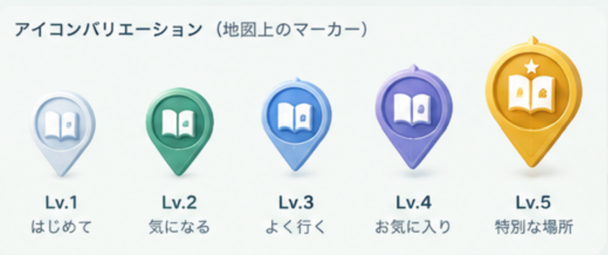
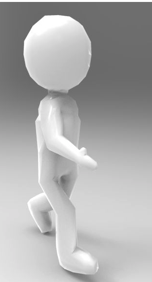
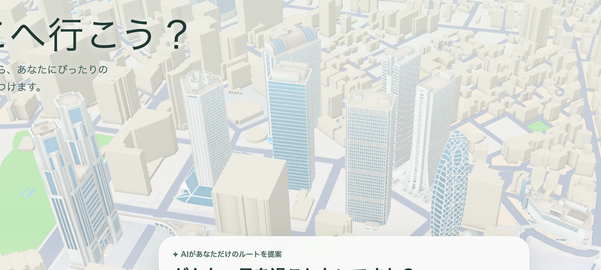

# 「地図を育てる」要件

更新日：2026年9月8日

自分や他人の視点で街を探索し、訪問と体験で地図を育てる。**訪れると建物が立ち上がり、用途によって姿が変わり、通うほど装飾が育つ。** 探索、経路案内、移動中の記録、写真投稿をこのタブで行う。

以下は決定済みの利用体験を定義する。建物詳細は「望ましい機能」、造形例や5段階の装飾は「参考案」とし、未決事項は末尾にまとめる。

## 1. レンズと表示

初期状態は「自分レンズ・2D地図」。履歴がなくても希望を入力して探索できる。

| レンズ | 体験 |
|---|---|
| 自分レンズ | 自分の希望・確認済みの好み・記録から場所やコースを探し、訪問した建物を育てる |
| 他人レンズ | ペルソナや友人の共有視点を選び、注目点・候補・経路・建物の姿を切り替える |

誰の視点か、推薦の理由は何かを確認でき、自分レンズへ戻れる。ペルソナの想定と実在する友人の共有情報を区別し、他人の用途・訪問・好みで自分の記録を上書きしない。

レンズと2D・3Dは独立して切り替える。移動記録と写真投稿はどちらの表示でも使える。

| 表示 | 内容と操作 |
|---|---|
| 2D「地図を見る」 | 地名・道路・施設・現在地・軌跡・保存場所・経路を俯瞰する。移動・拡大縮小・場所選択ができ、成長や用途は色・輪郭・アイコンで示す |
| 3D「地図の世界に入る」 | 現在地の人形を中心に、訪問による建物の立ち上がりと成長を見る。追従・回転・拡大縮小ができ、いつでも2Dへ戻れる |

3Dは専用の操作で開き、場所のタップでは自動で切り替えない。切替時は建物・人物・操作・追従方法を合わせて変え、現在地との関係を保つ。2Dへ戻ると元の表示範囲を復元する。動きを減らす端末設定では大きなカメラ移動や変身演出を省く。

### 今いる場所を記録し、不明な区間を補う

日常の記録は「地図を育てる」で行う。自分レンズに「今ここにいる」などの入口を置き、現在地や選んだ建物・施設と時刻を確認して、滞在・訪問を記録できるようにする。自動取得した訪問候補も、その場で確認・訂正できる。

地図と時系列に、欠損区間と、位置や訪問先が曖昧な区間を示す。タップして候補選択・場所検索・地図上の指定で補える。「この時間はこの店にいた」「この駅から電車で移動した」といった短い入力からも補完案を作れる。

場所・おおよその時間・移動手段を分かる範囲で入力する。正確な経路や時刻は必須にせず、不明・後回しも選べる。既存記録を下書きにして訂正できるようにする。

### 記録のついでにAIが話を聞く

記録や補完のついでに、AIが「ここでは何をしていた？」「どうだった？」と1問ずつ尋ねる。用途・理由・感想を整理し、本人が確認・訂正する。回答は任意で、会話なしでも場所を記録できる。

本人が伝えた内容とAIの補完案、測位による記録を区別する。AIが作った場所・時間・移動の補完案は、本人が確認してから記録に反映する。端点だけから正確な移動経路を作らず、概略の申告は概略のまま保持する。

記録・補完・訂正は同じ体験に結び付け、訪問を重複登録しない。確認された訪問は建物の成長へ、用途は外観へ反映し、「自分を知る」の振り返りにも引き継ぐ。保存失敗時は入力を保持して再試行できるようにする。

## 2. 訪問と用途で建物が育つ（必須）

### 訪問すると立ち上がる

訪問した建物が3Dで立ち上がり、その状態が蓄積される。2D中の訪問も保存し、3Dへ切り替えた際に反映する。

訪問済みと背景の未訪問建物を見分けられるようにする。通過は軌跡・解放範囲で表し、閲覧、経路検索、AIの推薦、他者の共有だけでは訪問済みにしない。

### 用途によって姿が変わる

自分レンズの3Dでは、本人が用途を登録・確認した建物を、その意味を象徴するランドマークへ置き換える。

| 用途 | 造形の参考案 |
|---|---|
| 勉強する場所 | 大きな本をかたどった建物 |
| 友人と話す場所 | 吹き出しが集まった建物 |
| 一人で休む場所 | 木陰や小さな庭 |

施設の業種ではなく、本人にとっての用途を反映する。複数用途を扱い、表示しきれない用途も確認できる。用途の追加・変更・削除は外観へ反映する。用途未登録なら通常の建物を表示し、訪問済みであれば立ち上がった状態を保つ。

レンズ表現を外すと、地図データに基づく元の建物形状を確認できる。置換後も位置・道路・施設名・案内に必要な入口との対応を保ち、現地の外観とは区別する。他人レンズでは、共有された用途に応じて同じ場所が別の姿になる。

### 通うほど造形・装飾が育つ

訪問を重ねると、用途のモチーフを保ちながら造形・色・縁取り・輝き・装飾が段階的に変わる。本が増える、庭が豊かになるなどの表現を検討する。2Dはマーカー、3Dはランドマークやアイコン・装飾で同じ成長段階を示す。

ユーザー提供画像の5段階を試作の参考とする。段階数・配色・名称・訪問回数は未確定。「お気に入り」「特別な場所」は訪問回数だけで決めず、本人の意味付けと区別する。画像のアプリ素材への採用は別途決める。

用途と成長段階は両方読み取れる表現にする。色だけに依存せず、用途名やアイコンでも意味を確認でき、選択中・AIのおすすめ・訪問済みの表示と混同しない。装飾が育っても道路や案内を隠さない。

### 成長の記録

訪問・用途・建物や施設・所有者・根拠を結び付け、成長段階を保存する。同一訪問の位置更新や再読込を重複加算しない。用途の変更や削除でも訪問の蓄積を保ち、再起動後に復元する。AIの推定用途は本人の確認済み用途と区別する。

## 3. 行き先の提案

### 自動クエスト

自分レンズでは、AIに質問しなくても「ここに行ってみない？」と提案する。現在地・表示地域・好み・訪問記録・定期区間・友人の共有情報を使う。友人や履歴がない場合も、利用可能な地域情報から提案する。

| きっかけ | 例 |
|---|---|
| 友人の訪問 | 「フレンドの○○さんも行っていたよ」 |
| 自分の好み | 「近くでもう一つ、一人で休める場所を探してみない？」 |
| 寄り道 | 「定期区間内で、帰りに30分寄ってみない？」 |
| 地図の成長 | 「まだ訪問記録のない建物を訪れてみない？」 |

アプリ内のカードなどに、行き先・理由・達成条件・所要時間・距離・分かる場合は追加運賃を表示する。「行ってみる」から詳細と案内へ進み、同じ提案についてAIへ相談できる。「あとで見る」「今回は見送る」と自動提案オフも用意し、案内を遮ったり見送り直後に再表示したりしない。

友人の訪問を理由にする場合は、閲覧可能な訪問記録や投稿を根拠として示す。場所の保存を訪問に、過去の訪問を現在地に読み替えない。共有取消後は提案と理由から対象情報を外す。

実際の訪問で達成し、建物の成長と写真・感想・用途の記録へつなぐ。提案の閲覧・受諾・経路検索だけでは達成にしない。提案先・理由・参照元・達成条件と、あとで見る／見送り／進行中／達成の状態を保存する。

### 定期区間内の寄り道（特色）

「帰りに30分」「追加運賃なし」などを指定し、定期区間の駅・停留所から寄れる、まだ訪問記録のない場所をAIが提案する。徒歩区間と最終目的地までを含むコース、追加時間・運賃・理由を示す。区間外を許容するときも費用を明示し、候補がなければ条件変更へ戻る。

AIのおすすめ、クエスト、寄り道、友人との共同コースは、次の案内機能へ接続する。

## 4. 経路案内・乗換案内（必須）

両レンズで利用でき、AIとの会話なしでも目的地を指定して使える。

| 機能 | 必要な操作・情報 |
|---|---|
| 目的地の指定 | 場所名・住所・駅名の検索、地図や建物の「ここへ行く」、保存場所から開く。出発地は現在地を初期値とし、手入力で変更できる |
| 徒歩案内 | 経路・距離・所要時間・目的地・主な曲がり角を表示。開始後は現在地・次の方向・残りの距離と時間を示す。終了と経路を外れた際の再検索ができる |
| 乗換案内 | 出発日時・到着希望日時を指定。鉄道・バスと徒歩を含む候補の出発／到着時刻・所要時間・乗換回数・運賃を比較する |
| 乗換の詳細 | 路線・行先・乗降駅や停留所・乗換順序・各区間の時刻を示す |

時刻・運賃・運行情報は交通データに基づき、取得できない項目は不明とする。AIで補完せず、時刻表の予定とリアルタイム情報を区別する。

### 定期券を考慮する（必須）

定期券の区間・交通事業者・経由路線・有効期間を登録・編集・削除できる。検索時に利用の有無を選び、指定日時に有効な定期券で追加運賃を計算する。

候補ごとに通常運賃・追加運賃・所要時間・乗換回数を示し、速さを優先する経路と追加運賃を抑える経路を比較する。適用区間と追加費用の発生区間を分け、期間外は適用しない理由を示す。適用可否や金額が不明な場合は、追加運賃なしと表示しない。

定期券は本人の移動条件として保存し、他人レンズでも本人のものを使う。

## 5. 写真と場所への意見

### 写真を撮って投稿する

写真を撮影し、投稿先の場所・本文・公開範囲を確認して投稿する。写真を場所と本人の体験に結び付け、地図から確認できるようにする。撮影場所を取得できなければ手動で選べる。撮影取消時は投稿しない。

### 建物詳細（望ましい機能）

両レンズで建物をタッチすると、他の人にとってどんな場所かを用途・体験・写真・意見から知り、自分の意見も投稿できる。

投稿者・時点・対象を示し、異なる意見を残す。AIの要約から元の投稿を確認でき、「みんな」は閲覧可能な投稿の範囲を指す。意見がなければ最初の投稿へ案内する。建物全体と個別施設を投稿先として選び分ける方法は検討する。

## 6. 保存・失敗時・タブ間の接続

移動・訪問・写真・場所との関連・公開範囲を保存する。タブ、レンズ、表示を切り替えても、選択中の場所・地図範囲・経路・案内状態・記録を保つ。レンズ変更だけで案内中の経路を置き換えない。

検索・推薦の処理中、候補なし、地域や交通手段の未対応、通信失敗を区別する。失敗時も地図と既存記録を表示し、条件や編集中の写真・本文を保って再試行できる。位置情報を失ったら更新停止を示し、手動で出発地や場所を選べるようにする。

「みんなで育てる」から友人の共有視点・共同コースを受け取り、「自分を知る」へ振り返る日付・場所・記録を渡す。

## 7. 受入条件

| 確認する体験 | 完了の判断 |
|---|---|
| レンズと表示 | 自分・他人・ペルソナを識別でき、2D・3Dと独立して切り替えられる |
| その場の記録と補完 | 地図から現在・直前の滞在を記録し、欠損・曖昧な区間を候補選択や短い入力で補える。不明を残せ、AIへの回答なしでも保存できる |
| 補完の根拠 | 測位・本人の申告・AIの案を区別し、確認後に重複なく反映する。概略の経路や時刻を実測として扱わない |
| 建物の成長 | 初訪問で立ち上がり、用途で姿が変わり、再訪で育つ。元の形状も確認でき、重複計上・用途変更・再起動で記録が崩れない |
| クエスト | 質問なしで提案され、理由と条件を確認し、案内・保留・見送り・オフを選べる。実訪問で達成し、共有取消を反映する |
| 経路と乗換 | AIを経由せず検索・比較・案内開始／終了ができ、時刻・運賃の不明と取得失敗を識別できる |
| 定期券と寄り道 | 定期券を管理し、期限と区間に応じた費用を比較できる。徒歩・最終目的地を含めて寄り道条件を評価する |
| 写真・意見 | 写真を場所・公開範囲付きで投稿し、失敗時に再試行できる。建物詳細を採用する場合は両レンズから意見を読み書きできる |
| 状態の保持 | タブ・レンズ切替後も案内と記録を保持し、他者の情報を本人の訪問として扱わない |

## 8. 未決事項

- 訪問判定、建物との対応が不確かな場合の確認、同日再訪の数え方、記録訂正・削除時の再計算、建物データがない場所の表現
- 成長段階・しきい値・名称・造形、複数用途／施設の代表表現と切替、2Dの成長表示
- クエストの表示時機・頻度・件数・達成判定。プッシュ通知と報酬の有無
- 交通データの提供元・対応地域／路線・更新頻度・運賃計算、リアルタイム情報の範囲、複数枚・連絡・エリア定期への対応
- 自動再検索、音声案内、自動車・自転車案内は追加検討
- 3Dへの切替と位置記録開始・継続の関係、3D案内の範囲、切替操作の名称・位置・アイコン、建物詳細の情報量、人物の実機での視認性

## 付録：地図・人物・建物の表現仕様

通常の地図と実在建物の補完に関する既存仕様。用途を象徴するランドマークへの置換とは目的を分けて扱う。

造形・地図基盤・試作時の確認結果を開く

## 現在地の表示

2Dと3Dでは、それぞれの表示目的に合う現在地表現を使用する。

| モード | 現在地の表現 |
|---|---|
| 地図を見る | 地図で一般的な現在地パック。位置、向き、測位精度を地図の読みやすさを損なわずに示す |
| 地図の世界に入る | 頭、胴体、手足が判別できる簡素な人形。現在地と進行方向を示し、街の表示を隠さない大きさにする |

3Dの人形は、次の条件を満たす。

- 特定の年齢、性別、人物像を強く想起させない中立的な外観とする。
- 初期版では着せ替え、容姿の編集、複数キャラクターの選択を設けない。
- 有効な方角を取得できる場合は、その方角へ向ける。
- 方角を取得できない場合は、直前の有効な移動方向を維持し、根拠のない向きへ回転させない。
- 有効な移動を検出した場合だけ歩行モーションを再生する。測位の揺れだけで歩行させない。
- 停止中、記録中、測位精度が低い状態を、人形または足元の表示で区別できるようにする。
- カメラを回転しても現在地と進行方向を読み取れるようにする。

人物の周囲から街が育つ表現を製品固有の体験とし、人形は簡素にする。造形は次の画像を基準とする。

大きな多面体の頭、細い胴体、関節の分かる簡略化された手足、まとまりのある手先と足先で構成する。顔、髪、服、指、肌の質感などは作らず、全身を一つの無地の素材で表示する。小さく表示しても人と進行方向が分かり、地図や建物より目立たない造形にする。特定作品の形状や意匠はそのまま複製しない。

人形には簡素な骨格を入れ、左右の足の接地、足上げ、大きめの腕振り、重心の上下動が一続きに見える短く軽快な歩行サイクルを持たせる。移動速度に合わせて再生速度を調整し、停止時は歩行途中で固めず自然な立ち姿へ戻す。造形は簡素にするが、滑って移動しているように見えない歩行品質は確保する。

初期試作では、George Blackwellの「Super Basic Human Model w/ Animations」を使用する。配布元は `https://georgeblackwell.itch.io/basic-human-mesh`、ライセンスはCC BY 4.0であり、作者名と配布元をアプリまたは同梱資料に表示する。これはMapbox上で大きさ、視認性、歩行品質を確認するための仮採用であり、最終版の造形確定とは区別する。

## モードの切替

- 2Dから3Dへの切替は、地図上の通常操作と区別できる明示的な操作にする。
- 切替時には、現在見ている場所または現在地との関係を失わないようにカメラを移動する。
- カメラ移動だけでなく、3D用の建物、人物、操作UI、追従方法を同時に切り替える。
- 3Dから2Dへ戻った場合は、3Dへ入る前に見ていた範囲へ戻ることを基本とする。
- 動きを減らす端末設定が有効な場合は、大きなカメラアニメーションを省略する。

切替操作の最終的な表示名は未決とする。「地図の世界に入る」「3Dで歩く」「街の成長を見る」を、記録開始との関係を決めた後に比較する。

## 地図の技術基盤

Mapboxを採用する場合は、Mapbox Standardを通常の地理情報の基盤とし、標準の3D建物をそのまま成長表現として使わない。

PLATEAUはLOD2の素の表示とアニメ調表示を試作比較した結果、求める見た目とのずれと読み込み負荷が大きいため採用しない。通常の地理情報はMapbox Standardを使い、不足するランドマークだけを根拠と利用条件を確認した外部モデルで補う。

- 2Dでは、地名、道路、施設を確認できる淡い背景地図を表示する。
- 3Dでは、独自に管理する探索状態と建物データを使って、育った範囲を表示する。
- 軌跡、解放範囲、場所、記憶、AI提案経路は独自レイヤーとして重ねる。
- 記憶、AI提案、気になる場所は、対象建物を選択したうえで、その建物の上に高度付きの軽量3Dアイコンとして表示できる。アイコンは少数の単純形状を再利用し、地図の建物形状や操作を隠さない大きさにする。
- Mapbox由来の地図と、利用者の記録や推定による表示を見分けられるようにする。

3Dアイコンの座標は対象建物の形状中心、高度はMapboxの建物属性にある`height`へ固定する。アイコンから屋根の固定点まで接続線と標的リングを表示し、建物自体も選択色で示す。高さの根拠がない場合は建物上に配置しない。種類、参照先、確認状態は表示データとして分離する。詳細3Dと近距離の広域3Dで表示し、俯瞰や密集時は非表示または集約する。

### 不足するランドマークの補完

Mapboxの標準3D表現に存在しない、または体験上必要な特徴が不足しているランドマークだけを、独自の3Dモデルで補完する。街全体を独自モデルで再制作せず、Mapboxの建物を基盤として利用する。

- 対象は、経路の目印、地域らしさ、場所の記憶、成長演出に必要な建物に限定する。
- Mapboxに十分な3Dランドマークがある場合は重複して制作しない。
- 制作前に、対象地点でのMapbox表示、建物形状、高さ、視認距離を確認する。
- 独自モデルはBlenderで制作し、編集可能な`.blend`とアプリで利用する軽量なglTFまたはGLBを残す。
- 制作にはAstraを利用し、形状、縮尺、原点、向き、材質、ポリゴン数を同じ基準で揃える。
- 地図上でその場所だと分かる実際の外形、屋根、塔、段差などの形状を優先する。
- 建物の材質は淡いアイボリーを基調とし、形状を読み取るための陰影を残す。全棟へ窓や外装格子を追加することは要件にしない。
- 公開モデル、図面、現地写真など根拠のある形状だけを使用し、資料にない窓、階数、外装線を推測で補わない。
- 外部から取得したモデルは実形状を保ったまま材質と軽さを周囲のMapbox建物に合わせる。実写真テクスチャは使用しない。
- 遠景でも識別でき、周辺の地図情報を隠さず、対象端末で操作を妨げない軽さにする。
- 出典、参照資料、制作日、利用条件をモデルごとに記録する。
- 権利上再現できない意匠がある場合は、場所の識別に必要な特徴だけを抽象化する。

対象地域をMapboxで確認して不足一覧を作り、優先度の高いランドマークから1件ずつ制作・表示確認する。

造形、配色、陰影は次の画面を基準とする。窓や外装の密度を全建物へ再現する基準にはせず、形状の参考として使う。この画像はそのままアプリ素材として使用するものではない。

### Mapbox Standardの初回目視確認（2026-09-08）

Mapbox Standardの`default`テーマで3D建物、ランドマーク、ファサード、樹木を有効にし、人物モデルを重ねて次の地点を確認した。これは各地点の初期カメラ範囲に対する目視評価であり、都市全体の網羅率やMapboxが公表する件数ではない。

| 地域 | 確認結果 | 初期判断 |
|---|---|---|
| 東京駅・丸の内 | 駅舎と周辺高層棟の形状・ファサードを確認 | 標準3Dを初期デモの基盤にできる |
| 東京・新宿 | 東京都庁舎、コクーンタワーなどの固有形状と簡略化されたファサードを確認 | 今回定めた質感の基準地点として使う |
| 横浜・山下公園 | マリンタワーと氷川丸を識別。周辺街区は汎用形状が中心 | 標準3Dを使い、不足する目印だけ補完する |
| 横浜・みなとみらい | ランドマークタワー、観覧車、周辺大型施設を識別 | 標準3Dを基盤にできる |
| 名古屋・栄 | 中部電力 MIRAI TOWERとオアシス21を識別 | 標準3Dを初期デモの基盤にできる |
| 箱根・芦ノ湖 | 湖岸と建物形状は見えるが、象徴的な3Dランドマークが不足 | 地域らしさに必要な目印を独自モデル候補にする |
| 大阪・道頓堀 | 街区形状は見えるが、初期カメラ範囲では道頓堀らしい象徴物が弱い | デモ地点を再検討するか象徴物を補完する |

初期デモ地域は、ランドマークの識別しやすさだけで選ぶなら東京駅・丸の内または名古屋・栄を優先する。コンセプトとの適合を含める場合は、横浜・山下公園を標準3Dと少数の独自ランドマークで構成する。

